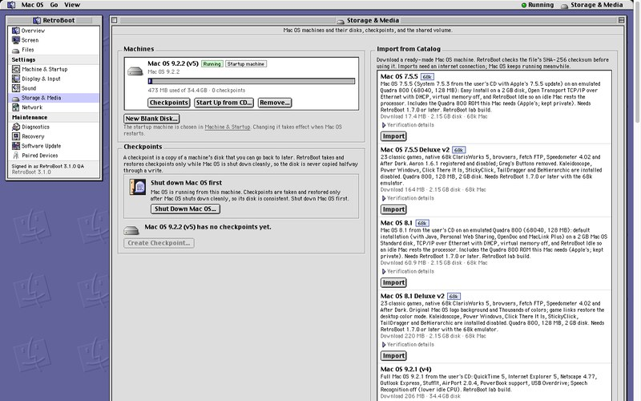

# RetroBoot

RetroBoot turns a spare PC, Intel Mac, Raspberry Pi, or Planet Computers Gemini PDA into a dedicated classic Mac for kids, families, and retro enthusiasts—no collector hardware required. Power on, hear a genuine classic Mac startup chime, and the selected Mac takes over the screen. Press **Ctrl+Alt+Delete** on a PC keyboard (or **Windows+Alt+Backspace** on some laptops) at any time to open the local **RetroBoot** panel, or manage everything from a phone or browser on your network.

[Download RetroBoot 3.2.1](https://mcchord.net/retroboot-downloads/#devices) · [Install](docs/guide/installing.md) · [Families & kids](docs/guide/families-and-kids.md) · [Upgrade to 3.2.1](docs/guide/upgrading.md) · [Mac disk library](docs/guide/disk-library.md) · [Web management](docs/guide/web-management.md) · [How it works](docs/dev/how-it-works.md)

*RetroBoot cold-booting straight to the Mac OS 9 Finder in Proxmox. Playback is shortened.*

## 3-step quick start

1. **Download:** Pick the image for your PC, Intel Mac, or Raspberry Pi on the [downloads portal](https://mcchord.net/retroboot-downloads/#devices) (or add `https://mcchord.net/retroboot-downloads/rpi-imager.json` in **Raspberry Pi Imager**).
2. **Flash to USB or SD:** Write it with **balenaEtcher**, **Raspberry Pi Imager**, **Fedora Media Writer**, or **Rufus** in **DD Image** mode.
3. **Boot & pick a Mac:** Choose **Kids & Family: Mac OS 9.2.2 Mega Deluxe** (Kid Pix Studio Deluxe, Logical Journey of the Zoombinis & all 146 classic games and apps in Launcher) or **Mac OS 9.2.2 (Classic Clean desktop)**—or expand **Browse all 13 Library Macs**.

## What's in RetroBoot 3.2.1

- **Download a Mac hotfix (`3.2.1`).** Fixes **Download a Mac** getting stuck on the striped progress bar when any installed machine metadata has `os_version: null` (such as a newly created blank disk) or when `Panel.show()` races `CatalogList._load()`, ensures catalog fetch timeouts fail cleanly instead of hanging indefinitely with retry-window respect in `CatalogRegistry.snapshot()`, and restores the Web **Storage** catalog error banner and **Try Again** retry action.
- **3.2.0 controls, Web Helper whitelist & refreshed Mac OS 9 images.** Perceptual non-linear volume hotkeys (`amixer -M` / 2.2 curve / Bluetooth `pactl`), **Legacy** Classic Mac mouse tracking enabled by default, top-level **Keyboard & Mouse**, **Modern Web Helper**, and **Force Reboot…** entries in the **Ctrl+Alt+Delete** menu, a reworked Web **Network** page with quick-jump links and **Sites not to help (whitelist)** passthrough, plus updated **Deluxe v10**, **SuperDeluxe v7**, and **Mega Deluxe v5** images (ACTION Menus off, 2-second ACTION GoMac bar delay, Desktop Read Me files removed, and all 146 Mega Deluxe apps and games organized in Launcher).
- **Simple first-boot choice & all 13 ready-to-run Macs built in.** Start straight into **Mac OS 9.2.2 Mega Deluxe** (now packaged as a fast `retroboot-thin-1` archive) or **Mac OS 9.2.2 (Classic Clean desktop)**, browse all 13 Macs from System 7.5.5 to Mac OS X Tiger, add custom HTTPS image servers, or install RetroBoot alone first.
- **Genuine classic Mac startup chimes & sound controls.** Play model-matched chimes (**Automatic**, **Mac OS 9**, **Quadra**, **Power Mac**, **Mac II**, **Macintosh SE**, or **Off**), choose HDMI/speaker/USB/Bluetooth outputs, click **Test Sound**, and toggle live browser audio on **Screen**.
- **Print to PDF, plug-and-play USB drives & Web Files previews.** Print straight from Mac apps into **`RetroBoot Share/Printed PDFs/`**, plug FAT32 or exFAT USB flash drives into **`RetroBoot Share/USB Drives/`**, preview Apple `PICT`, images, PDFs, and text directly in any browser, move files, and download folders as `.zip`.
- **Game controllers & authentic Classic Mac input.** Play games with USB or Bluetooth controllers (`Arrow keys` or `WASD`), toggle **Natural scrolling**, choose PC (`Ctrl`) or Mac (`Win`) **Command key** mapping, and keep native unaccelerated Classic Mac mouse tracking with live **Mouse DPI** control.
- **Safety checkpoints, BitLocker warnings & privacy masking.** Every downloaded or imported catalog Mac automatically saves a zero-cost reflink **Fresh Install** checkpoint, interrupted HFS+ disks snapshot before repair, the installer flags encrypted Windows partitions (`Windows (encrypted)`), and remote **Screen** feeds automatically hide local pairing codes (`PAIRING CODE HIDDEN`).
- **A/B Software Updates & Raspberry Pi Imager JSON.** x86-64 PCs update live via signed A/B slots (`Software Update`) and Raspberry Pi 4/5 gains offline signed `tryboot` `.rbu` bundles alongside [Release `v3.2.1`](https://github.com/amcchord/RetroBoot/releases/tag/v3.2.1).

## Choose your hardware

| Hardware | Install media | Mac runtimes |
| --- | --- | --- |
| **x86-64 PC or Intel Mac** | Hybrid USB/DVD ISO or **Universal Raw USB Image** (`.img.xz`). UEFI & legacy BIOS. | Classic PowerPC, Quadra 800 & PowerPC Mac OS X |
| **Raspberry Pi 4, Pi 5 & Pi 400** | Ready-to-flash `.img.xz` via [Pi Imager JSON](https://mcchord.net/retroboot-downloads/rpi-imager.json) or direct download | Classic PowerPC & Quadra 800 |
| **Raspberry Pi Zero 2 W** | Dedicated microSD image preloaded with System 7.5.5 & Mac OS 8.1 (USB OTG hub required) | 68040 Macs |
| **Planet Computers Gemini PDA** | Installer bundle run from Gemian | Classic PowerPC & Quadra 800 |

Consult the [installation guide](docs/guide/installing.md) and [verify checksums (`SHA256SUMS`)](https://github.com/amcchord/RetroBoot/releases/tag/v3.2.1) before flashing or erasing a disk. [Open RetroBoot downloads](https://mcchord.net/retroboot-downloads/#devices)

## Screenshots

| PC Installer (Two-Option Choice) | Local RetroBoot Panel | Web Overview | Storage & Checkpoints |
| --- | --- | --- | --- |
|  |  |  |  |

*Boot GIF captured on Proxmox in 3.0.0; installer, local panel, and Web UI screenshots captured live on Proxmox in 3.1.0.*

## Under the hood

The Debian 13 host handles your hardware quietly behind the scenes—Linux stays hidden during normal boot, setup, and recovery. QEMU runs the Mac while RetroBoot's presenter renders the boot checkerboard, integer-scaled guest display, startup chimes, and Platinum recovery panel. The local panel and paired browser share the same `hostd` service for settings, Print-to-PDF, checkpoints, USB sharing, and lifecycle control, while signed A/B updates swap system slots without touching your Macs or settings on `RBDATA`. [Architecture and boot sequence](docs/dev/how-it-works.md)

## Documentation

| Guide | Covers |
| --- | --- |
| [Install RetroBoot](docs/guide/installing.md) | PC, Intel Mac, Universal USB, Raspberry Pi Imager JSON & Gemini setup |
| [Families & kids guide](docs/guide/families-and-kids.md) | Mega Deluxe (Kid Pix, Zoombinis), Print-to-PDF, gamepads & Fresh Install checkpoints |
| [Upgrade to 3.2.1](docs/guide/upgrading.md) | A/B Software Updates (x86 & Pi 4/5) and Zero 2 W / Gemini upgrades |
| [Mac disk library](docs/guide/disk-library.md) | All 13 included Classic 68k, PowerPC Mac OS 9 & Mac OS X editions |
| [Image servers](docs/guide/image-servers.md) | Configure custom HTTPS catalogs and build `retroboot-thin-1` archives |
| [Web management](docs/guide/web-management.md) | QR browser pairing, live screen/audio, Files (PICT/ZIP/Move) & checkpoints |
| [Build and test](docs/dev/source-builds.md) | Debian source build prerequisites and component test suites |
| [Appliance notices](image/NOTICES.md) | Third-party packages and firmware |

The repository publishes source and component tests. Guest OS software, ROMs, normalized startup chimes (`RB_CHIMES_DIR`), extracted artwork, and guest disk images remain external. Existing component licenses are documented with the code; a repository-wide license is pending.
