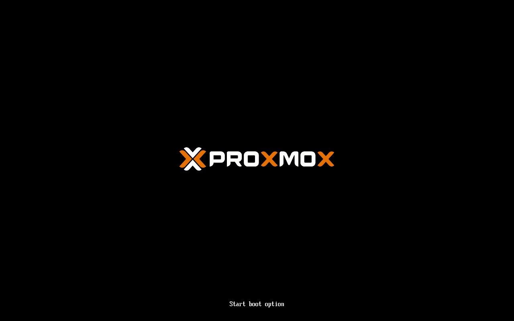
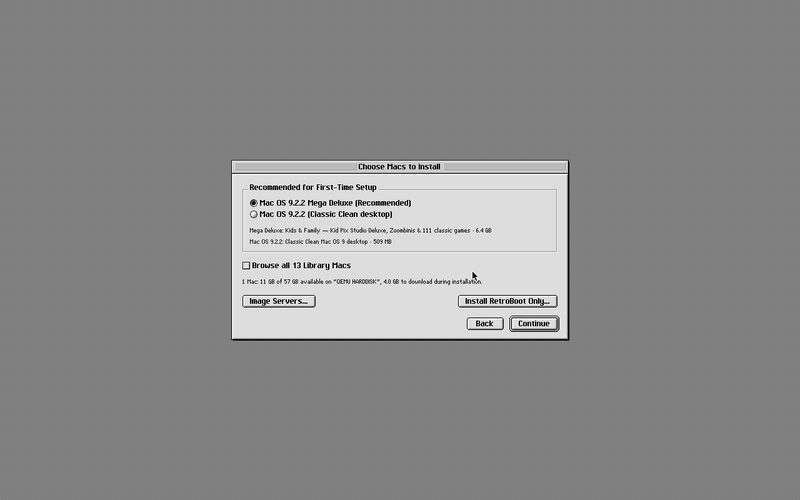
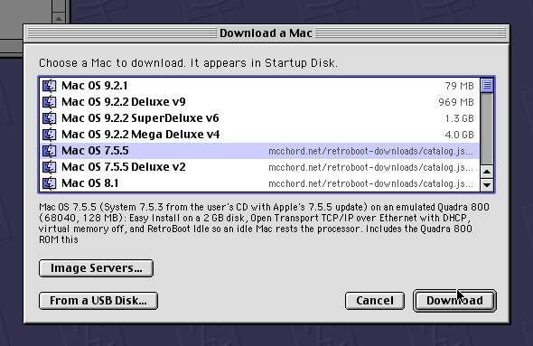
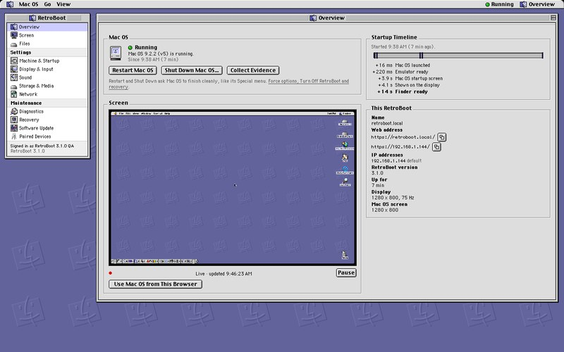

# RetroBoot

RetroBoot runs Mac OS on a dedicated PC, Raspberry Pi or Planet Computers Gemini PDA. Power on, hear a classic Mac startup chime, and the selected Mac takes over the screen. Press **Ctrl+Alt+Delete** on a PC keyboard (or **Windows+Alt+Backspace** on some laptops) to open the local RetroBoot controls. A paired browser can manage the same computer over your local network.

[Install RetroBoot](docs/guide/installing.md) · [Upgrade an existing system](docs/guide/upgrading.md) · [Mac disk library](docs/guide/disk-library.md) · [Host an image server](docs/guide/image-servers.md) · [How it works](docs/dev/how-it-works.md)

*RetroBoot 3.0.0 cold-booting to Mac OS 9.2.1 Finder in Proxmox. Playback is shortened.*

## RetroBoot 3.1.0

- **Simple two-option first-boot setup.** Pick between **Mac OS 9.2.2 Mega Deluxe** (Kid Pix Studio Deluxe, Logical Journey of the Zoombinis and 111 classic games, now packaged as `retroboot-thin-1`) and **Mac OS 9.2.2 (Classic Clean desktop)**, or expand **Browse all 13 Library Macs**.
- **Genuine Mac startup chimes & sound output controls.** Choose **Automatic (by Mac model)** or pick a family chime (`os9`, `quadra`, `powermac`, `macii`, `se`), select an output device, toggle mute, adjust volume, or click **Test Sound** in both the local panel and Web UI.
- **Print-to-PDF, USB Share & Web Files enhancements.** Print straight from classic Mac apps into **RetroBoot Share**, plug in USB flash drives to share files automatically, preview text/PICT/PDF/images, and download folders as ZIP from desktop or mobile browsers.
- **Easy flashing & Raspberry Pi Imager repository.** Write the new **Universal Raw USB Image** (`BIOS + UEFI`) or hybrid ISO to USB for PCs, and add `https://mcchord.net/retroboot-downloads/rpi-imager.json` in Raspberry Pi Imager.
- **Input, gamepads & recovery polish.** Map Bluetooth or USB game controllers, toggle **Natural scrolling**, choose PC (`Ctrl`) or Mac (`Win`) Command-key layout, take automatic **Fresh Install** checkpoints, and protect local pairing codes with Web Screen privacy masking.

### Image catalogs and installation

- **Bring your own Mac images.** Add HTTPS catalog URLs in the installer, the local Download a Mac panel, or the paired browser. Import a machine archive directly if you already have the file.
- **Set up the computer first.** Install RetroBoot without a guest, then choose or import a Mac after the first boot.
- **Move an existing installation forward.** Use signed Software Update on a PC, flash the new card and migrate data on a Pi, or retain your Gemini data and previous system tree during installation.

## Choose a download

| Hardware | Install media | Mac runtimes |
| --- | --- | --- |
| **x86-64 PC** | Hybrid USB/DVD ISO or **Universal Raw USB Image** (`.img.xz`). UEFI or legacy BIOS. | Classic PowerPC, Quadra 800 and PowerPC Mac OS X |
| **Raspberry Pi 4, Pi 5 & Pi 400** | Ready-to-flash microSD image (`.img.xz` or Pi Imager JSON) | Classic PowerPC and Quadra 800 |
| **Raspberry Pi Zero 2 W** | Separate microSD image with System 7.5.5 and Mac OS 8.1 | Quadra 800 |
| **Planet Computers Gemini PDA** | Installer bundle run from Gemian | Classic PowerPC and Quadra 800 |

Download the installer or update for your computer without signing in, or use `https://mcchord.net/retroboot-downloads/rpi-imager.json` in Raspberry Pi Imager. Consult the installation guide before writing an image or choosing a target disk. [Download RetroBoot](https://mcchord.net/retroboot-downloads/#installers)

## Start using it

1. Install RetroBoot on the machine you want to use. First-time setup lets you pick **Mac OS 9.2.2 Mega Deluxe**, **Mac OS 9.2.2 (Classic Clean desktop)**, or any Mac from the 13-entry library.
2. On a computer with no Mac yet, **RetroBoot Setup** opens at the first start. Choose **The Internet** or **A USB disk**, then pick a Mac in **Download a Mac**. RetroBoot asks for your time zone first if the installer didn't.
3. To add another Mac later, press **Ctrl+Alt+Delete** and open **Download a Mac**. It lists the RetroBoot Mac library. **Image Servers…** adds your own catalog, and **From a USB Disk…** imports a machine archive.
4. Choose the Mac that starts by default in **Startup Disk**. Use the Mac OS **Shut Down** and **Restart** commands for normal guest operation.
5. For browser management, press **Ctrl+Alt+Delete**, open **Network & Web Access**, and scan the QR code or enter the displayed address, certificate SHA-256 fingerprint, and code.

## Screenshots

| PC installer | Download a Mac | Web overview |
| --- | --- | --- |
|  |  |  |

These screens were captured from RetroBoot running in Proxmox (boot GIF from 3.0.0; installer, panel, and web screens from 3.1.0).

## Under the hood

The Debian host handles your hardware. QEMU runs the Mac, while RetroBoot's presenter draws the startup screen, guest and recovery. The local panel and web app use the same host service for settings and lifecycle commands. PC updates replace a system slot while keeping machines and settings on a separate data volume. [Architecture and boot sequence](docs/dev/how-it-works.md)

## Documentation

| Guide | Covers |
| --- | --- |
| [Install](docs/guide/installing.md) | PC, Pi and Gemini installation |
| [Upgrade and recover](docs/guide/upgrading.md) | Data preservation and rollback by platform |
| [Mac disk library](docs/guide/disk-library.md) | Supported guest versions and editions |
| [Image servers](docs/guide/image-servers.md) | Configure a URL, package a disk and publish a catalog |
| [Web management](docs/guide/web-management.md) | Pair a browser, see the running Mac, and manage storage |
| [Build and test](docs/dev/source-builds.md) | Debian build prerequisites and verification |
| [Appliance notices](image/NOTICES.md) | Third-party packages and firmware |

The repository publishes source and component tests. Guest software, ROMs, extracted artwork and guest disk images remain separate. Existing component licenses are documented with the code. A repository-wide license is pending.
