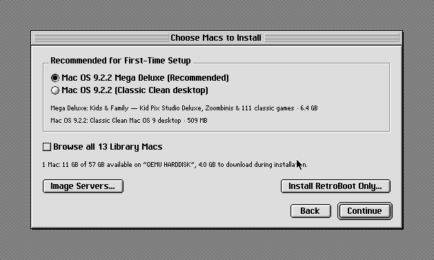
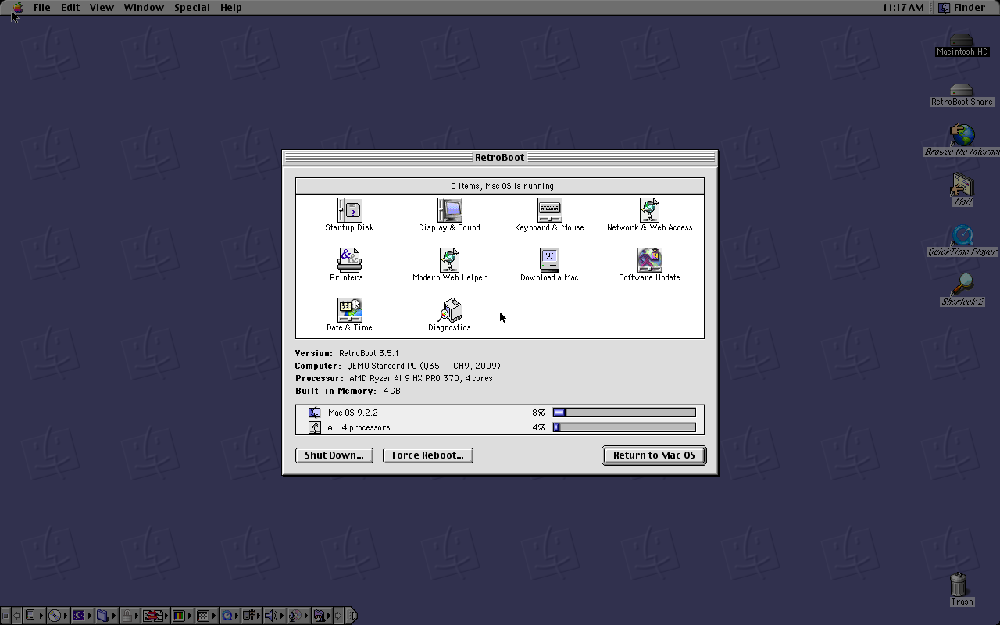

# RetroBoot

RetroBoot turns a spare PC, Intel Mac, Raspberry Pi, or Planet Computers Gemini PDA into a dedicated classic Mac for kids, families, and retro enthusiasts—no collector hardware required. Power on, hear a genuine classic Mac startup chime, and the selected Mac takes over the screen. Press **Ctrl+Alt+Delete** on a PC keyboard (or **Windows+Alt+Backspace** on some laptops) at any time to open the local **RetroBoot** panel, or manage everything from a phone or browser on your local network.

[User Manual](docs/manual/README.md) · [Download RetroBoot 3.5.1](https://mcchord.net/retroboot-downloads/#devices) · [Install](docs/guide/installing.md) · [Families & kids](docs/guide/families-and-kids.md) · [Upgrade to 3.5.1](docs/guide/upgrading.md) · [Mac disk library](docs/guide/disk-library.md) · [Web management](docs/guide/web-management.md) · [How it works](docs/dev/how-it-works.md)

*RetroBoot cold-booting straight to the Mac OS 9 Finder in Proxmox. Playback is shortened.*

## Related project: ClassicMac

RetroBoot is a sister project to **[ClassicMac](https://github.com/amcchord/ClassicMac)**—the two are very similar and share much of the same custom QEMU classic Mac emulation stack, guest drivers, Apple Platinum UI, and ready-to-run Mac OS image library.

- **Choose RetroBoot** if you want to turn a **spare PC, Intel Mac, Raspberry Pi, or Planet Computers Gemini PDA** into a dedicated, boot-straight-to-Mac-OS appliance with a startup chime and no host desktop—ideal for kids, families, or a standalone retro machine with gamepad support, plug-and-play USB drives, and phone/browser management over your local network.
- **Choose ClassicMac** if you want to run classic Mac OS in a window on your everyday **Apple Silicon Mac, Windows 11 PC, or Linux desktop** (or **iPad** via the beta) alongside modern apps without dedicating a machine, keep portable `.classic` machine files, or try experimental **Copland** on macOS.

## 3-step quick start

1. **Download:** Pick the image for your PC, Intel Mac, or Raspberry Pi on the [downloads portal](https://mcchord.net/retroboot-downloads/#devices) (or add `https://mcchord.net/retroboot-downloads/rpi-imager.json` in **Raspberry Pi Imager**).
2. **Flash to USB or SD:** Write it with **balenaEtcher**, **Raspberry Pi Imager**, **Fedora Media Writer**, or **Rufus** in **DD Image** mode.
3. **Boot & pick a Mac:** Choose **Kids & Family: Mac OS 9.2.2 Mega Deluxe v7** (126 unique titles across 8 tabs in a 4-row Launcher with a focused 13-app `Applications` tab, pre-personalized color *The Oregon Trail* v1.2, clean ACTION Menus™ with corner menus removed, ACTION GoMac Battery Monitor & 2-second bar delay, and on-demand Virtual CDs with 0 mounted at boot—featuring Kid Pix Studio Deluxe & Logical Journey of the Zoombinis) or **Mac OS 9.2.2 (Classic Clean desktop)**—or expand **Browse all 14 Library Macs** (including the 68k **Mac OS 8.1 Mega Deluxe v1** tuned for Raspberry Pi Zero 2 W).

## What's in RetroBoot 3.5.1

- **32-bit UEFI (`BOOTIA32.EFI` + `efi_uga`) & VirtualBox documentation (`3.5.1`).** Adds `i386-efi` GRUB (`BOOTIA32.EFI` and `grubia32.efi`) with EFI UGA display support (`efi_uga`) across the installer ISO, Universal raw image, and installed ESP (plus firmware-matching `efibootmgr` registration and `hid-apple` in initramfs) so 64-bit Intel Macs with 32-bit Apple EFI 1.10 (such as 2006–2007 Core 2 Duo MacBooks) and 32-bit EFI PCs/VMs can boot natively, alongside clear VirtualBox setup instructions.
- **Pi Zero 2 W USB mouse fix, RPi OOBE & Pi Zero 2 W OTA updates (`3.5.0`).** Fixes Raspberry Pi Zero 2 W USB mouse movement (`host`-mode USB replacing `dwc2` OTG under `[pi02]`), adds guided first-start onboarding (Network / Wi-Fi, Bluetooth, Command key, and auto-detected Time Zone) across Pi 4/5 and Pi Zero 2 W (over preloaded System 7.5.5 v2 & Mac OS 8.1 v2), brings signed A/B `tryboot` Software Updates to Pi Zero 2 W on a 4-partition MBR layout alongside a **public unauthenticated update feed** (`https://mcchord.net/retroboot-downloads/feed.json`), hides PowerPC/OS X images on 68k-only boards, and completes 68k Ctrl+Alt+Del Platinum icons.
- **Polish & bugfixes (`3.4.2`).** Fixes download progress text wrapping (`layout_text_lines` avoids orphan leading `·`, removes duplicate scaled percentages, and uses a wider two-line dialog), turns Mac printing **off by default** (`printer.enabled = false`) with a prominent **Enable Mac printing** toggle at the top of local **Printers…** and Web **Printers**, ensures the Mac startup chime finishes cleanly without being interrupted or doubled during boot (`start_startup_chime`, ALSA `dmix` `buffer_size 8192`), and uses the authentic Mac OS 9 three-wave speaker icon (`speaker_high`) on the Volume/Mute OSD.
- **Seamless CUPS & Mac OS 9 Color LaserWriter printing (`3.4.1`).** Fixes CUPS network printer discovery and IPP/JetDirect/LPD setup (keeping partial results on slow Avahi/mDNS backends, supporting USB/DNS-SD query `&` URIs, deduplicating protocols, and falling back cleanly to generic PostScript instead of failing `lpadmin` IPP Everywhere on JetDirect/LPD queues), replaces the speaking-message icon with an authentic Mac OS 9 `LaserWriter 8` printer icon, automatically provisions **`RetroBoot Printer`** (**Apple Color LaserWriter 12/600 PS** over TCP/IP LPR `10.0.2.2`, with **AppleTalk kept off** for fast Mac OS 9 startup) when enabled, and fixes Mac OS 9 Desktop PrintMonitor duplicate-header LPD streaming.
- **Automatic time zone detection & live transfer speed/ETA (`3.4.0`).** Prefetches and pre-selects your likely IANA time zone over HTTPS right after Wi-Fi/network setup (instead of defaulting to UTC), adds a local **Detect** button, live local clock preview, and Web **Use This Device’s Time Zone** action, shows live speed (`MB/s` / `KB/s`) and remaining time (`left`) across catalog downloads, determinate A/B Software Updates, USB copies, disk archive unpacking, and Web uploads, and displays your connected IP/SSID directly in **Hardware Check**.
- **HDMI & mixerless volume control (`3.3.0`).** Adds ALSA `softvol` (`RetroBoot Playback Volume` over shared `audio`-group `dmix` / `plughw`) for HDMI codecs and USB DACs that lack hardware mixer controls, enables **Volume**, **Mute**, and **Test Sound** across Web **Sound**, **Display & Sound**, and keyboard volume hotkeys, and syncs mute state cleanly when adjusting volume.
- **Physical, network & USB CUPS printing (`3.3.0`).** Routes classic Mac PostScript/PDF print jobs from LPD (`515`), IPP (`631`), or AppSocket/JetDirect (`9100`) to either **`RetroBoot Share/Printed PDFs/`** or any discovered/manual **CUPS** printer (with optional **Also save a PDF copy**), managed in the **Printers** web page and **Ctrl+Alt+Delete → Printers…** while keeping CUPS isolated on `/run/cups/cups.sock`.
- **Clean Update (`3.3.0`).** Adds a **Clean Update** option in **Software Update** (local panel and Web UI) to start fresh—erasing Macs, checkpoints, shared files, paired browsers, CUPS queues, and settings while preserving saved **Wi-Fi networks**.
- **Download a Mac hotfix (`3.2.1`) & `3.2.0` polish.** Fixes **Download a Mac** when blank disks have `os_version: null`, bounds catalog fetch timeouts with retry-window respect, delivers perceptual volume hotkeys (`amixer -M` / 2.2 curve / Bluetooth `pactl`), **Legacy** mouse tracking default, **Keyboard & Mouse** / **Modern Web Helper** / **Force Reboot…** top-level panel entries, Web **Network** whitelist passthrough, and **Deluxe v10**, **SuperDeluxe v7**, and **Mega Deluxe v5** Mac OS 9 editions.
- **Simple first-boot choice & all 14 ready-to-run Macs built in.** Start straight into **Mac OS 9.2.2 Mega Deluxe v7** (126 unique titles across 8 tabs in a 4-row Launcher with focused productivity/audio apps, color *The Oregon Trail* v1.2, clean ACTION Menus™, ACTION GoMac Battery Monitor & 2-second delay, on-demand Virtual CDs with 0 mounted at boot, packaged as a fast `retroboot-thin-1` archive) or **Mac OS 9.2.2 (Classic Clean desktop)**, browse all 14 Macs from System 7.5.5 through the 68k **Mac OS 8.1 Mega Deluxe v1** (tuned for Pi Zero 2 W) up to Mac OS X Tiger, add custom HTTPS image servers, or install RetroBoot alone first.
- **Genuine classic Mac startup chimes & sound controls.** Play model-matched chimes (**Automatic**, **Mac OS 9**, **Quadra**, **Power Mac**, **Mac II**, **Macintosh SE**, or **Off**), choose HDMI/speaker/USB/Bluetooth outputs, click **Test Sound**, and toggle live browser audio on **Screen**.
- **Print to PDF, plug-and-play USB drives & Web Files previews.** Print straight from Mac apps into **`RetroBoot Share/Printed PDFs/`**, plug FAT32 or exFAT USB flash drives into **`RetroBoot Share/USB Drives/`**, preview Apple `PICT`, images, PDFs, and text directly in any browser, move files, and download folders as `.zip`.
- **Game controllers & authentic Classic Mac input.** Play games with USB or Bluetooth controllers (`Arrow keys` or `WASD`), toggle **Natural scrolling**, choose PC (`Ctrl`) or Mac (`Win`) **Command key** mapping, and keep native unaccelerated Classic Mac mouse tracking with live **Mouse DPI** control.
- **Safety checkpoints, BitLocker warnings & privacy masking.** Every downloaded or imported catalog Mac automatically saves a zero-cost reflink **Fresh Install** checkpoint, interrupted HFS+ disks snapshot before repair, the installer flags encrypted Windows partitions (`Windows (encrypted)`), and remote **Screen** feeds automatically hide local pairing codes (`PAIRING CODE HIDDEN`).
- **A/B Software Updates & Raspberry Pi Imager JSON.** x86-64 PCs, Raspberry Pi 4/5, and Raspberry Pi Zero 2 W update live via signed A/B slots (`Software Update` against the public `https://mcchord.net/retroboot-downloads/feed.json` feed) or offline `.rbu` bundles alongside [Release `v3.5.1`](https://github.com/amcchord/RetroBoot/releases/tag/v3.5.1).

## Choose your hardware

| Hardware | Install media | Mac runtimes |
| --- | --- | --- |
| **x86-64 PC or Intel Mac** | Hybrid USB/DVD ISO or **Universal Raw USB Image** (`.img.xz`). 64-bit & 32-bit UEFI + legacy BIOS. | Classic PowerPC, Quadra 800 & PowerPC Mac OS X |
| **Raspberry Pi 4, Pi 5 & Pi 400** | Ready-to-flash `.img.xz` via [Pi Imager JSON](https://mcchord.net/retroboot-downloads/rpi-imager.json) or direct download | Classic PowerPC & Quadra 800 |
| **Raspberry Pi Zero 2 W** | Dedicated microSD image preloaded with System 7.5.5 & Mac OS 8.1 (USB OTG hub required) | 68040 Macs |
| **Planet Computers Gemini PDA** | Installer bundle run from Gemian | Classic PowerPC & Quadra 800 |

Consult the [installation guide](docs/guide/installing.md) and [verify checksums (`SHA256SUMS`)](https://github.com/amcchord/RetroBoot/releases/tag/v3.5.1) before flashing or erasing a disk. [Open RetroBoot downloads](https://mcchord.net/retroboot-downloads/#devices)

## Screenshots

| PC Installer (Mac Selection) | Local RetroBoot Panel | Mega Deluxe v7 Finder | Web Overview | Web Printers |
| --- | --- | --- | --- | --- |
|  |  |  |  |  |

*Boot GIF captured live on Proxmox in 3.0.0; local 3.5.0 panel and Mega Deluxe v7 Finder captured live on Proxmox; installer and Web UI screens rendered/captured in RetroBoot 3.5.0's MIT Platinum theme.*

## Under the hood

The Debian 13 host handles your hardware quietly behind the scenes—Linux stays hidden during normal boot, setup, and recovery. QEMU runs the Mac while RetroBoot's presenter draws the checkerboard, integer-scaled guest display, startup chimes, and Platinum recovery panel. The local panel and paired web app share the same `hostd` service for settings, checkpoints, Print-to-PDF, USB sharing, and lifecycle control. System updates swap A/B slots while preserving your Macs and settings on `RBDATA`. [Architecture and boot sequence](docs/dev/how-it-works.md)

## Documentation

| Guide | Covers |
| --- | --- |
| [User Manual](docs/manual/README.md) | Complete 12-chapter RetroBoot 3.5.1 manual, architecture, printing, Web UI, and full settings reference |
| [Install](docs/guide/installing.md) | PC, Raspberry Pi, Universal USB/SD, BitLocker & flashing safety |
| [Families & kids](docs/guide/families-and-kids.md) | Mega Deluxe (Kid Pix, Zoombinis), Print-to-PDF, gamepads & Fresh Install checkpoints |
| [Upgrade to 3.5.1](docs/guide/upgrading.md) | A/B Software Updates (PC, Pi 4/5 & Zero 2 W) and Gemini upgrades |
| [Mac disk library](docs/guide/disk-library.md) | All 14 included guest systems and editions |
| [Image servers](docs/guide/image-servers.md) | Custom HTTPS catalogs and packaging `retroboot-thin-1` disk archives |
| [Web management](docs/guide/web-management.md) | Browser pairing, Overview, Files (PICT/ZIP/Move) & remote Screen audio |
| [Developer & hardware docs](docs/dev/README.md) | Architecture, builds, bring-up checklists and verification |
| [Appliance notices](image/NOTICES.md) | Third-party packages and firmware |

The repository publishes source and component tests. Guest software, ROMs, normalized startup chimes (`RB_CHIMES_DIR`), extracted artwork, and guest disk images remain external. Existing component licenses are documented with the code. A repository-wide license is pending.
