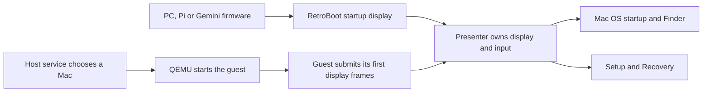

# How RetroBoot works

RetroBoot separates the operating system that owns your hardware from the Mac you use on screen. Linux handles storage, displays, networking and input. QEMU runs the selected Mac. The presenter owns the display and switches between startup, the guest and local controls.

## From power on to Finder

On a PC, quiet GRUB draws the initial checkerboard. The initramfs splash takes over before Linux services start. The presenter then inherits the screen and shows the guest once usable guest frames arrive. Raspberry Pi and Gemini use their platform boot loaders and kernel paths. The host service records the boot stages and offers **Startup Details** on supported builds. The firmware, display handoff and guest startup are measured separately.

## The control paths

| Component | Job |
| --- | --- |
| [Presenter](../../presenter/) | Draws the panel and guest frames, routes keyboard and pointer input, and keeps recovery available |
| [Host service](../../hostd/retroboot/) | Owns settings, machines, guest lifecycle, downloads, device services and update jobs |
| [Emulator](../../emulator/) | Provides separate Classic PowerPC, 68040 and PowerPC Mac OS X runtimes |
| [Device web app](../../web/) | Pairs with the device and talks to the same host service as the local panel |
| [Image builders](../../image/) | Assemble the Linux root, board boot files and release artifacts |

Mac OS sends display updates to the presenter through a local socket and shared frame buffers. The presenter forwards input in the guest’s expected coordinates. The web **Screen** view uses the presenter’s frame tap and keeps the same input routing. Settings changes are validated by the host service whether they come from the local panel or a paired browser. Changes that alter emulated hardware apply when the Mac restarts.

## Machines and updates

A machine consists of its own disk plus metadata and any startup memory its runtime requires. Import stages and checks an archive before adding a new machine. The existing machine remains available. A catalog lists what can be downloaded. The device filters those listings to images its installed runtimes can start. [Image server format](../guide/image-servers.md)

On a PC, an update stages a signed Linux root in the inactive boot slot. The active slot and the data partition remain in place. At restart the boot loader tries the new slot. The host records success or returns to the previous slot. The Pi and Gemini boot paths use different layouts and have separate upgrade procedures. [Upgrade guide](../guide/upgrading.md)

## Networking

The host owns Wi-Fi profiles and keeps current WPA credentials outside the guest. On supported Classic configurations, Mac OS’s AirPort software talks to an emulated AirPort card, and the host carries out the network changes. The Modern Web Helper can translate pages for period browsers. A paired browser on your local network can manage RetroBoot even while the guest is stopped.

## Test boundaries

Component tests cover catalog parsing and imports, display math, panel state and individual system services. VM tests can exercise an installation, update, guest input and saved-file recovery. Physical display, battery, touch and Wi-Fi behavior need the actual device. A desktop frame alone cannot show that a guest responds to input. [Build and test from source](source-builds.md)
