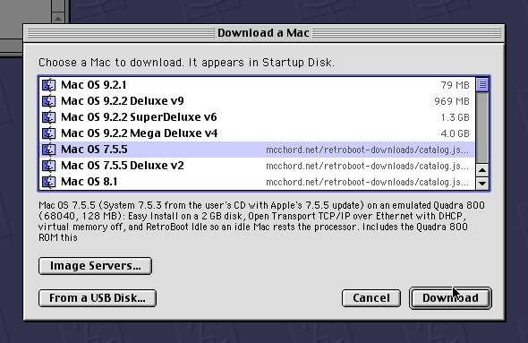
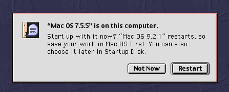

# Mac disk library

RetroBoot 3.3.0 includes all **13 ready-to-run Macs** right out of the box—built into both the installer and **Ctrl+Alt+Delete → Download a Mac** with no account, password, or server configuration needed. You can also download archives manually with SHA-256 verification from the [RetroBoot downloads portal](https://mcchord.net/retroboot-downloads/#advanced).

RetroBoot filters the list to the Mac runtimes supported by your hardware and groups them cleanly across **Kids & Family**, **Clean Classic**, **68k**, **Deluxe**, and **Mac OS X**:

| Runtime | Editions available | Hardware support |
| --- | --- | --- |
| **68k (Quadra 800)** | System 7.5.5, System 7.5.5 Deluxe v2, Mac OS 8.1, Mac OS 8.1 Deluxe v2 | x86-64 PCs, Raspberry Pi 4/5, Raspberry Pi Zero 2 W & Gemini PDA |
| **PowerPC Classic** | Mac OS 9.2.1 (v4), Mac OS 9.2.2 (v5), Deluxe v10, SuperDeluxe v7, **Mega Deluxe v5** | x86-64 PCs, Raspberry Pi 4/5 & Gemini PDA |
| **PowerPC Mac OS X** | Jaguar 10.2.8, Panther 10.3.9, Tiger 10.4.11 Period Editions & **Tiger Deluxe** | x86-64 PCs |

## Featured & curated editions

- **Kids & Family — Mac OS 9.2.2 Mega Deluxe v5 (`thinArchive`):** Our flagship family edition packed with **all 146 classic games, creative apps, and utilities across 8 tabs** in Launcher, a 2-second **ACTION GoMac** bar hover delay, the classic Apple menu (ACTION Menus off), and a clean desktop—highlighted by **Kid Pix Studio Deluxe**, **Zoombinis**, **Oregon Trail**, **SimCity**, and **ClarisWorks 5**.
- **Clean Mac OS 9.2.2 (v5):** Clean, snappy Mac OS 9.2.2 with QuickTime 6, AirPort, Classilla/iCab web browsers, Acrobat 5, ATI 3D software, and crisp RetroBoot Display.
- **SuperDeluxe v7:** 59 classic games (*Harry the Handsome Executive*, *Mighty Mike*, *Bub & Bob*, *Wolfenstein 3D*, *Angband*), full After Dark collection, ClarisWorks 5, Home Page 3, Audion, SoundEdit 16, classic Apple menu (ACTION Menus off), 2-second ACTION GoMac bar delay, and clean desktop ([SuperDeluxe guide](superdeluxe-image.md)).
- **Deluxe v10:** 16 classic games, Audion with SomaFM Groove Salad, After Dark screensavers, sample QuickTime movies, 2-second ACTION GoMac bar delay, clean desktop, and automatic on-demand Myst disc mounting ([Deluxe guide](deluxe-image.md)).
- **Mac OS 7.5.5 / 8.1 Deluxe v2:** 23 classic 1990s games, ClarisWorks 5, and After Dark—ideal for Raspberry Pi Zero 2 W and 68k nostalgia.
- **Mac OS X Period & Tiger Deluxe:** Period 2002–2006 Aqua desktops with Camino, Audacity, VLC, GLtron, and **iLife ’06 + Quake III Arena** in **Tiger Deluxe**. RetroBoot automatically applies per-Mac recommended RAM (`2048 MB` for Tiger Deluxe, `1024 MB` for Tiger/Panther Period on capable PCs) and `ATI Radeon` graphics—adjustable anytime in **Startup Disk** or **Machine & Startup**.

Downloading an edition imports it as an independent Mac alongside your existing ones and creates an automatic **Fresh Install** checkpoint. Add additional third-party HTTPS catalogs anytime via **Image Servers…** ([guide](image-servers.md)).

