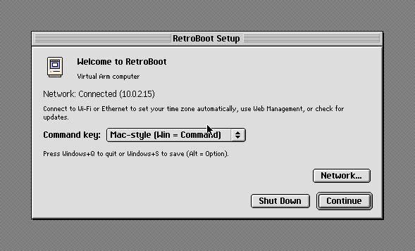
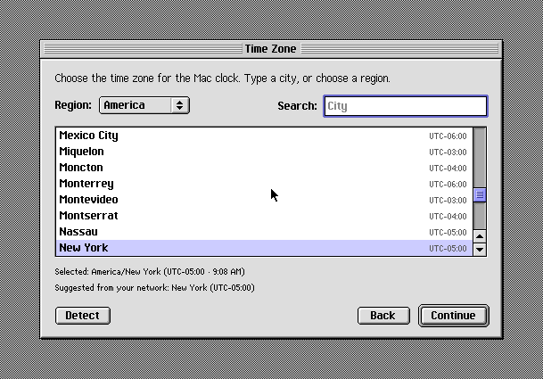
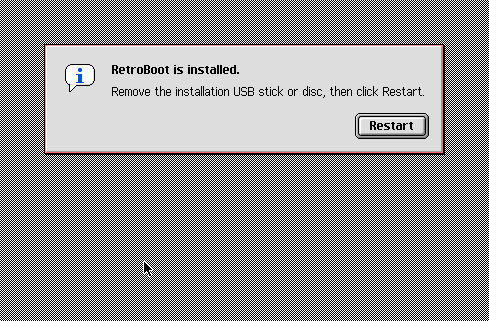
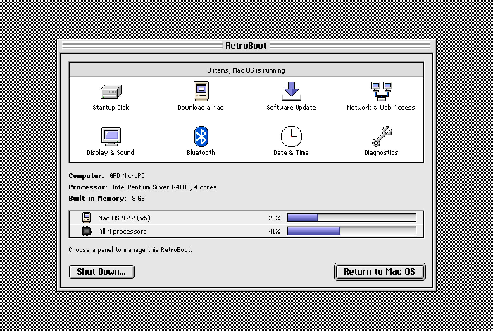

# First start and setup

On most installs, power-on plays your startup chime (when staged) and boots straight through the checkerboard to the Mac Finder using the Mac, display scale, and time zone you chose in the installer. This page covers setting up a fresh install with no Mac yet, how RetroBoot prepares disks, and changing controls later.

## Getting a Mac OS system

If you chose **Install RetroBoot Only…**, first start opens **RetroBoot Setup**:

1. Choose **The Internet** (built-in 13-Mac library—free, HTTPS SHA-256 verified) or **A USB disk** (to import `.tar.gz` Mac archives).
   - **Quick tip:** Use **Network…** first if you need Wi-Fi, then set your **Time Zone**.
2. In **Download a Mac**, pick right from the featured choices at the top:
   - **Kids & Family: Mac OS 9.2.2 Mega Deluxe v4** (*Kid Pix Studio Deluxe*, *Zoombinis*, and 111 classic titles).
   - **Standard: Mac OS 9.2.2 (v5)** (clean, fast Mac OS 9.2.2 ready for your own software).
   - Or browse all 13 editions (68k System 7.5.5 / 8.1, Deluxe, SuperDeluxe, and Mac OS X Jaguar/Panther/Tiger on PCs).
3. RetroBoot downloads, verifies SHA-256, prepares the disk, creates an automatic **"Fresh Install"** checkpoint, and offers **Start Mac OS**.

## What RetroBoot does to a new Mac disk

Whenever a Mac disk is imported, RetroBoot prepares it safely offline and saves a golden **"Fresh Install"** reflink checkpoint automatically:

- **Golden "Fresh Install" & pre-repair protection:** Instant XFS reflink snapshots let you reset back to a brand-new state anytime, and RetroBoot takes a pre-repair snapshot before running `fsck.hfsplus` after unclean shutdowns.
- **No stuck Disk First Aid dialogs:** Offline repair runs automatically before boot if needed.
- **Energy Saver stays awake:** Prevents the emulated Mac from falling asleep on its own (you can still choose Sleep manually on laptops).
- **DHCP Ethernet & AirPort handoff:** Keeps Mac networking effortless and syncs host Wi-Fi network names automatically when AirPort is enabled (passwords stay private on the host).
- **Real-time clock & low idle CPU:** Syncs Mac OS Time Synchronizer to your timezone and turns off background Speech Recognition listening.

## Changing setup later

Everything you chose in the installer or in RetroBoot Setup can be changed later in the **RetroBoot** window. Press **Ctrl+Alt+Delete** at any time—even while Mac OS is running—to open it over the dimmed screen:

| Icon | What it controls |
| --- | --- |
| **Startup Disk** | Pick the default Mac, manage [checkpoints](recovery.md#checkpoints-and-the-startup-disk) (including **Fresh Install**), create blank disks, or boot from a CD/ISO |
| **Download a Mac** | Download any of the 13 Macs, add custom [image servers](image-servers.md), or import from USB |
| **Software Update** | Check for signed over-the-air updates (PC, Raspberry Pi 4/5, and 4-part MBR Pi Zero 2 W) or install `.rbu` bundles from USB |
| **Network & Web Access** | Wi-Fi, QR code & pairing code, certificate SHA-256 fingerprint, AirPort adapter, Modern Web Helper |
| **Display & Sound** | Pixel size, resolution, scaling, rotation, **Startup Chime**, **Test Sound**, **Audio Output**, **Gamepad mode**, mouse DPI & key swaps |
| **Bluetooth** | Pair Bluetooth keyboards, mice, trackpads, speakers, and game controllers |
| **Date & Time** | Change timezone |
| **Diagnostics** | Hardware identity, board thermal/power status, screenshots and evidence bundles |

Everything changed in the **RetroBoot** window shares the exact same validated configuration as the [web management portal](web-management.md).

Next: [Everyday use](everyday-use.md) or [Families & kids guide](families-and-kids.md).
