# Installing RetroBoot

Turn a spare x86-64 PC, Intel Mac, or Raspberry Pi into a classic Macintosh in three simple steps: download, flash to USB or microSD, and choose **Kids & Family Mega Deluxe v7** or **Clean Mac OS 9.2.2**.

All **14 ready-to-run Macs** are built into RetroBoot's catalog—no extra setup is required.

> **Hardware notes.** Verified in Proxmox VMs (UEFI and legacy BIOS) and tested on physical mini PCs, laptops, and Raspberry Pi 4/5/Zero 2 W boards.

## Quick 3-step overview

1. **Download:** Pick your installer from the [RetroBoot 3.5.0 downloads portal](https://mcchord.net/retroboot-downloads/):
   - **x86-64 PC or Intel Mac:** download `retroboot-installer-3.5.0-product.iso` (USB/DVD) or `retroboot-installer-3.5.0-universal-product.img.xz` (universal USB/SD image for both x86 PCs and Raspberry Pi 4/5).
   - **Raspberry Pi 4, Pi 5, Pi 400, CM4:** open **Raspberry Pi Imager**, add custom repository URL `https://mcchord.net/retroboot-downloads/rpi-imager.json` (or download `retroboot-3.5.0-rpi-product.img.xz` directly).
   - **Raspberry Pi Zero 2 W:** download `retroboot-3.5.0-rpi-zero2w-product.img.xz` (tuned for 512 MB boards with System 7.5.5 and Mac OS 8.1; requires a USB OTG adapter/hub for keyboard & mouse).
2. **Flash to USB or SD:** Use **balenaEtcher**, **Raspberry Pi Imager**, `dd` ([terminal examples](../dev/testing-other-hardware.md#write-the-stick)), or **Rufus in DD Image mode**.
   - **Windows Rufus tip:** When Rufus prompts for image mode, always select **Write in DD Image mode** (ISO mode breaks dual UEFI/BIOS boot and the `RBINSTEFI` setup folder).
   - **macOS popup warning:** Right after flashing finishes, macOS may say *"The disk you inserted was not readable by this computer."* Always click **Ignore** (or **Eject**) — **never click Initialize**, or it will erase the card/USB stick.
   - **Raspberry Pi Imager OS Customisation:** Our `rpi-imager.json` feed disables Imager's OS customisation prompts automatically (`"init_format": ""`). If flashing a custom `.img.xz` manually, decline OS customisation so `cmdline.txt` isn't modified.
3. **Boot & pick your Mac:** Start the computer from your flashed USB stick/SD card (F12/F11/F8/Esc on PCs; Option/Alt on Intel Macs; insert SD and power on for Raspberry Pi).

> **Important for Windows PCs (BitLocker Recovery Key):** Before turning off **Secure Boot** in your PC's BIOS/UEFI setup or wiping an internal drive, sign in at `https://aka.ms/myrecoverykey` on your phone or another device and save your **BitLocker Recovery Key**. Disabling Secure Boot triggers BitLocker recovery if you ever switch back to Windows. RetroBoot also flags encrypted drives as **`Windows (encrypted)`** before erasing.

## Installing on a PC or Intel Mac

### What you need

- An x86-64 PC or Intel Mac with UEFI or legacy BIOS firmware (**Secure Boot must be turned off**; turning off *Fast Boot* also helps USB devices initialize cleanly).
- A target disk of at least **8 GiB** that RetroBoot may **erase completely**. (Note: use **Product** builds for everyday family use; **Debug** is only for developer logs.)
- Optional: Ethernet or Wi-Fi to download Macs from the built-in catalog during installation.

### 1. Start from the stick

Start the computer from your USB stick (or DVD). You will see the checkerboard and then the classic welcome window—no Linux console or text prompts appear.

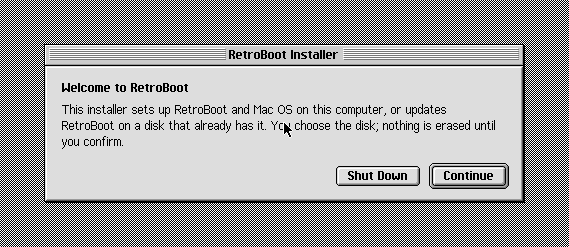

Nothing is erased until you explicitly confirm. **Shut Down** turns the computer off safely.

### 2. Hardware check & Wi-Fi

RetroBoot checks the display, keyboard, disks, and network, naming your Wi-Fi adapter if present. While offline, click the **Wi-Fi…** button right in the installer to join your wireless network (any network joined during install carries over automatically to the installed system).

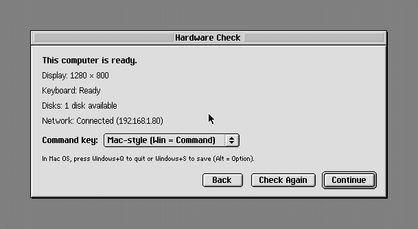

### 3. Choose a disk, and confirm the erase

Choose your destination drive. The installer's own USB stick, read-only media, and disks under 8 GiB are excluded. Existing OS partitions are labeled (`Windows`, **`Windows (encrypted)`** for BitLocker/Device Encryption, `Mac OS`, `Linux`, or `RetroBoot`).

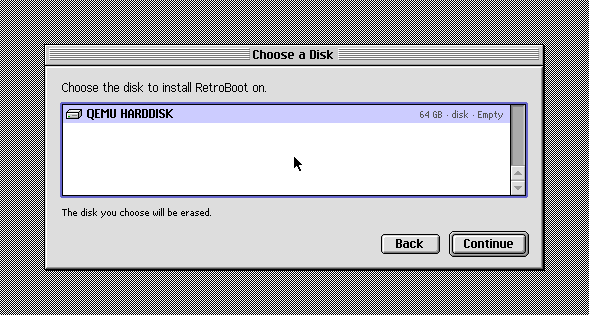

If the chosen disk already holds RetroBoot, the installer offers **Update** instead, preserving your Macs, documents, checkpoints, and settings ([Software Update](software-update.md#updating-with-the-installer-usb-disk)).

On erase confirmation, **Cancel** is always the default safe button:

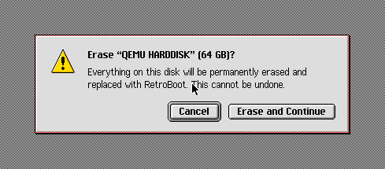

### 4. Choose the Macs to install

**Choose Macs to Install** lists all 14 Macs from the built-in RetroBoot catalog (plus any **Image Servers…** or **USB disk** archives you add). Right near the top you can choose between **Kids & Family: Mac OS 9.2.2 Mega Deluxe v7** (126 unique titles across 8 tabs in a 4-row Launcher with focused productivity/audio apps, Color Oregon Trail, Kid Pix Studio Deluxe, Zoombinis, clean ACTION Menus™, GoMac Battery Monitor & 2-second bar delay, and on-demand Virtual CDs with 0 mounted at boot) or **Clean Mac OS 9.2.2**, or check multiple Macs and set **Starts first**.

| Source | Where the Mac comes from |
| --- | --- |
| On this disc | Pre-bundled Macs in private custom installer images |
| Internet | The built-in RetroBoot 14-Mac library (free, public HTTPS, SHA-256 verified) |
| Image Servers… | Additional custom HTTPS catalogs (such as ClassicMac) |
| USB disk | `.tar.gz` machine archives on an attached USB stick |

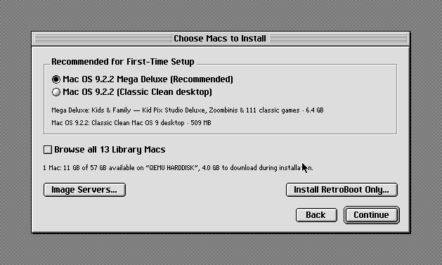

If you want to set up the computer first and download Macs later, choose **Install RetroBoot Only…** (RetroBoot Setup runs on first boot).

### 5. Display & Time Zone

RetroBoot picks the largest integer pixel scale (`1×`–`4×`) that keeps the Mac screen at least 720 × 540. You can test another resolution with **Try Resolution** (auto-reverts in 14 seconds if not kept), then confirm your auto-detected city or pick another region in **Time Zone** (with a **Detect** button and live local time preview).

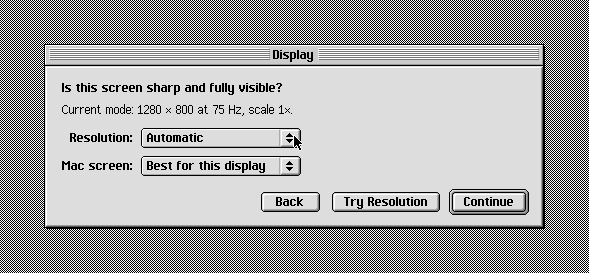

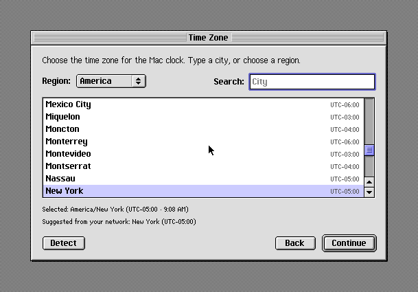

### 6. Network & Web Access (optional)

When connected, the installer's **Network** screen (matching **Network & Web Access** shown below) displays a local HTTPS URL, a 6-digit pairing code, a **QR code**, and the certificate SHA-256 fingerprint so you can monitor progress from a phone camera.

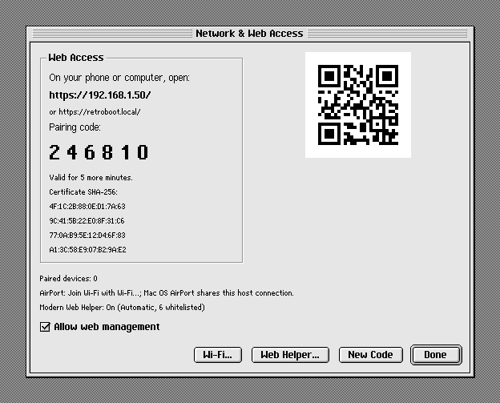

### 7. Install & Restart

RetroBoot formats five partitions (`RBEFI` 256 MiB, `BIOSBOOT` 1 MiB, `RBROOT_A` 3 GiB, `RBROOT_B` 3 GiB for seamless OTA updates, and `RBDATA` XFS reflink for Macs, checkpoints, and `RetroBoot Share`) and shows live transfer speed and remaining time while copying and unpacking Macs. Every imported Mac automatically gets a golden **Fresh Install** checkpoint.

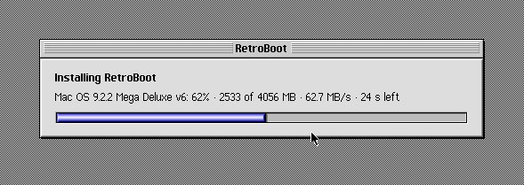

When installation completes, pull the USB stick out and click **Restart** to boot directly into your Mac Finder!

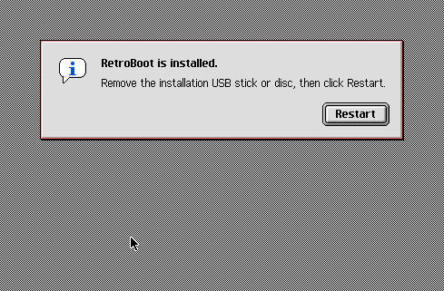

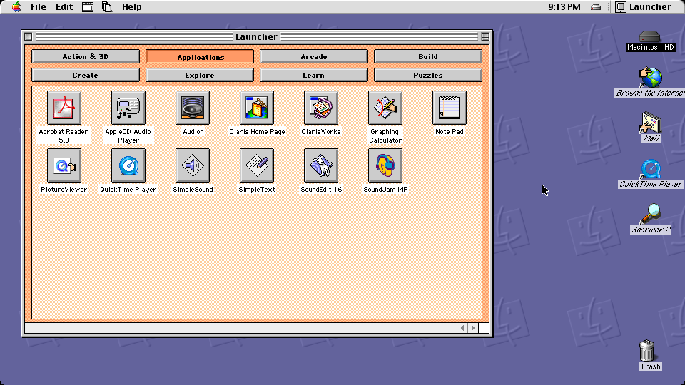

## Installing on Raspberry Pi

On a Raspberry Pi 4, Pi 5, Pi 400, CM4, or Zero 2 W, flashing the SD image creates a ready-to-boot card—just insert it and power on (`SETUP.txt` on the card explains display presets and Wi-Fi). RetroBoot grows `RBDATA` automatically on first boot. For detailed display presets (DSI/DPI), see [Raspberry Pi displays](raspberry-pi-displays.md).

- Note on the **Universal `.img.xz`**: a single universal stick/SD card can boot both an x86-64 PC and a Raspberry Pi 4/5, and supports installing onto the card's own free space or a second disk.

## Wi-Fi without typing on the computer (`network.conf`)

Both the PC installer's **RBINSTEFI** FAT partition and the Raspberry Pi's **RETROBOOT** FAT boot partition contain `retroboot/network.conf.example` and `SETUP.txt`—visible when plugged into any Windows, Mac, or Linux computer. Rename `network.conf.example` to `retroboot/network.conf` and edit with plain text:

```
WIFI_SSID=My Network
WIFI_PASSWORD=my wifi password
```

| Setting | Meaning |
| --- | --- |
| `WIFI_SSID` | Network name (1–32 bytes). Required |
| `WIFI_PASSWORD` | Password (8–63 characters). Omit for open networks |
| `WIFI_SECURITY` | `wpa-psk` (WPA/WPA2/WPA2-3 mixed; default), `sae` (WPA3-only) or `open` |
| `WIFI_HIDDEN` | `yes` for hidden SSIDs |

RetroBoot imports the profile automatically once, carries it onto the installed system, and never logs or displays the password.

## If something goes wrong

If installation fails, RetroBoot shows an evidence ID (see [Troubleshooting](troubleshooting.md)). Nothing half-installed is left bootable—you can adjust settings or restart the installer cleanly.

Next: [First start and setup](first-start.md) or [Families & kids guide](families-and-kids.md).
