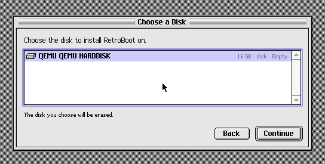

# Install RetroBoot 3.0.3

Select the installer for your computer and download its checksum. The same page has the Mac disk library and a catalog URL you can add during setup. [RetroBoot downloads](https://mcchord.net/retroboot-downloads/#installers)

If RetroBoot already runs on the device, use the [upgrade guide](upgrading.md). A fresh install to a selected PC disk or SD card erases that disk or card.

## x86-64 PC

1. Verify the ISO against its SHA-256 checksum. Write it to a USB stick with a raw disk-image writer, or attach the ISO to a virtual machine.
2. Boot the installer in UEFI or legacy BIOS mode. Secure Boot must be off.
3. Choose the destination disk. Select a Mac from an available source, or add your catalog through **Image Servers…**. Choose **Install RetroBoot Only…** if you want to add a Mac later.
4. Review the erase confirmation. Complete installation, remove the installer and restart.




## Raspberry Pi

1. Choose the **Pi 4/5 SD image** or the separate **Zero 2 W SD image**. Write it to a microSD card of at least 16 GB. With Raspberry Pi Imager, choose **Use custom** and leave OS customisation off.
2. Insert the card and power on the Pi. RetroBoot expands the data partition during the first start.
3. For a supported touchscreen or small display, use **Display & Sound → Pi Display**. Pi 4/5 supports PowerPC and 68040 Macs. Zero 2 W supports 68040 Macs.
4. On Zero 2 W, System 7.5.5 starts by default after setup. Choose Mac OS 8.1 in **Startup Disk**. Both are installed on the card and work offline.

A Pi 4 with an old bootloader may need a firmware update before it can boot a GPT card. The Zero 2 W image uses its own boot layout and requires a USB OTG adapter or hub for USB input. Use the correct image for the board.

## Planet Computers Gemini PDA

1. Download and extract the Gemini bundle. Copy the whole directory into Gemian on the device.
2. Verify `SHA256SUMS` and run the installer from Gemian with root access.

```sh
sudo sh gemini-install.sh --verify
sudo sh gemini-install.sh --activate
```

3. Reboot into RetroBoot. The installer keeps Gemian’s recovery partition and installs RetroBoot beside Gemian’s files. For an existing RetroBoot system follow the [Gemini upgrade procedure](upgrading.md#gemini-pda).

## Add your first Mac

Open **Download a Mac**, or import a machine archive from USB. If you host your own library, add the catalog URL under **Image Servers…**. Use **Startup Disk** to choose the default Mac. [Image server setup](image-servers.md) · [Mac disk library](disk-library.md) · [Pair a browser](web-management.md#pair-a-browser)
