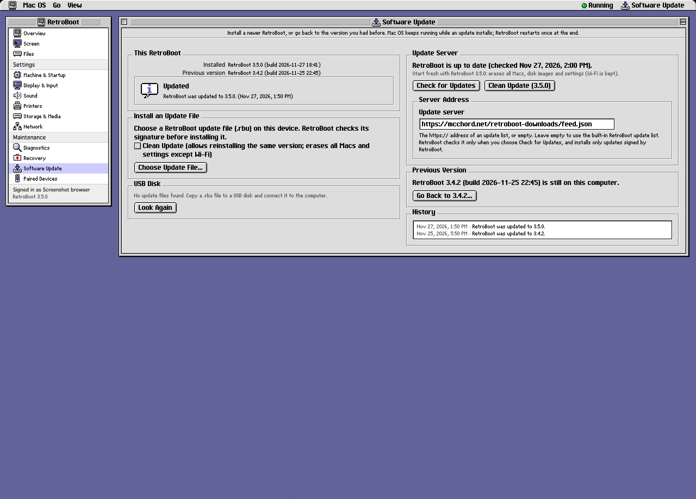
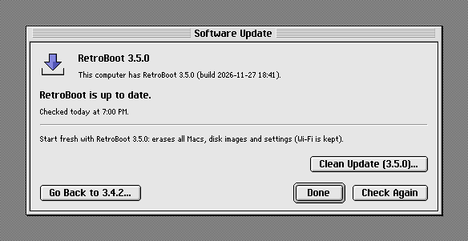

# Software Update

RetroBoot updates itself without erasing anything. Your Mac, its documents, your settings, Wi-Fi networks and paired browsers stay as they are. Mac OS keeps running while an update installs; at the end you choose **Restart to Update**, Mac OS shuts down the usual way, and the computer starts again with the new version: checkerboard, then Mac OS.

The version you had before stays on the computer. If the new one doesn't start properly, the computer goes back to the old one by itself, and you can also go back on purpose.

Rendered in RetroBoot's MIT Platinum theme showing an active Software Update state.

On the computer, the same controls are in **Ctrl+Alt+Delete ▸ Software Update…**:

## Where updates come from

An update is a signed bundle whose name ends in `.rbu`—for example `retroboot-update-3.5.0-product.rbu` (x86-64 PC), `retroboot-update-3.5.0-rpi-product.rbu` (Raspberry Pi 4/5), or `retroboot-update-3.5.0-rpi-zero2w-product.rbu` (Raspberry Pi Zero 2 W). RetroBoot verifies the signature before writing anything and refuses unsigned files, corrupted downloads, or bundles for the wrong architecture, board, Pi model, or flavor.

| Way | How |
| --- | --- |
| **Web page** | Open the device's web page and choose **Software Update** (under Maintenance, or in the RetroBoot menu). Click **Choose Update File…** and pick the `.rbu` file |
| **USB disk** | Copy the `.rbu` file to a USB disk (at the top level or in a folder named `RetroBoot`) and plug it in. On the computer, press **Ctrl+Alt+Delete**, then **Software Update…** and **Install from USB Disk**. On the web page, the file appears under *USB Disk* with an **Install** button; **Look Again** checks the disk again |
| **Update server** | On the Software Update web page, enter the address of an update server (it must start with `https://`) and choose **Check for Updates**, then **Download and Install**. RetroBoot never checks or installs anything by itself |

## Installing

1. Start the update from one of the places above. An update file is about 575 MB. Installing it took about a minute in the lab, plus the time to copy the file. Keep using Mac OS meanwhile; the web page and the panel show the progress.
2. When it says **RetroBoot 0.3.0 is ready to install**, choose **Restart to Update** (**Restart to Update…** on the web page, which asks you to confirm). Mac OS is asked to shut down, the same as choosing Shut Down from the Special menu, so applications can ask you to save your work.
3. The computer restarts. Mac OS starts as usual. Once Mac OS shows its startup screen, RetroBoot keeps the new version.

You don't have to restart at once. The update waits until you choose **Restart to Update**; turning the computer off and on in the meantime keeps the current version. **Don't Install** forgets it.

## Clean Update (fresh start)

If you want a brand-new, just-installed RetroBoot experience—whether you are moving to a newer release or reinstalling the same version—choose **Clean Update**:

- **On the computer:** Open **Ctrl+Alt+Delete ▸ Software Update…** and tick **Clean Update**, or choose **Clean Update (<version>)…** when RetroBoot is already up to date.
- **On the web page:** On **Software Update**, tick **Clean Update** when uploading a `.rbu` file, click **Clean Update** next to a USB or update-server release (including the current version when up to date), or toggle **Clean Update** under *Ready to Install* before restarting.

A Clean Update keeps your saved **Wi-Fi networks** so the machine can reconnect right away, and erases all Macs, disk images, checkpoints, shared files, media, Bluetooth pairings, paired browsers, and settings. After it restarts, RetroBoot opens straight into first-time Setup.

## If the new version doesn't start

The first start of a new version is a trial. If it doesn't reach Mac OS within a few minutes, if it stops with an error, or if the power goes out before it gets there, the next start uses the version you had before. Nothing is lost. When the version it goes back to is 0.3.0 or later, the web page and the Software Update window say what happened (“RetroBoot 0.3.1 didn't finish starting, so this computer went back to RetroBoot 0.3.0.”) and offer **Try Again** (**Try Again…** on the web page).

## Going back to the previous version

Press **Ctrl+Alt+Delete**, choose **Software Update…**, then **Go Back to …** (or use the same button on the web page). Mac OS shuts down first, then the computer restarts with the earlier version. Your Mac and settings are kept. If you later want the newer version again, the button reads **Switch to …**.

Versions before 0.3.0 can't install updates by themselves. If you go back to one of them, update again with the RetroBoot installer USB disk (below).

## Updating with the installer USB disk

Computers that still run RetroBoot 0.2, or whose RetroBoot can't update itself, are updated with the installer:

1. Start the computer from the RetroBoot installer USB disk.
2. Choose the computer's disk. Because it already has RetroBoot, the installer offers **Update** (keeps Mac OS, documents and settings) next to **Erase and Install…**.
3. Choose **Update**, wait for “RetroBoot is updated.”, remove the USB disk and click **Restart**.

The installer only updates a disk it recognizes as RetroBoot. Anything else is left alone and the installer says so.

## For the curious

The computer has two system areas. The one you are using stays untouched while the new version is written into the other one, checked file by file, and given one trial start. See [ARCHITECTURE.md section 13](../ARCHITECTURE.md#13-software-update-update-01) for the details and the [update report](../../image/reports/update-2026-10-11.md) for the 17 lab tests, including power cuts during an update and bundles with bad signatures. So far it has been tested with the lab VMs' firmware; a rollback on real laptop firmware hasn't been forced yet.
