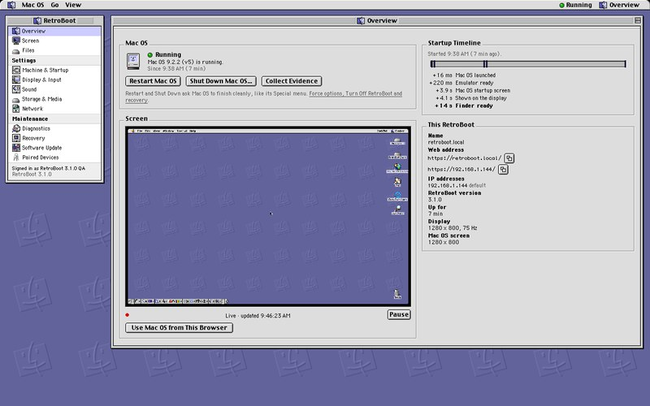
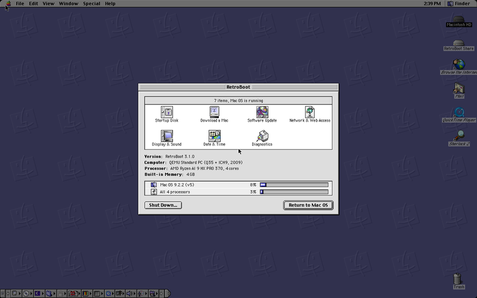
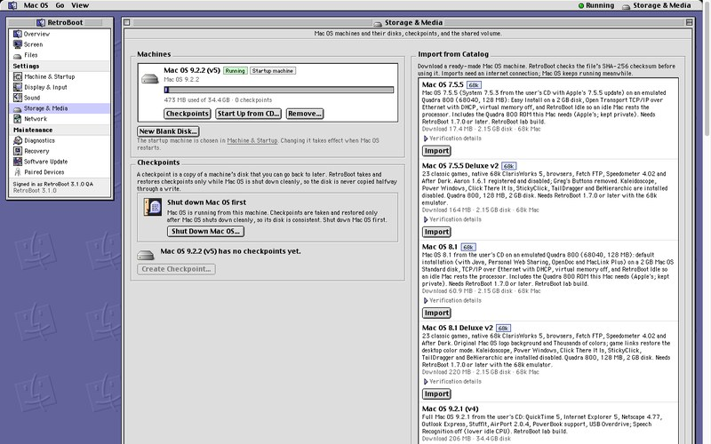

# Web management

RetroBoot serves its own control panel. Open it in a browser on the same network to see the running Mac, manage its settings, add disk images, or install an update.

## Pair a browser

1. On the RetroBoot computer, press **Ctrl+Alt+Delete** and open **Network & Web Access…**. The same panel is available during Setup, and remote screen feeds automatically mask the screen whenever a pairing code is shown.
2. Scan the QR code or open the address shown there. RetroBoot uses its own HTTPS certificate. Compare its SHA-256 fingerprint against the one shown on the RetroBoot screen.
3. Enter the six-digit code and a name for the browser. Use **Paired Devices** to remove a browser when it no longer needs access.

## Manage files, sound, checkpoints, and Macs

- **Files & Print-to-PDF:** Drag files into **RetroBoot Share**, preview text/PICT/PDF/images directly in the browser, download folders as ZIP, and browse files printed to PDF or copied from inserted USB flash drives.
- **Sound & Input:** Pick startup chimes (Automatic by Mac model or a specific Mac family), switch audio outputs, test chimes, adjust **Mouse DPI**, enable **Natural scrolling**, and map game controllers.
- **Storage & Media:** View installed Macs, restore automatic **Fresh Install** or manual checkpoints, browse catalog downloads (with SHA-256 details collapsed until needed), or import an archive. Under **Image Servers**, enter one HTTPS catalog URL per line and apply the settings. [Host your own catalog](image-servers.md)

