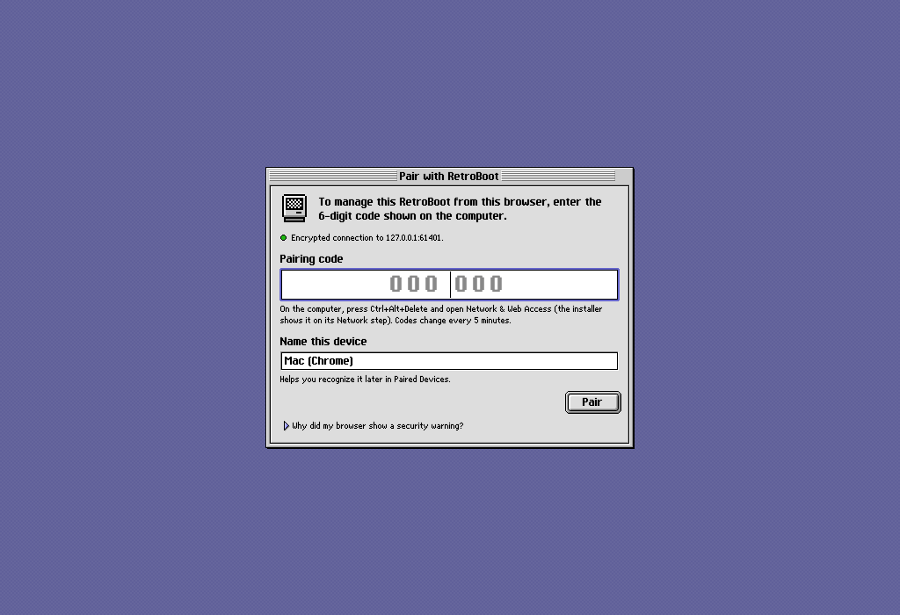
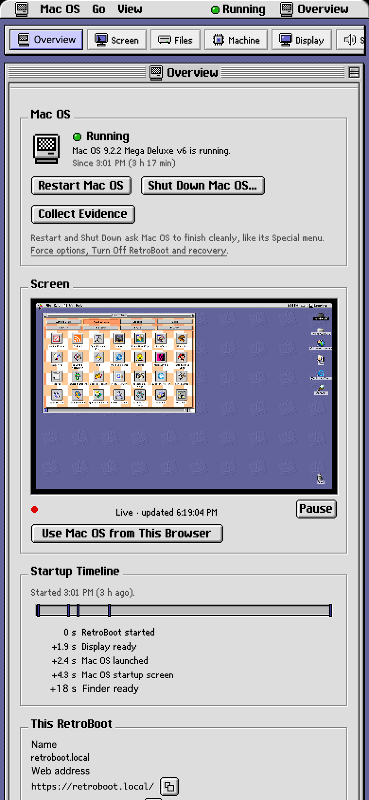
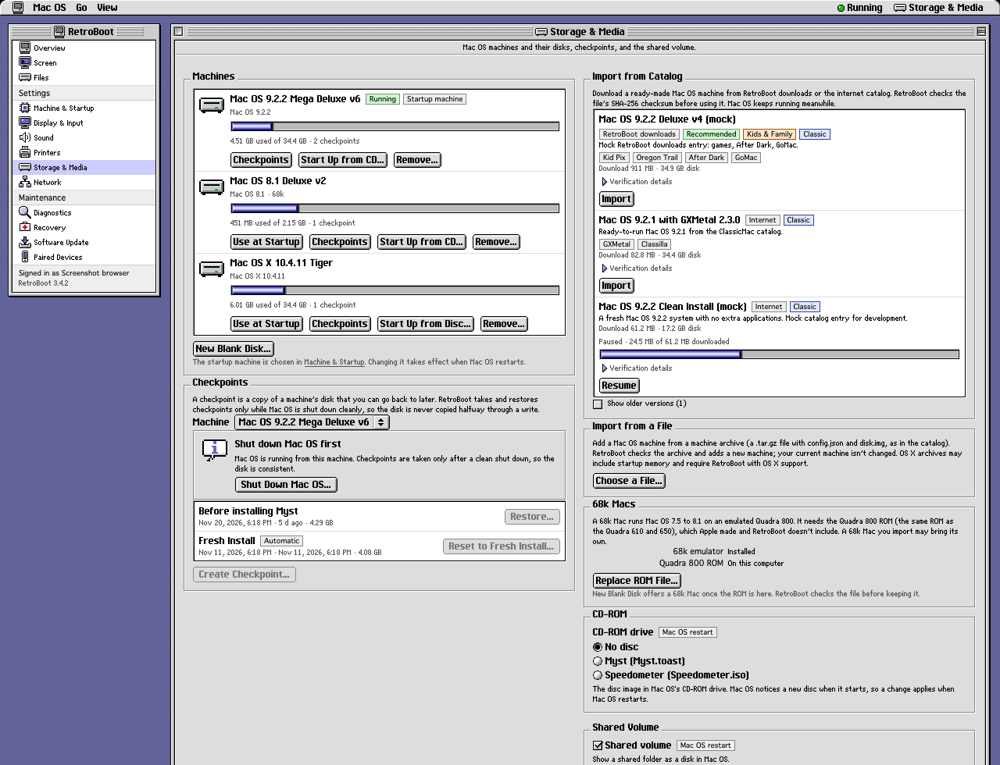
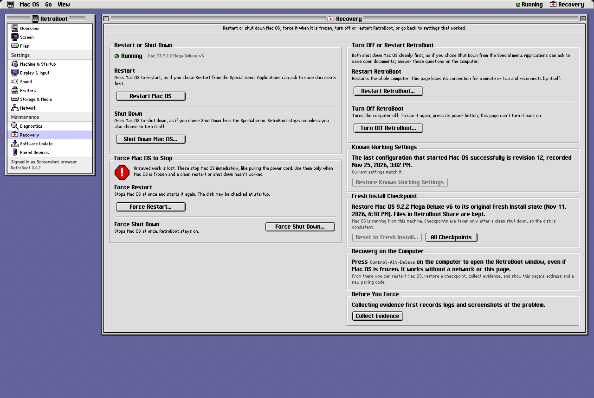
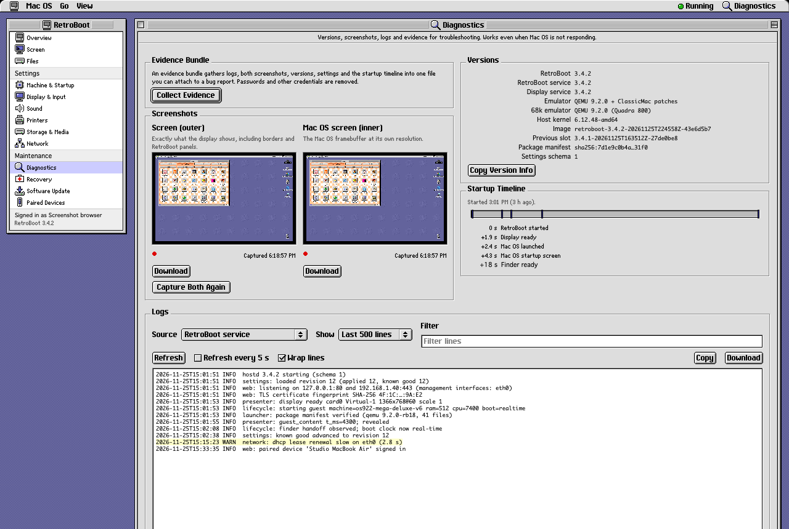

# Web management

Every RetroBoot serves its own management page. Open it from a phone or another computer on the same network. You don't need a cloud account, an internet connection or even a working Mac OS: the page keeps working while Mac OS is frozen, because it doesn't run inside the emulator.

Rendered from RetroBoot 3.4.2 in RetroBoot's MIT Platinum theme.

The page looks like Mac OS 9. It uses the Charcoal, Geneva and Monaco fonts, the icons and the desktop pattern of the Mac OS system on your RetroBoot, and its buttons, check boxes and windows match Mac OS 9.2.1 pixel for pixel. Until a Mac OS system is installed, the same layout appears with plain fonts and RetroBoot's own icons.

## Pairing a browser

1. On the computer, press **Ctrl+Alt+Delete** and open **Network & Web Access**. In first-time setup, **Network…** in the RetroBoot Setup window opens it too, and the installer's Network step shows the same address and code.
2. The window shows the address, a 6-digit pairing code, a QR code of the address and the fingerprint of RetroBoot's certificate:

   

   Rendered from RetroBoot's own window with example values.

3. Open the address in a browser, or scan the QR code. Each RetroBoot makes its own certificate, so the browser warns that it doesn't recognize it. Compare the fingerprint the browser shows with the one on the computer, then continue.
4. Enter the code and give the browser a name:

   

A code works once and expires after 5 minutes. After too many wrong codes it's retired, and **New Code** makes another. Paired browsers are listed under **Paired Devices**, where you can sign them out one by one:

 Unticking **Allow web management** turns the web page off entirely; the panel on the computer always keeps working.

The name `retroboot.local` works on most phones and computers. When two RetroBoots share a network, the second one gives itself a unique name such as `retroboot-1a2b.local`, and the panel shows the name it really has.

## Finding your way around

The window on the left (or the **Go** menu on a phone) lists the pages:

| Page | What it's for |
| --- | --- |
| **Overview** | Whether Mac OS is running, its startup timeline, a live picture, the address and version |
| **[Screen](screen.md)** | Seeing, hearing, and controlling Mac OS from a browser |
| **[Files](files.md)** | Copying files, viewing Print-to-PDF drawings, previewing PICT/images, moving items, downloading `.zip` folders, and safe-ejecting USB drives |
| **Machine & Startup** | Default Mac, per-Mac memory & graphics defaults, processor, time zone, battery display, automatic start and startup indicator |
| **Display & Input** | Display scaling, pixel size, graphics card (3D acceleration), rotation, resolution, keyboard swaps, gamepad preset (`Arrows` / `WASD` / `Off`), natural scrolling and mouse DPI |
| **Sound** | Volume, mute, startup chime style (**Automatic**, **Mac OS 9**, **Quadra**, **Power Mac**, **Mac II**, **Macintosh SE**, **Off**), output selector & **Test Sound** |
| **Printers** | Configure physical/network/USB **CUPS** printers, switch Mac output between **Save as PDF** and a printer queue, optional PDF copy, and test pages (Mac OS 9 automatically configures **RetroBoot Printer** as an **Apple Color LaserWriter 12/600 PS** over TCP/IP LPR `10.0.2.2` with AppleTalk kept off) |
| **Storage & Media** | Your Macs, automatic **Fresh Install** & manual checkpoints, 13-Mac catalog imports, USB drive sharing, and CD-ROM disc |
| **Network** | Quick-jump sections, **Modern Web Helper** with **Sites not to help (whitelist)** passthrough, Wi-Fi, Mac OS AirPort networking, and the remote screen |
| **Diagnostics** | Versions, screenshots, the startup timeline, logs and evidence bundles |
| **Recovery** | Clean and forced restarts and shutdowns, and the last settings that worked |
| **[Software Update](software-update.md)** | Installing a newer RetroBoot, or going back |
| **Paired Devices** | The browsers that can manage this RetroBoot |

The menu bar works like Mac OS's. The **Mac OS** menu has Start, Restart, Shut Down and the force actions. The RetroBoot menu (the little Mac at the left) has **About RetroBoot**, **Software Update…**, **Restart RetroBoot…** and **Turn Off RetroBoot…**. **View ▸ Browser Pixel Size** chooses how many screen pixels each Mac pixel gets in this browser. Automatic matches your screen, and only sizes your screen can draw exactly are offered.

On a phone, the pages stack into one column, and the list of pages moves into the **Go** menu:

## Overview and Needs attention

*Overview* shows whether Mac OS is running and its startup timeline: when Mac OS was launched, when its startup screen appeared, when it was shown, and when the Finder was ready. It also shows the addresses, the version and a live picture of the Mac's screen. Drop files on that picture to copy them to the Mac.

When RetroBoot decides Mac OS is frozen, the page says **Needs attention** and suggests collecting evidence before you try a clean **Restart** or a **Force Restart** on the **Recovery** page.

## Storage & Media

## Settings, and Apply and Restart

Each setting says when it takes effect:

| Kind | Examples | When it takes effect |
| --- | --- | --- |
| Live | Pixel size, Mac screen size, scaling, main display, rotation, swap Command/Option, recovery keys, pointer speed, volume, automatic start, startup indicator, web helper, remote screen | At once |
| Mac OS restart | Startup machine, memory, processor, time zone, the battery in Mac OS, Mac OS keys, the graphics card, sound on or off, Mac OS networking and adapter, the shared folder, the CD-ROM disc | At the next Mac OS start |
| Timed | Display resolution | At once, and goes back after 15 s unless you keep it |

Edits stay a local draft (marked *Edited*) until you click **Apply**. A saved change that needs a restart is marked *Pending*, with *In use now: …* beside it. **Apply and Restart Mac OS** asks Mac OS to restart cleanly through its own Restart. If you'd rather wait, **Apply Without Restarting** saves the change for the next start.

A display resolution change shows a 15-second countdown at the top of the page. If the computer's screen goes blank or looks wrong, do nothing, and RetroBoot puts the previous mode back automatically.

Settings are checked as a whole before they're saved. If someone changed the same settings elsewhere (on the computer or in another browser), the page tells you what changed and lets you keep or drop your edits. RetroBoot also remembers the last settings that started Mac OS successfully. **Restore Known Working Settings** goes back to them, and a damaged settings file is recovered automatically.

## Starting, stopping and forcing

| Action | What happens |
| --- | --- |
| Start Mac OS | Starts at once |
| Restart Mac OS / Shut Down Mac OS… | Asks Mac OS to do it through its own power-key dialog. While Mac OS is still starting, RetroBoot waits for the Finder and then for the dialog, so a request right after startup works too. Shut Down leaves RetroBoot on unless you tick *Also turn off RetroBoot* |
| Restart RetroBoot / Turn Off RetroBoot | Shuts Mac OS down cleanly first (waking it if it's asleep), then restarts or turns off the whole computer |
| Force Restart / Force Shut Down | Only after you confirm that unsaved work will be lost. Evidence is saved first |

If Mac OS doesn't respond to a clean request, the page says so and offers the matching force action. It never forces anything by itself.

## Machines, checkpoints and media

*Storage & Media* lists your Macs and their checkpoints. It imports machines from the RetroBoot Mac library (checked by SHA-256), from RetroBoot downloads when the computer was installed with their sign-in (each entry names its catalog; earlier versions of a system appear after **Show older versions**), or from an archive file you choose (**Import from a File**), chooses the CD-ROM disc, and turns the shared folder on or off. A checkpoint can only be taken while Mac OS is shut down, so the copy is never half-written.

**Remove…** deletes a Mac with its disk and checkpoints, after a warning that names it and the space it frees; tick the box to confirm. It can't be undone, and the shared folder isn't touched. RetroBoot refuses to remove the Mac that is running, the one chosen to start, or your only Mac, and says why. A power cut during a removal leaves nothing half-deleted: RetroBoot finishes the cleanup at its next start. From 1.6.0 the computer's own Startup Disk window offers the same removal as **Delete…** ([polish](../../hostd/reports/polish-2026-10-13.md#1-remove-a-mac-delete-apiv1machinesid); on the test machines the refusal for the running Mac was checked, and nothing was removed: [fleet7](../../image/reports/fleet7-2026-10-13.md)).

**New Blank Disk…** (under the list) makes a Mac with an empty disk, and **Start Up from CD…** on a Mac starts it once from a disc in a CD-ROM drive connected to the RetroBoot computer or from a CD image, the way Mac OS is installed on a blank disk. Both are the same actions as in the computer's [Startup Disk window](recovery.md#new-blank-disks-deleting-macs-and-starting-up-from-a-cd).

## Diagnostics

*Diagnostics* shows versions, the startup timeline, two screenshots (what the computer's screen shows, and Mac OS's own screen) and the logs. **Collect Evidence** builds a bundle you can download. It contains logs, settings, status and both screenshots. Wi-Fi passwords, session tokens and pairing codes are removed from logs, pages and bundles.

## Security

- The page is served over HTTPS with a certificate the device makes itself. It's available only on the local network and on the device itself, and never published to the internet.
- Only a paired browser can change anything. Sessions use secure, strict cookies, and every change also needs a matching origin and a per-session token.
- The page can only ask for specific, checked actions. It can't run commands, reach the emulator's internals or read arbitrary files.
- Wi-Fi passwords go to the computer's network manager and are never shown, logged or given to Mac OS.
- Mac OS itself can't reach this page or any other service on the computer.

Screenshots on this page are rendered from RetroBoot 3.4.2's MIT Platinum Web UI and local panel. See [Conventions and Screenshot Provenance](../manual/README.md#conventions-and-screenshot-provenance) for details.
