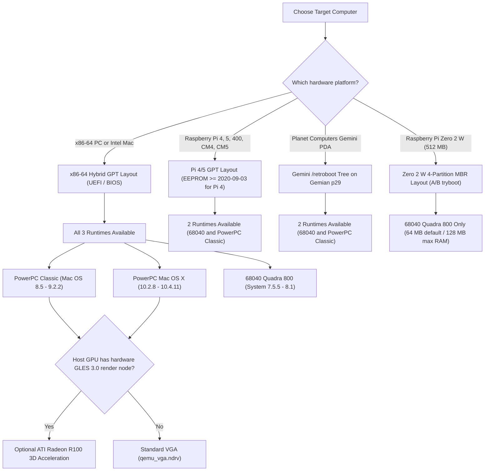

[Table of Contents](README.md) · [Next →](02-architecture-how-it-works.md)

# Chapter 1: System Requirements & Supported Platforms

RetroBoot turns bare-metal PCs, Intel Macs, single-board computers, handhelds, and virtual machines into dedicated classic Macintosh appliances. Rather than running an emulator inside a general-purpose desktop window, RetroBoot boots directly into a silent Linux appliance layer (`rb-presenter` + `hostd`) that owns the display, audio, input, and storage, then launches isolated QEMU runtimes for Motorola 68040, PowerPC Classic, or PowerPC Mac OS X guests.

Because QEMU translates 68040 and PowerPC instructions in software using its Tiny Code Generator (TCG), **single-core CPU speed** determines how quickly Mac OS boots and how responsive applications feel, while additional cores handle display composition, audio mixing, browser screen streaming, and Print-to-PDF without stalling the Mac.

---

## Platform Support Matrix

| Platform | CPU Architecture | Boot Loader & Partitioning | Supported Mac Runtimes | Software Update | Notes |
| --- | --- | --- | --- | --- | --- |
| **x86-64 PC** | `x86_64` | Hybrid GRUB (UEFI + Legacy BIOS), GPT | 68040 (7.5.5–8.1), PowerPC Classic (8.5–9.2.2), PowerPC Mac OS X (10.2.8–10.4.11) | Signed A/B `.rbu` OTA & USB | Primary platform; supports ATI Radeon 3D on hardware OpenGL ES 3.0 GPUs |
| **Intel Mac** | `x86_64` | Hybrid GRUB (UEFI via Option/Alt boot), GPT | 68040, PowerPC Classic, PowerPC Mac OS X | Signed A/B `.rbu` OTA & USB | Boot installer via Option/Alt startup manager; target drive erased completely |
| **Raspberry Pi 4 / 400 / CM4 / CM4S** | `aarch64` (BCM2711, Cortex-A72) | Pi EEPROM + `kernel8.img` (4 KiB pages), GPT | 68040 (7.5.5–8.1), PowerPC Classic (8.5–9.2.2) | A/B `tryboot` `.rbu` or card migration | Pi 4 requires EEPROM `>= 2020-09-03` for GPT SD/USB boot; 3.5 mm jack on Pi 4B |
| **Raspberry Pi 5 / 500 / CM5** | `aarch64` (BCM2712, Cortex-A76) | Pi EEPROM + `kernel8.img` (4 KiB pages), GPT | 68040 (7.5.5–8.1), PowerPC Classic (8.5–9.2.2) | A/B `tryboot` `.rbu` or card migration | Uses 4 KiB-page `kernel8.img` (not `kernel_2712.img`); hardware power button & RTC |
| **Raspberry Pi Zero 2 W** | `aarch64` (BCM2837, Cortex-A53, 512 MB) | Pi firmware (`dwc_otg` USB) + `kernel8.img`, 4-partition MBR | **68040 Quadra 800 only** (7.5.5, 8.1) | A/B `tryboot` `.rbu` (or 3-part card migration) | Excludes PowerPC runtimes; no DSI port; requires USB OTG adapter/hub |
| **Planet Computers Gemini PDA** | `aarch64` (MT6797X / Helio X27) | MediaTek LK `boot.img` (`boot` p22), `/retroboot` in `linux` p29 | 68040 (7.5.5–8.1), PowerPC Classic (8.5–9.2.2) | `gemini-install.sh --keep-data --activate` | Dual-boot alongside Gemian; lid sleep, Hall sensor, speaker/headphone switch |
| **Proxmox / KVM / QEMU VMs** | `x86_64` (`q35`) or `aarch64` (`virt`) | OVMF (UEFI) or SeaBIOS (Legacy BIOS) | All 3 runtimes (`x86_64`); 68k/PPC (`aarch64`) | Signed A/B `.rbu` (`x86_64` VMs) | Software-path validation; does not qualify real display, Wi-Fi, audio, or speed |

> [!NOTE]
> Physical hardware validation (display wiring, touch, battery gauges, Wi-Fi radios, speakers, and real-time clock/speed) is strictly distinct from Proxmox VM and QEMU emulator tests. Always verify hardware-specific claims against physical device reports rather than VM captures.

---

## Detailed Hardware Requirements

### CPU

- **x86-64 PC & Intel Mac:** Any 64-bit x86-64 processor. Modern high-IPC cores (AMD Ryzen, Intel Core, or recent Intel N-series) deliver faster PowerPC translation and higher frame rates in 3D games; entry-level Celeron N4100/N5105 systems remain fully usable for Classic Mac OS 9 and 68k systems.
- **ARM64 (Raspberry Pi & Gemini PDA):** 64-bit ARMv8 (`aarch64`) running with **4 KiB memory pages**. Raspberry Pi 5 intentionally boots `kernel8.img` (4 KiB pages) rather than `kernel_2712.img` (16 KiB pages) to maintain compatibility with the qualified arm64 emulator packages. On the Gemini PDA, `hostd` pins QEMU's TCG vCPU thread to the Cortex-A72 cluster (`cpu8-9`), while host services and `rb-presenter` run on the Cortex-A53 cluster (`cpu4-7`).

### Memory (RAM)

- **x86-64 PC / Intel Mac:**
  - **4 GiB:** Minimum observed in Proxmox VMs running Classic Mac OS 9 or 68k guests.
  - **8 GiB:** Tested bare-metal baseline (GPD MicroPC, ThinkPad X1 Carbon) for Classic Mac OS and 68k guests.
  - **16–32+ GiB (Recommended):** Recommended when running **Mac OS X 10.4 Tiger Deluxe** (which automatically allocates `2048 MB` guest RAM on hosts with `>= 5.5 GiB` or `>= 3.5 GiB` + ATI Radeon) or running the installer with multiple large images.
- **Raspberry Pi 4 / 5:** 1 GiB to 16 GiB boards are supported; QEMU's translation cache automatically scales to match board RAM.
- **Raspberry Pi Zero 2 W:** Fixed **512 MB** LPDDR2, managed under a dedicated 68040-only memory budget (see below).
- **Planet Gemini PDA:** **3.8 GiB** system RAM (`MT6797X`) with `zram` swap (`min(RAM/4, 1 GiB)`, `lzo-rle`).

### Storage Minimums

- **PC / Intel Mac Internal or External Target Disk:**
  - **8 GiB absolute minimum:** `install-to-disk` and `list-disks` reject any target drive smaller than **8 GiB** because the fixed system partitions (`RBEFI` 256 MiB + `BIOSBOOT` 1 MiB + `RBROOT_A` 3 GiB + `RBROOT_B` 3 GiB) consume ~6.25 GiB before `RBDATA` and its mandatory 1 GiB free margin.
  - **16–32+ GiB (or 64+ GiB) recommended:** Required for **Kids & Family: Mac OS 9.2.2 Mega Deluxe v7** (`4,254,239,361` B / `3.96 GiB` thin archive inside a 32 GiB sparse disk), **Mac OS X Period & Tiger Deluxe** editions, additional Mac installations, XFS reflink checkpoints, `RetroBoot Share` files, and uploaded CD images in `/var/lib/retroboot/media/`.
- **Raspberry Pi microSD / USB SSD:** **16 GB minimum** microSD card (Class 10 / A1 / U1 or better) or USB SSD/NVMe; `RBDATA` automatically expands to fill the remaining card space on first boot.
- **Installer USB Stick:** **4 GB+** USB drive for `retroboot-installer-3.5.0-product.iso` or `retroboot-installer-3.5.0-universal-product.img.xz`.

### Firmware Settings

- **x86-64 PC & Intel Mac:**
  - **UEFI** (`BOOTX64.EFI`) and **Legacy BIOS** (`grub-bios-setup` + `BIOSBOOT`) are both supported by the hybrid installer and installed layout.
  - **Secure Boot must be OFF:** RetroBoot's GRUB bootloader and Debian kernel are not signed for Microsoft Secure Boot.
  - **Fast Boot should be OFF:** Prevents the firmware from skipping USB controller initialization, which can hide USB keyboards or installer sticks at early boot (observed on GPD MicroPC and Ryzen mini PCs).
  - **Windows BitLocker warning:** Save your BitLocker Recovery Key at `https://aka.ms/myrecoverykey` before disabling Secure Boot or wiping any drive.
- **Raspberry Pi 4:** Bootloader EEPROM dated **2020-09-03 or later** is required to boot the GPT SD/USB card layout. Update older Pi 4 EEPROMs using Raspberry Pi Imager before flashing RetroBoot. (The **Universal Installer** image uses MBR so it boots on older Pi 4 EEPROMs as well.)
- **Raspberry Pi 5 & Zero 2 W:** Pi 5 supports GPT from its factory bootloader; Zero 2 W boots from a 4-partition MBR (`bootcode.bin`, `start.elf`, `start_cd.elf`, `fixup.dat`) and uses the BCM2710 `dwc_otg` USB controller for full-speed USB mouse/hub compatibility.

### Display & GPU

- **2D Classic & OS X Desktop (`standard` VGA):** Works on any PC/VM graphics adapter supported by Linux KMS (`i915`, `xe`, `amdgpu`, `bochs-drm`, `virtio-gpu`, `qxl`), Raspberry Pi `vc4`/`RP1`, or Gemini `geminipda-drm`.
- **3D Acceleration (`ati-radeon`, ATI Radeon R100):** Requires a host GPU exposing a Linux DRM render node (`/dev/dri/renderD*`) with **hardware-accelerated OpenGL ES 3.0 via EGL surfaceless** (`libEGL.so.1` + `libGLESv2.so.2`, non-software Mesa renderer). At startup, `hostd` probes this under the `rbguest` user; if unavailable, the ATI option is disabled in the UI and Mac OS falls back cleanly to Standard VGA (`qemu_vga.ndrv`).
- **Raspberry Pi Displays:**
  - HDMI up to 1920×1080 (automatically capped at 1080p for software scaling performance unless overridden via `host_mode`).
  - Official Raspberry Pi Touch Display (7-inch 800×480) and Touch Display 2 (5-inch / 7-inch 720×1280) on Pi 4/5 (`CAM/DISP1` for explicit selection on Pi 5; automatic detection works on either port).
  - Pimoroni HyperPixel 4.0 and HyperPixel 4.0 Square (720×720; touch requires a newer **HyperPixel XP** board) via the 40-pin GPIO header. HyperPixel presets disable GPIO serial, I2C, SPI, and analog audio.
  - Pi Zero 2 W has **no DSI connector** (HDMI or GPIO DPI only).

### Audio, Networking, Peripherals & Printers

- **Audio:** Works with standard HDA/SOF/USB/HDMI ALSA outputs, Raspberry Pi `vc4` HDMI and Pi 4B 3.5 mm analog jack (`bcm2835 Headphones`), and Gemini `mt6797-mt6351` speakers/headphones. On mixerless HDMI devices (such as AMD HD Audio), RetroBoot automatically provisions a `-51.00..0.00 dB` `"RetroBoot"` ALSA `softvol` control over shared `dmix`.
- **Wi-Fi & Bluetooth:** Ships Debian 13 `non-free-firmware` for Intel (`iwlwifi`/`btintel`), Realtek (`rtw88`/`rtw89`/`rtl_bt`, including power-saving workarounds for `RTL8821CE`), MediaTek (`mt7921`, Gemini MT6630 CONSYS), Qualcomm Atheros, and Broadcom chipsets. BlueZ supports classic HID and Bluetooth Low Energy HOGP **keyboards, mice, trackpads, and game controllers** (A2DP Bluetooth audio profiles are intentionally excluded).
- **USB & Optical Drives:** USB keyboards, mice, tablets, gamepads, and flash drives work out of the box (Pi Zero 2 W requires a USB OTG adapter/hub). Physical USB or SATA CD-ROM drives are passed directly to Mac OS for disc mounting and **Start Up from CD**.
- **Printers:** Supports **Print-to-PDF** (`Printed PDFs/` in `RetroBoot Share`), automatic Mac OS 9 **RetroBoot Printer** setup (`Apple Color LaserWriter 12/600 PS` over TCP/IP LPR `10.0.2.2`, AppleTalk OFF), and physical/network printers via socket-isolated CUPS (`ipp://`, `ipps://`, `socket://`, `lpd://`, `dnssd://`, and `usb://` / `ipp-usb`).

---

## Mac Runtime & Memory Budget Matrix

RetroBoot isolates its three Macintosh architectures into separate QEMU packages under `/usr/lib/retroboot/` so fixes or optimizations for one era never destabilize another.

| Runtime | Package Path | Emulated Hardware | Supported OS Versions | Guest RAM Choices (MiB) | Platform Availability |
| --- | --- | --- | --- | --- | --- |
| **68040 Quadra 800** | `/usr/lib/retroboot/qemu-m68k` | Motorola 68040 (`q800`), `nubus-qfb`, SONIC Ethernet, Apple Sound Chip, SCSI HD/CD | System 7.5.5 – Mac OS 8.1 (HFS Standard; max 2 GB for 7.5.5, 4 GB for 7.6–8.1) | `64`, `128` (default on PC/Pi 4/5), `256` (max `128` on Zero 2 W; default `64`) | x86-64 PC, Intel Mac, Pi 4/5, Pi Zero 2 W, Gemini PDA, VMs |
| **PowerPC Classic** | `/usr/lib/retroboot/qemu` | PowerPC `7400` (G4) or `g3`, `mac99` (Cuda or PMU), std-VGA / ATI R100, Sungem or AirPort, USB/ADB | Mac OS 8.5 – 9.2.2 (HFS+) | `256`, `384`, `512` (default), `768`, `896` | x86-64 PC, Intel Mac, Pi 4/5, Gemini PDA, VMs (**not Zero 2 W**) |
| **PowerPC Mac OS X** | `/usr/lib/retroboot/qemu-osx` | PowerPC `7400` (G4), `mac99` PMU, `openbios-ppc-osx`, 16 KiB `nvram.img`, std-VGA / ATI R100 AGP, Sungem Ethernet | Mac OS X 10.2.8 Jaguar, 10.3.9 Panther, 10.4.11 Tiger | `128`, `256`, `384`, `512`, `768`, `896`, `1024`, `1536`, `2048` (min `256` for 10.4; auto `2048` on Tiger Deluxe / ATI with `>= 3.5 GiB` host RAM) | x86-64 PC, Intel Mac, x86-64 VMs |

> [!IMPORTANT]
> **Quadra 800 ROM requirement:** RetroBoot never distributes proprietary Apple ROM binaries. Each 68040 Mac archive carries its own `Quadra800.rom` (or you can upload a verified Quadra 610/650/800 1 MiB ROM in the Web UI), which `hostd` verifies by SHA-256 (`05ad753fb594e656cf078023ec189e09e2a7655a780de993b75b8c51ed6b09ca`) and caches in `/var/lib/retroboot/roms/`.

### TCG Translation Cache (`-accel tcg,tb-size=`)

`hostd` (`retroboot/platform.py`) sizes QEMU's JIT translation buffer according to host memory so translated code never starves the Linux kernel or presenter:

| Host Board / Memory Tier | TCG Translation Cache (`tb-size`) |
| --- | --- |
| **Raspberry Pi Zero 2 W** (512 MB profile) | `64 MB` |
| **Raspberry Pi 4/5** (`<= 1024 MB` RAM) | `128 MB` |
| **Raspberry Pi 4/5** (`<= 2048 MB` RAM) | `256 MB` |
| **Raspberry Pi 4/5** (`> 2048 MB` RAM) | `512 MB` |
| **Gemini PDA** & **x86-64 PC / Intel Mac / VMs** | `512 MB` |

### Raspberry Pi Zero 2 W 512 MB Memory Budget

On the 512 MB Raspberry Pi Zero 2 W, `/usr/lib/retroboot/rpi-profile.json` and `config.txt` enforce a strict memory budget so 68040 Mac OS runs smoothly without exhausting RAM:

| Budget Component | Allocation / Limit | Purpose |
| --- | --- | --- |
| **Mac OS Guest RAM** (`machine.quadra_ram_mb`) | `64 MB` default (`128 MB` maximum) | 68040 System 7.5.5 / Mac OS 8.1 guest memory |
| **QEMU TCG Translation Cache** | `64 MB` | JIT block cache for 68040 emulation |
| **VideoCore GPU Firmware (`gpu_mem`)** | `16 MB` | Minimal firmware allocation (`[pi02] gpu_mem=16`) |
| **KMS Contiguous Memory (`dtparam=cma-64`)** | `64 MB` | `vc4` DRM display buffers |
| **Modern Web Helper (`rbwebproxy`)** | Capped at `64 MB` | Reduced systemd `MemoryMax` (vs `384 MB` on PCs/Pi 4/5) |
| **Remaining Headroom (~240 MB)** | Linux kernel, `rb-presenter`, `hostd`, NetworkManager | Keeps host services responsive without OOM pressure |

---

## Disk Partition Budget Table

RetroBoot uses a 5-partition GPT layout on x86-64 PCs and Raspberry Pi 4/5 (`install-to-disk` / `make-disk.sh`), keeping OS upgrades atomic and user data untouched:

| # | GPT `PARTLABEL` | Filesystem | Size | Partition Type (PC / Pi 4–5) | Contents & Role |
| --- | --- | --- | --- | --- | --- |
| `1` | `RBEFI` | FAT32 | `256 MiB` | `EF00` (PC) / `0700` `RETROBOOT` (Pi) | GRUB EFI/BIOS configs, `slots.env`, checkerboards (PC); firmware, `kernel8.img`, `config.txt`, `retroboot/display.txt` (Pi) |
| `2` | `BIOSBOOT` | Raw (none) | `1 MiB` | `EF02` (both) | GRUB `core.img` for Legacy BIOS boot on PC; placeholder on Pi 4/5 so root/data partition numbers stay 3–5 |
| `3` | `RBROOT_A` | ext4 | `3 GiB` (`3072 MiB`) | `8300` | System slot `a` (Debian 13 root, kernel, initramfs, `rb-presenter`, `hostd`, QEMU packages) |
| `4` | `RBROOT_B` | ext4 | `3 GiB` (`3072 MiB`) | `8300` | System slot `b` (populated in-place by A/B Software Update; untouched fallback target) |
| `5` | `RBDATA` | XFS (`reflink=1`) | Remainder of disk | `8300` | Mounted at `/var/lib/retroboot`: Macs, instant reflink checkpoints, `share/`, `media/`, `roms/`, `network/`, `bluetooth/`, `logs/` |

- **Raspberry Pi Zero 2 W SD layout:** Uses a 4-partition **MBR** table (`256 MiB` FAT32 boot `0x0C`, `2.5 GiB` ext4 `RBROOT_A`, `2.5 GiB` ext4 `RBROOT_B`, initial `1 GiB` expanding XFS `RBDATA`) because the BCM2837/BCM2710 boot ROM requires MBR; total raw size is `6,400 MiB` (fits 8 GB+ cards; 16 GB+ recommended) while enabling full `tryboot.txt` A/B Software Updates. Older 3-partition Zero 2 W cards must be flashed once to gain `RBROOT_B`.
- **Planet Gemini PDA layout:** Uses a `/retroboot` directory inside Gemian's existing ext4 `PARTNAME=linux` (p29) partition alongside `boot` (p22) and `para` (p2), creating no new partitions.

---

## Product vs. Debug Builds

Every RetroBoot release ships in two flavors built from the same source tree. Everyday users should always install **Product** builds.

| Feature | Product Build (`-product`) | Debug Build (`-debug`) |
| --- | --- | --- |
| **Intended Audience** | Everyday home, family, and retro-computing use | Developers, hardware bring-up, and automated lab QA |
| **Linux Visibility** | Completely hidden (`getty@`, `serial-getty@`, `getty.target` masked) | Kernel serial console (`ttyS0` / `ttyAMA10`) auto-logs in as root |
| **SSH Access** | Disabled (`ssh.service` masked) | `openssh-server` enabled (key-only root login with lab key) |
| **VM Guest Agent** | Disabled (`qemu-guest-agent.service` masked) | Enabled for Proxmox lab orchestration & host-key pinning |
| **Diagnostic CLI Tools** | Minimal appliance rootfs | Adds `iproute2`, `less`, `strace`, `pciutils`, `usbutils`, `iw`, `ethtool` |
| **Startup Details (`Esc` at boot)** | Available (`retroboot.diag=1`) | Available (`retroboot.diag=1`) |
| **Recovery (`Ctrl+Alt+Del`) & Web UI** | Full local panel, Diagnostics evidence capture, and HTTPS Web UI | Full local panel, Diagnostics evidence capture, and HTTPS Web UI |
| **OTA Update Channel** | Accepts signed `product` `.rbu` bundles | Accepts signed `debug` `.rbu` bundles |

---

## Verified Hardware vs. VM Performance Reference

RetroBoot strictly separates **physical hardware benchmarks** from **Proxmox VM / QEMU emulator measurements**.

### Physical Hardware Measurements

Measured on bare-metal devices running Mac OS 9.2.2 (October 2026 fleet runs with product bundle `0.3.0`, Speedometer 4.02 where Quadra 605 = `1.0`) and Tiger Deluxe 10.4.11 (November 2026 Ryzen update):

| Physical Machine | CPU / GPU / RAM | Cold Power-On → Finder Menus | Speedometer 4.02 (CPU / Gfx / Disk) | Idle QEMU CPU (% of 1 core / Pkg Power) | Quake III Arena (ATI 3D) |
| --- | --- | --- | --- | --- | --- |
| **Beelink SER9 Mini PC** | AMD Ryzen AI 9 HX 370, Radeon 890M, 32 GB | `22.1–23.4 s` (OS 9, 3D on); `32.4 s` from guest launch (Tiger 10.4.11) | `167.6–169.2` CPU / skipped (3D) / `4.79` Disk (OS 9) | `8.3%` / `3.50 W` (OS 9); `3.50%` (Tiger 10.4.11) | `73.5–88.4 fps` (OS 9 640×480); `57.1–57.3 fps` uncapped / `59.91 fps` 60-fps match (Tiger 1280×800) |
| **Lenovo ThinkPad X1 Carbon (6th Gen)** | Intel Core i5-8350U, UHD 620, 8 GB | `~36.4–37.0 s` (OS 9) | `60.2–60.5` CPU / `32.9` Gfx / `4.79` Disk | `19.7%` / `1.1 W` | `28.6 fps` (OS 9, package r19) |
| **14-inch Celeron N5105 Laptop** | Intel Celeron N5105, UHD, 16 GB, 2160×1440 | `51.4–52.4 s` (OS 9) | `53.8–53.9` CPU / `27.4` Gfx / `4.85` Disk | `24.3%` / `7.73 W` | `19.1 fps` (OS 9) |
| **GPD MicroPC** | Intel Celeron N4100, UHD 600, 8 GB, 6" DSI | `66.3–67.0 s` (OS 9) | `35.3–35.4` CPU / `17.1` Gfx / `4.78` Disk | `28.0%` / `2.66 W` | `7.2 fps` (OS 9) |

### Proxmox VM & QEMU Emulator Measurements (Simulated Hardware)

Measured inside Proxmox VE virtual machines (`q35`, 4 vCPU `x86-64-v3`, OVMF/SeaBIOS on an i7-12700K lab host) and ARM64 QEMU `virt`. **These numbers measure software correctness and relative guest behavior under nested virtualization; they do not represent physical bare-metal or physical Raspberry Pi speed:**

| Virtual Environment | Guest OS & Runtime | Cold Boot / Launch Timing | Observed Simulated Metrics |
| --- | --- | --- | --- |
| **Proxmox VM 164 / 165** (x86-64) | Mac OS 9.2.2 Standard (PowerPC) | `~44.8–46.2 s` power-on → Finder (`~14.4–19.2 s` kernel launch → Finder) | `15.8%` whole-VM idle CPU; 0 display transition glitches across cold boots |
| **Proxmox VM 165 / 169** (x86-64) | System 7.5.5 & Mac OS 8.1 (68040 Quadra 800) | `~8.8–9.1 s` kernel launch → Finder (`~4.7–4.8 s` after QEMU start) | `7.4%` (8.1) / `10.8%` (7.5.5) whole-VM idle CPU (`3.0–3.5%` emulator with `RetroBoot Idle`); Speedometer 4.02 CPU `~34.7`, Gfx `34.0` |
| **Proxmox VM 350 / 351** (x86-64) | RetroBoot `3.4.2` + Mega Deluxe v6 | Fresh ISO install & signed A/B `3.4.1 -> 3.4.2 -> 3.4.1` verified | Confirmed default-off `Enable Mac printing` checkmark + PDF test page + `RetroBoot Printer` on restart, 3-wave Volume OSD, clean download wrap, & serialized startup chime |
| **Proxmox VM 352 / 353** (x86-64) | RetroBoot `3.5.0` (`8.1` 68k & `9.2.2`) | Fresh ISO install & signed A/B `3.4.2 -> 3.5.0 -> 3.4.2` verified | Confirmed 68k `rbplatinum` panel icons on Mac OS 8.1, public feed default URL, and live A/B upgrade commit & rollback |
| **ARM64 QEMU `virt`** (`qa-pi45`, `qa-zero2w`) | Pi 4/5 Setup & Zero 2 W System 7.5.5 | Reaches Setup (`pi45`) & System 7.5.5 Finder (`zero2w`) in software QA | Validates rootfs, `rpi-profile.json`, and 68k guest path only; does not test Pi firmware, HDMI/DSI/GPIO wiring, touch, Wi-Fi, or physical speed |

---

## Platform & Mac Runtime Selection Decision Tree

---

[Table of Contents](README.md) · [Next →](02-architecture-how-it-works.md)
