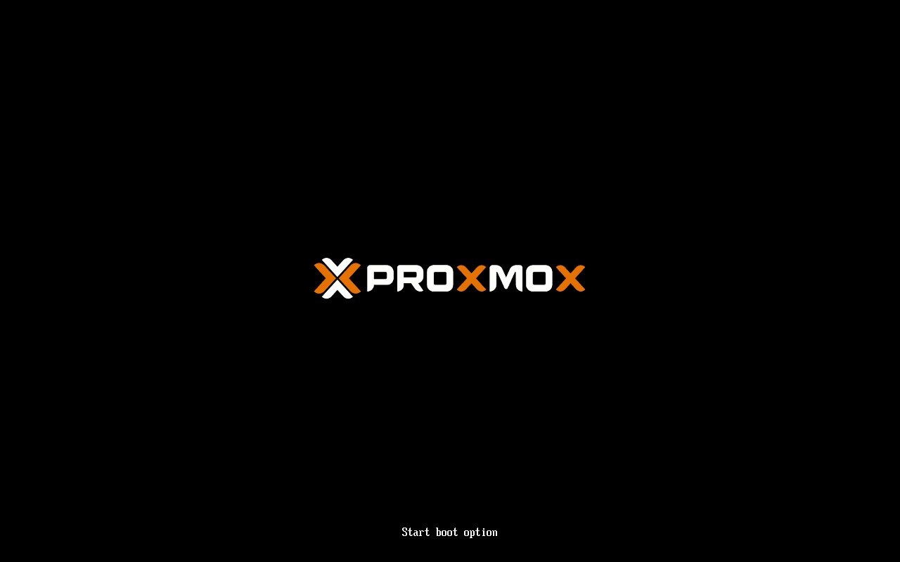
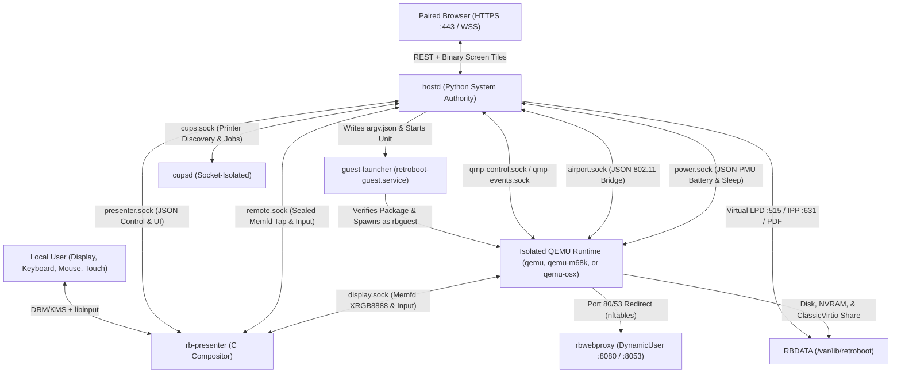
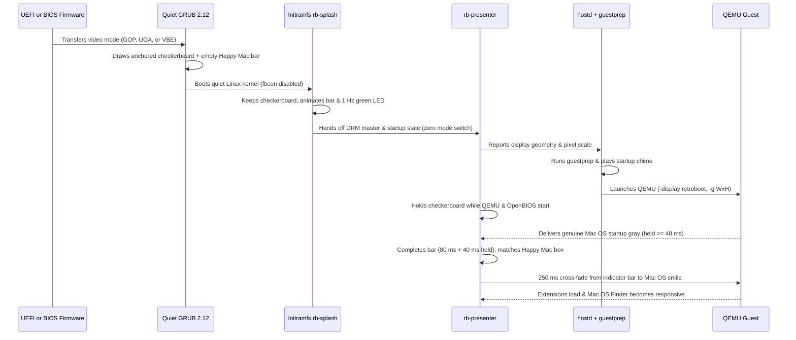
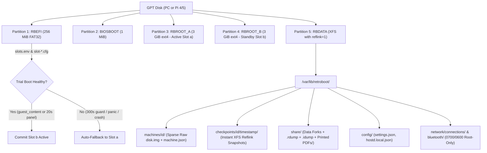
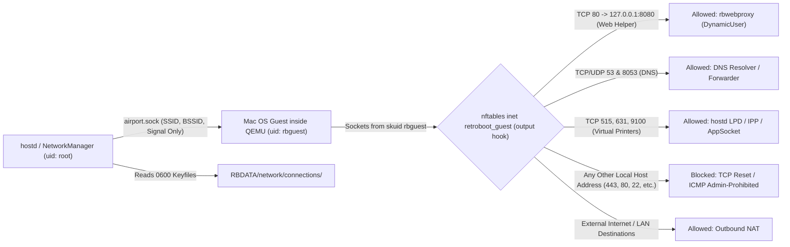

[← Previous](01-system-requirements.md) · [Table of Contents](README.md) · [Next →](03-installation.md)

# Chapter 2: Architecture & How RetroBoot Works

RetroBoot is designed as an **invisible Linux appliance**. Under the hood, Debian 13 (trixie) manages storage, display modesetting, input devices, Wi-Fi, Bluetooth, audio, and network isolation—yet no Linux logo, boot log, terminal prompt, or desktop environment ever appears on screen during normal operation or recovery.

From the instant firmware hands off to the bootloader until the Mac OS Finder appears, one unified presentation pipeline owns every pixel on the screen.

Proxmox VE virtual machine cold-boot capture showing the seamless checkerboard-to-Finder handoff in a simulated environment.

---

## The Invisible Linux Philosophy

Standard Linux distributions print kernel messages, initialize framebuffer consoles (`fbcon`), clear the display during KMS driver handoffs, and launch login managers (`getty`). RetroBoot suppresses every Linux surface across four stages:

1. **Quiet Bootloader (GRUB):** RetroBoot's patched GRUB 2.12 ships 64-bit UEFI (`BOOTX64.EFI`), 32-bit UEFI (`BOOTIA32.EFI` with `efi_gop` and `efi_uga` for 32-bit EFI 64-bit Macs), and legacy BIOS (`i386-pc`), using `timeout=0`, `timeout_style=hidden`, `gfxpayload=keep`, and an empty glyph font (`blank.pf2`) so no menu or text renders. On UEFI it preserves the firmware GOP/UGA mode and paints the anchored 50% checkerboard (`rb_startup_scene`) directly over the firmware image.
2. **Silent Kernel (`config/cmdline`):** Boot parameters pass `quiet loglevel=0 rd.udev.log_level=0 systemd.show_status=false rd.systemd.show_status=false vt.global_cursor_default=0 console=ttyS0,115200` together with `video=efifb:off video=vesafb:off fbcon=map:9 drm_kms_helper.fbdev_emulation=0`. Because Debian 13 has no `simpledrm` and framebuffer consoles are disabled, `fbcon` never clears or writes to the screen.
3. **Initramfs Splash (`rb-splash`):** Before systemd even starts, `rb-splash` draws the exact same anchored checkerboard on any DRM/KMS device that appears and animates the Happy Mac progress bar (or the Mac OS 9.2-style installer startup box in installer mode).
4. **Masked Consoles & Unified Compositor:** Product builds mask `getty@.service`, `serial-getty@.service`, `getty.target`, `ctrl-alt-del.target`, and console password prompts. `rb-presenter` inherits the DRM master directly from `rb-splash` with no video mode change, and every setup, error, and recovery screen renders in native Mac OS 8/9 Platinum styling. (Pressing `Escape` on the checkerboard reveals the optional Platinum **Startup Details** diagnostic window if startup stalls.)

---

## Core Runtime Components

| Component | Binary / Location | Role & Responsibilities |
| --- | --- | --- |
| **`rb-splash`** | `/usr/lib/retroboot/bin/rb-splash` | Lightweight initramfs build of the presenter (linked only with `libdrm` and `libudev`). Redraws the anchored checkerboard and animates the Happy Mac progress bar or installer box until `rb-presenter` takes over. |
| **`rb-presenter`** | `/usr/lib/retroboot/bin/rb-presenter` | C DRM/KMS compositor and `libinput` router (`retroboot-presenter.service`). Composes four scenes (`splash`, `guest`, `panel`, `black`), enforces integer/fit scaling and rotation, captures/fades Happy Mac art, renders Platinum UI documents, and exposes the remote frame tap. |
| **`hostd`** | `/usr/lib/retroboot/hostd/` | Python appliance authority (`retroboot-hostd.service`). Owns the versioned settings store, machine registry, guest supervisor & frozen-guest watchdog, HTTPS/HTTP API (`443`/`80`) and static Web UI (`/usr/lib/retroboot/web/`), AirPort bridge, PMU power bridge, BlueZ pairing, CUPS wrapper, and A/B Software Update manager. |
| **PowerPC Classic QEMU** | `/usr/lib/retroboot/qemu/` | Isolated `qemu-system-ppc` (`mac99`, G3/G4) package for Mac OS 8.5–9.2.2, paired with verified `qemu-ndrv` (`qemu_vga.ndrv`) and `qemu-classicvirtio` (`ndrvloader`) overlays. |
| **68040 Quadra 800 QEMU** | `/usr/lib/retroboot/qemu-m68k/` | Isolated `qemu-system-m68k` (`q800`) package with `classicvirtio-68k.rom` and `q800-pram-seed.img` for System 7.5.5–Mac OS 8.1. Requires user-supplied `Quadra800.rom` verified by SHA-256. |
| **PowerPC Mac OS X QEMU** | `/usr/lib/retroboot/qemu-osx/` | Isolated `qemu-system-ppc` (`10.0.13`) package with `openbios-ppc-osx` and `macosx-flash-seed.img` (16 KiB flash NVRAM) tuned for Mac OS X 10.2.8–10.4.11. |
| **`rbwebproxy`** | `/usr/lib/retroboot/webproxy/rbwebproxy` | Sandboxed **Modern Web Helper** (`retroboot-webproxy.service`, `DynamicUser`). Intercepts guest HTTP (`:8080`) and DNS (`:8053`) to translate modern HTTPS pages into HTML/images readable by Internet Explorer 5, Netscape 4, and Classilla. |
| **Socket-Isolated `cupsd`** | `/run/cups/cups.sock` (`cups.socket`) | Debian CUPS daemon constrained strictly to its Unix domain socket (`ListenStream=/run/cups/cups.sock`). TCP port `631` stays reserved for `hostd`'s virtual IPP server for Mac OS, preventing port collisions or external exposure. |
| **`rbplatinum` v8** | `/usr/lib/retroboot/platinum/` | Runtime Platinum asset extractor. Extracts fonts, palettes, chrome sprites, brushed-metal assets, and authentic Mac icons (HFS+ Mac OS 9 and HFS Standard System 7.5.5 / Mac OS 8.1) from the user's own Mac OS disk into `/var/lib/retroboot/assets/platinum/`, falling back to built-in MIT art when no disk exists. |
| **`guestprep`** | `/usr/lib/retroboot/guestprep/` | Offline HFS/HFS+ and 68k disk preparer (`rbguestprep`). Runs before launch to check/repair volumes (`fsck.hfsplus`), set Energy Saver sleep to Never, configure DHCP TCP/IP & AirPort startup networks, disable AppleTalk, provision **`RetroBoot Printer`** (Color LaserWriter 12/600 PS), install `RetroBoot Idle` (68k), and place the Control Strip / ATI `radeon-3d` helpers. |

---

## Full Runtime Component & IPC Socket Architecture

### Unix IPC Sockets (`/run/retroboot/` & `/run/cups/`)

All inter-process communication stays on local Unix domain sockets with strict permissions rather than open network ports:

| Socket Path | Protocol & Framing | Endpoints | Purpose |
| --- | --- | --- | --- |
| `/run/retroboot/display.sock` | `AF_UNIX` `SOCK_SEQPACKET` (binary `rbd_hdr` + `SCM_RIGHTS` memfd) | QEMU ⇄ `rb-presenter` | Transfers `XRGB8888` guest `SURFACE` memfds, `DAMAGE` rectangles, `GUEST_EVENT` timing/pointer-mode events, and routes `KEY`, `POINTER_ABS`, `POINTER_REL`, `BUTTON`, and `RESIZE` back to QEMU. |
| `/run/retroboot/presenter.sock` | `AF_UNIX` `SOCK_STREAM` (newline-delimited JSON) | `hostd` ⇄ `rb-presenter` | Sends `set_scene`, `ui_show` Platinum UI documents, `display_config`, `input_config`, `osd`, `startup_config`, and `pointer_nudge`; receives `chord` (`Ctrl+Alt+Del`), `preboot_key`, `ui_action`, `host_key`, and `lid` events. |
| `/run/retroboot/remote.sock` | `AF_UNIX` `SOCK_SEQPACKET` (sealed memfd + input) | `rb-presenter` ⇄ `hostd` | Opened only while at least one paired browser watches the Web **Screen** page; copies damaged 128 px column tiles into a sealed read-only memfd and forwards remote keyboard/pointer input. |
| `/run/retroboot/airport.sock` | `AF_UNIX` `SOCK_STREAM` (newline-delimited JSON, `0660 root:rbguest`) | `hostd` ⇄ QEMU | Bridges Mac OS AirPort 2.0.4 `scan`, `join`, and `leave` operations to NetworkManager without ever sending Wi-Fi passwords or WEP keys into QEMU. |
| `/run/retroboot/power.sock` | `AF_UNIX` `SOCK_STREAM` (newline-delimited JSON, `0660 root:rbguest`) | `hostd` ⇄ QEMU | Synchronizes laptop AC/battery percentages and drain estimates, Mac OS `via-pmu` sleep/wake vectors, and PowerBook backlight slider changes. |
| `/run/retroboot/qmp-control.sock` | `AF_UNIX` `SOCK_STREAM` (QMP JSON) | `hostd` ⇄ QEMU | Queries guest responsiveness (`query-status`), presses virtual ADB power/volume/brightness keys, and sends clean shutdown/quit commands. |
| `/run/retroboot/qmp-events.sock` | `AF_UNIX` `SOCK_STREAM` (QMP JSON) | `guest-launcher` ⇄ QEMU | Tracks `SHUTDOWN` and `RESET` events so `guest-launcher` exits cleanly (`0` shutdown, `10` reset, `20` host-stop, `1` crash) and writes `/run/retroboot/guest/status.json`. |
| `/run/cups/cups.sock` | `AF_UNIX` `SOCK_STREAM` (IPP over Unix socket) | `hostd` ⇄ `cupsd` | Isolates Debian CUPS from TCP `631` so `hostd` owns virtual Mac IPP/LPD printing while `cupsd` handles physical/network USB and Avahi printers. |

---

## Power-On to Finder Boot Sequence & Checkerboard Handoff

RetroBoot coordinates GRUB, the Linux kernel, `rb-splash`, `rb-presenter`, and QEMU so the transition from firmware to the Mac OS Finder has no terminal flicker or half-drawn startup screen:

### How First Genuine Content Is Detected

Because Mac OS paints its startup screen top-down, cutting immediately on the first non-black frame would flash a half-painted gray screen. Instead, `rb-presenter` samples an 80×60 grid of 2×2 pixel blocks on every `DAMAGE` event and every 100 ms:

- **`gray` rule:** At least 97% of sampled blocks are non-black and within `±12` per channel of a single gray level `>= 32` (covering both solid desktop gray and the 50% QuickDraw dither on laptop built-in LCDs), and **zero pixels changed for at least 48 ms** (3 consecutive 16 ms refreshes).
- **`nonblack` rule:** At least 25% of samples are non-black and `<= 1%` changed over 500 ms (catching installers or custom boot screens).
- **250 ms Cut-Over:** Once Mac OS draws its Happy Mac icon inside the exact anchored rectangle (or immediately for `happy_mac: "late"` on ATI Radeon, where the overlay stays over the gray until Happy Mac appears), `rb-presenter` finishes the progress bar in 80 ms, holds 40 ms, and fades the bar over **250 ms** into Mac OS's smiling Happy Mac.

---

## Disk Layout, A/B Root Slots & `RBDATA` Structure

RetroBoot separates immutable OS slots from persistent user data so Software Updates can be written in the background while Mac OS keeps running, tested in a single trial boot, and rolled back automatically if anything goes wrong. (On **Raspberry Pi Zero 2 W**, the same dual-slot A/B `tryboot` lifecycle runs on a 4-partition MBR table—`p1` FAT32 boot, `p2` `RBROOT_A`, `p3` `RBROOT_B`, `p4` `RBDATA`—identified by filesystem labels and MBR `PARTUUID`s.)

### Complete `RBDATA` Directory Layout (`/var/lib/retroboot/`)

Every file in `RBDATA` survives A/B root updates and **Go Back to the Previous Version** rollbacks untouched:

| Path | Owner / Mode | Purpose |
| --- | --- | --- |
| `/var/lib/retroboot/machines/<id>/` | `root:rbdata` (`2770`) | Each Mac's directory: sparse raw `disk.img`, `machine.json`, `state.json`, plus `Quadra800.rom`/`pram.img` (68k) or `nvram.img` (OS X). |
| `/var/lib/retroboot/checkpoints/<id>/<ts>/` | `root:root` | Instant, zero-copy XFS reflink (`cp --reflink=always`) snapshots taken on clean shutdowns, **Fresh Install**, and pre-repair hooks. |
| `/var/lib/retroboot/share/` | `rbguest` accessible | Host backing store for the `RetroBoot Share` volume: plain data forks, `.rdump` Rez resource forks, `.idump` Finder metadata, `.retroboot-incoming/` (`0700` staging), `.classicvirtio.nosync.noindex/`, and `Printed PDFs/`. |
| `/var/lib/retroboot/media/` | `root:rbdata` (`2750`) | User-uploaded CD ISOs, StuffIt archives, and disk images for the virtual CD-ROM drive and media installer. |
| `/var/lib/retroboot/roms/` | `root:root` (`0700`/`0600`) | SHA-256 indexed store of verified user-supplied Mac ROMs (such as `Quadra800.rom`); never included in OS images or updates. |
| `/var/lib/retroboot/config/` | `root:root` | `settings.json` (+ `.bak` and `known_good`), `hostd.local.json` per-device overlay, `install-seed.json`, and optional `lab-auth.env` (`0600`). |
| `/var/lib/retroboot/network/connections/` | `root:root` (`0700`/`0600`) | NetworkManager `.nmconnection` keyfiles containing Wi-Fi SSIDs and PSKs; mounted via `50-retroboot-keyfile.conf` before NetworkManager starts. |
| `/var/lib/retroboot/bluetooth/` | `root:root` (`0700`) | BlueZ adapter/device link keys, bind-mounted onto `/var/lib/bluetooth` by `var-lib-bluetooth.mount` before `bluetoothd` starts. |
| `/var/lib/retroboot/assets/platinum/` | `root:root` | Runtime Platinum v8 UI bundle generated from the user's Mac disk (68k or PowerPC; never shipped inside OS images). |
| `/var/lib/retroboot/update/` | `root:root` | Software Update journal (`state.json`), staged `.rbu` bundles (`incoming/`), and per-build settings backups (`settings/<build_id>/`). |
| `/var/lib/retroboot/state/` | `root:root` (`0700`) | Pairing secrets, device TLS key/cert, `startup-timing.json`, captured `startup-icon.rbi`, `airport-names.json`, `oobe-pending.json` (first-boot setup marker), and `pi-display.json`. |
| `/var/lib/retroboot/logs/` | `root:root` | Persistent `journal/` (bind-mounted at `/var/log/journal`), `lifecycle.jsonl`, `guest-serial.log`, `hostd.log`, `startup-details/`, and redacted `evidence/` bundles. |
| `/var/lib/retroboot/downloads/` & `cups/` | `root` / `lp` | Temporary download staging for Mac catalog installs and CUPS spool/PPD state. |

---

## Privilege & Guest Network Isolation Boundary

RetroBoot treats emulated Mac OS software as untrusted with respect to host management and credentials. Even though QEMU's user-mode network (`slirp`) normally maps `10.0.2.2` to the host's loopback address, Mac OS cannot reach RetroBoot's management API, SSH (in debug builds), or local services:

1. **Unprivileged `rbguest` User:** QEMU executes strictly as `rbguest` (member of `audio`, `rbdata`, `render`, and `video` groups only). It has no read access to `/var/lib/retroboot/state/`, `/var/lib/retroboot/network/connections/`, `/var/lib/retroboot/roms/`, or other machines' directories.
2. **Permanent `nftables inet retroboot_guest` Table:** Loaded before the guest starts by `retroboot-guestnet.service` and verified before every launch by `hostd`, this table matches `meta skuid rbguest` packets aimed at `fib daddr type local` (`127.0.0.0/8`, `::1`, and every host interface IP). It permits only DNS (`53`, `8053`), Modern Web Helper (`8080`), and RetroBoot's virtual printer ports (`515`, `631`, `9100`), immediately rejecting everything else with a TCP reset or ICMP `admin-prohibited`.
3. **Root-Only Wi-Fi Credentials:** Wi-Fi passwords remain exclusively in `0600` keyfiles under `/var/lib/retroboot/network/connections/`. When AirPort emulation is active, `airport.sock` exchanges SSIDs, BSSIDs, channels, and signal strength—never WPA/WPA2/WPA3 passphrases or WEP keys. If Mac OS picks an unknown secured network, `rb-presenter` pauses guest input and prompts directly on the trusted host layer.

---

[← Previous](01-system-requirements.md) · [Table of Contents](README.md) · [Next →](03-installation.md)
