[← Previous](02-architecture-how-it-works.md) · [Table of Contents](README.md) · [Next →](04-first-start-and-mac-library.md)

# Chapter 3: Installing RetroBoot 3.5.0

You can install RetroBoot **3.5.0** onto an x86-64 PC, an Intel Mac, a Raspberry Pi 4/5/400/CM4/CM5, a Raspberry Pi Zero 2 W, or a Planet Computers Gemini PDA. All **14 ready-to-run Mac editions**—including **Kids & Family: Mac OS 9.2.2 Mega Deluxe v7**, **Clean Mac OS 9.2.2**, 68k System 7.5.5/8.1 (with **Mac OS 8.1 Mega Deluxe**), and Mac OS X Jaguar/Panther/Tiger—are available directly from RetroBoot's built-in HTTPS catalog during or after installation.

---

## Step 1: Download & Verify RetroBoot 3.5.0

Download the release image and its `.sha256` checksum file from the [RetroBoot 3.5.0 downloads portal](https://mcchord.net/retroboot-downloads/). Choose **Product** (`-product`) builds for everyday use; **Debug** (`-debug`) builds are only for developer SSH and serial-console bring-up.

| Target Platform | File / URL | Medium & Notes |
| --- | --- | --- |
| **x86-64 PC & Intel Mac** | `retroboot-installer-3.5.0-product.iso` | Hybrid UEFI + Legacy BIOS installer ISO (USB flash drive or DVD) |
| **Universal (x86-64 PC + Raspberry Pi 4/5)** | `retroboot-installer-3.5.0-universal-product.img.xz` | Single MBR raw image booting both x86-64 PCs and Pi 4/5 from USB or microSD |
| **Raspberry Pi 4 / 5 / 400 / CM4 / CM5** | `retroboot-3.5.0-rpi-product.img.xz` | Ready-to-flash GPT SD/SSD image (or use Raspberry Pi Imager feed below) |
| **Raspberry Pi Imager Feed** | `https://mcchord.net/retroboot-downloads/rpi-imager.json` | Custom OS list URL for Raspberry Pi Imager (`"init_format": ""` disables OS customization) |
| **Raspberry Pi Zero 2 W (512 MB)** | `retroboot-3.5.0-rpi-zero2w-product.img.xz` | Ready-to-flash 4-partition MBR SD image tuned for 68040 System 7.5.5 & Mac OS 8.1 (with A/B `tryboot` updates & OTG mouse fix) |
| **Planet Computers Gemini PDA** | `retroboot-3.5.0-gemini.tar` | Tarball extracted under Gemian; installs `/retroboot` + `boot.img` via `gemini-install.sh` |

### Verify SHA-256 Checksums

Always verify your download before flashing:

**macOS (Terminal):**

```sh
shasum -a 256 -c retroboot-installer-3.5.0-product.iso.sha256
```

**Linux (Terminal):**

```sh
sha256sum -c retroboot-installer-3.5.0-product.iso.sha256
```

**Windows (PowerShell):**

```powershell
Get-FileHash .\retroboot-installer-3.5.0-product.iso -Algorithm SHA256
Get-Content .\retroboot-installer-3.5.0-product.iso.sha256
```

Confirm the printed 64-character hexadecimal digest matches the `.sha256` file identically.

---

## Step 2: Flash Your USB Stick or microSD Card

RetroBoot installation media use hybrid partition tables (`RBINSTEFI` FAT32 + `RETROBOOT` ISO 9660/GPT/MBR). You **must** use a raw block-writing tool—file-copy tools such as Ventoy or Rufus ISO mode break hybrid boot and hide `RBINSTEFI`.

> [!WARNING]
> **macOS popup warning:** Immediately after flashing finishes, macOS often displays *"The disk you inserted was not readable by this computer."* Always click **Ignore** (or **Eject**). **Never click Initialize**, or macOS will overwrite the freshly flashed partition table.

### Option A: balenaEtcher (Windows, macOS, Linux)

1. Open **balenaEtcher** and click **Flash from file**.
2. Select `retroboot-installer-3.5.0-product.iso`, `retroboot-installer-3.5.0-universal-product.img.xz`, or the Raspberry Pi `.img.xz` directly (Etcher decompresses `.xz` automatically).
3. Click **Select target**, choose your USB stick or microSD card, and click **Flash!**.

### Option B: Raspberry Pi Imager (Recommended for Raspberry Pi)

1. Open **Raspberry Pi Imager**.
2. To load RetroBoot's curated feed directly, pass `--repo https://mcchord.net/retroboot-downloads/rpi-imager.json` when launching Imager (or add it under custom repositories), then pick **RetroBoot 3.5.0**.
   - Alternatively, click **Choose OS → Use custom** and select your downloaded `.img.xz` file manually.
3. Choose your microSD card under **Choose Storage** (16 GB or larger).
4. **Leave OS Customisation OFF.** The `rpi-imager.json` feed disables Imager's customization dialog automatically (`"init_format": ""`); if flashing manually, click **No** when prompted to apply OS customisation so Imager does not alter `cmdline.txt`.

### Option C: Fedora Media Writer (Windows, macOS, Linux)

1. Open **Fedora Media Writer** and select **Select .iso file** (also works with decompressed `.img` files).
2. Choose your downloaded RetroBoot image and target USB/SD drive, then click **Write**.

### Option D: Rufus on Windows (DD Image Mode Required)

1. Open **Rufus**, select your USB drive under **Device**, and click **SELECT** to pick `retroboot-installer-3.5.0-product.iso` (or an extracted `.img`).
2. Click **START**.
3. When Rufus displays the *ISOHybrid image detected* prompt, **always choose `Write in DD Image mode`** and click **OK**. (Choosing *ISO Image mode* breaks hybrid UEFI/BIOS boot and `RBINSTEFI`.)

### Option E: Terminal `dd` (macOS & Linux)

**macOS:**

```sh
diskutil list
diskutil unmountDisk /dev/diskN
# For .iso:
sudo dd if=retroboot-installer-3.5.0-product.iso of=/dev/rdiskN bs=4m
# Or for .img.xz (requires xz installed):
xz -dc retroboot-installer-3.5.0-universal-product.img.xz | sudo dd of=/dev/rdiskN bs=4m
diskutil eject /dev/diskN
```

**Linux:**

```sh
lsblk -o NAME,SIZE,MODEL,TRAN
# For .iso:
sudo dd if=retroboot-installer-3.5.0-product.iso of=/dev/sdX bs=4M conv=fsync status=progress
# Or for .img.xz:
xzcat retroboot-3.5.0-rpi-product.img.xz | sudo dd of=/dev/sdX bs=4M conv=fsync status=progress
sync
```

---

## Step 3: Firmware Prep & Windows BitLocker Warning

> [!CAUTION]
> **Windows BitLocker Recovery Key (`aka.ms/myrecoverykey`):** Before changing firmware settings or erasing any internal drive on a Windows PC, sign in to **`https://aka.ms/myrecoverykey`** from your phone or another computer and save your **BitLocker Recovery Key**. Turning off Secure Boot triggers BitLocker recovery if you ever switch back to Windows on another drive. RetroBoot also labels BitLocker-protected partitions as **`Windows (encrypted)`** in the disk picker.

Before booting the installer on an x86-64 PC or Intel Mac:

- **PC BIOS / UEFI Setup:**
  - Set **Secure Boot = Disabled / Off** (RetroBoot's GRUB bootloader and kernel are not Secure Boot signed).
  - Set **Fast Boot = Disabled / Off** (ensures USB keyboards, mice, and flash drives initialize reliably at power-on).
  - Open the one-time boot menu at startup (`F12`, `F11`, `F10`, `F8`, or `Esc` depending on motherboard/laptop vendor) and select your flashed USB stick (UEFI or Legacy BIOS).
- **Intel Mac:** Hold the **Option (`⌥`)** key immediately after powering on, then select **EFI Boot** from the Mac Startup Manager.
- **Raspberry Pi 4:** Verify your Pi 4 bootloader EEPROM is dated **2020-09-03 or newer** before booting the GPT SD card (`retroboot-3.5.0-rpi-product.img.xz`). If you have an older EEPROM, run Raspberry Pi Imager's *Misc utility images → Bootloader* update first. (The Universal `.img.xz` uses MBR and boots on any Pi 4 EEPROM.)

---

## Optional: Headless Wi-Fi Pre-Provisioning (`retroboot/network.conf`)

If you want RetroBoot to join your Wi-Fi network automatically without typing a password on the target machine, plug the flashed USB stick or SD card back into your desktop computer. Look for the FAT32 partition named **`RBINSTEFI`** (on installer USB/Universal sticks) or **`RETROBOOT`** (on Raspberry Pi SD cards).

Inside the `retroboot/` folder, rename `network.conf.example` to **`network.conf`** and edit it with a plain text editor:

```ini
WIFI_SSID=Your-Network-Name
WIFI_PASSWORD=your-wifi-passphrase
# WIFI_SECURITY=wpa-psk
# WIFI_HIDDEN=no
```

| Key | Accepted Values | Notes |
| --- | --- | --- |
| `WIFI_SSID` | `1–32` UTF-8 bytes | **Required.** Exact wireless network name |
| `WIFI_PASSWORD` | `8–63` characters (or 64 hex chars) | Required for `wpa-psk` and `sae`; omit for `open` networks |
| `WIFI_SECURITY` | `wpa-psk` (default), `sae` (WPA3-only), `open` | Defaults to `wpa-psk` when a password is set |
| `WIFI_HIDDEN` | `no` (default), `yes` | Set `yes` if the access point does not broadcast its SSID |

RetroBoot imports `network.conf` automatically into root-only `0600` NetworkManager storage (`/var/lib/retroboot/network/connections/`), carries the profile onto the installed system, and never logs or displays the password. Delete `retroboot/network.conf` from your USB installer stick after installation completes so the plaintext passphrase does not remain on removable media.

---

## Installation Path & Provisioning Flow

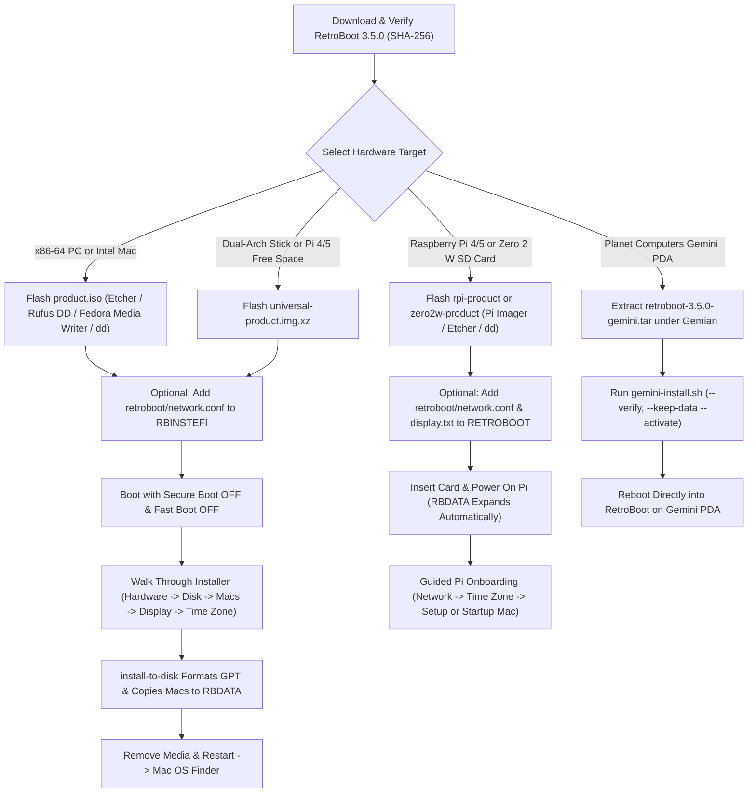

---

## PC & Intel Mac Installer Walkthrough

Boot from the USB stick (`retroboot-installer-3.5.0-product.iso`). After your computer's firmware logo, the RetroBoot checkerboard appears with the Mac OS 9.2-style *Welcome to RetroBoot* startup box while the live environment loads silently underneath.

### 1. Welcome to RetroBoot

Nothing on your computer is modified until you explicitly confirm an erase later in the wizard. Click **Continue** (or **Shut Down** to power off safely).

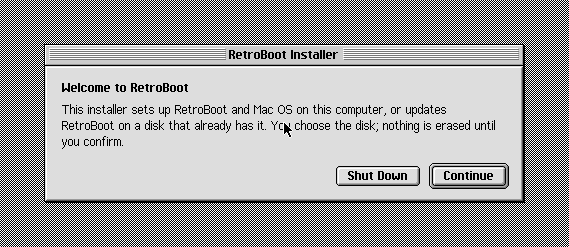

### 2. Hardware Check & Wi-Fi

RetroBoot inspects your display, keyboard, internal/external disks, and network interfaces. From **3.4.0** onward, connected Wi-Fi displays your active SSID and IP address right on this screen, and the **Wi-Fi…** button remains available even when already online (on Ethernet, for example) so you can configure wireless credentials before installing. Any network joined here is automatically copied to the installed system.

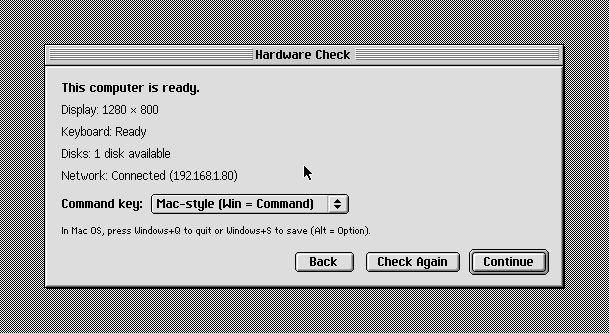

### 3. Choose a Disk & Confirm Erase

Select the target drive (`>= 8 GiB`). The installer's own boot stick, read-only drives, and disks smaller than 8 GiB are hidden or ineligible. Existing operating systems are labeled (`Windows`, **`Windows (encrypted)`** for BitLocker/Device Encryption, `Mac OS`, `Linux`, or `RetroBoot`).

- If the selected drive already has RetroBoot installed, the installer offers **Update** (default) to upgrade the inactive OS slot while preserving all Macs, checkpoints, Wi-Fi profiles, and settings.
- Selecting **Erase and Install…** opens a confirmation alert where **Cancel** is always the default button.

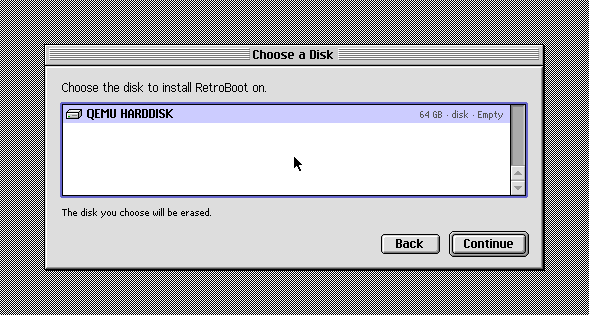

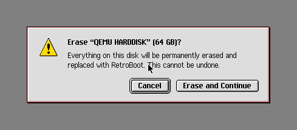

### 4. Choose Macs to Install

Pick one or more Macs from the built-in 13-Mac library—led by **Kids & Family: Mac OS 9.2.2 Mega Deluxe v7** (126 curated titles, Color Oregon Trail, clean ACTION Menus, GoMac Battery Monitor, on-demand Virtual CDs) and **Clean Mac OS 9.2.2**—or add machines from **Image Servers…** or a **USB disk** (`.tar.gz` archives).

- Check multiple Macs and pick which one **Starts first** after installation.
- Choose **Install RetroBoot Only…** if you are offline and want to install the base appliance now and download Macs later via **RetroBoot Setup**.

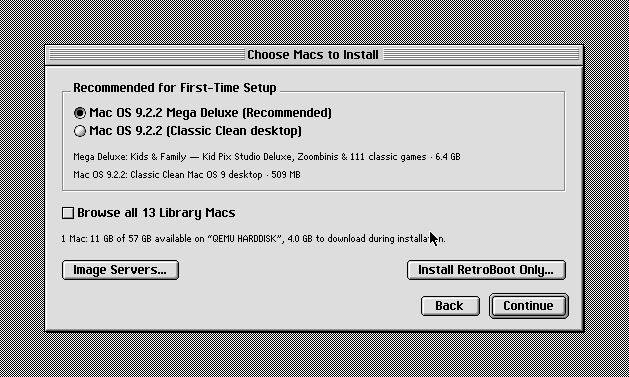

### 5. Display Check & Time Zone

RetroBoot automatically selects the largest integer pixel scale (`1×`–`4×`) that keeps the Mac screen at least `720 × 540`. You can preview alternatives with **Try Resolution** (automatically reverts after 14 seconds if not kept).

Next, in **Time Zone** (enhanced in `3.4.0+`), RetroBoot automatically queries your network's time zone over HTTPS, pre-selects your city instead of defaulting to UTC, shows a live local clock preview, and provides a **Detect** button alongside region and city search filters.

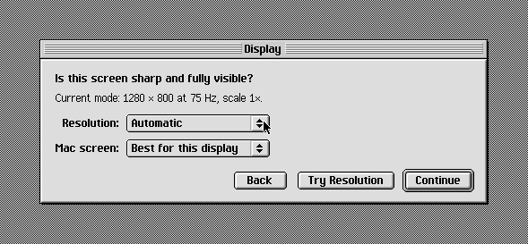

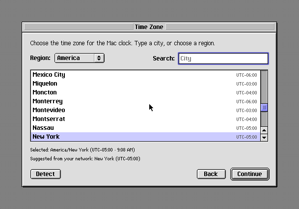

### 6. Network & Web Access (Optional)

When connected to your local network, you can view the installer's HTTPS address, 6-digit pairing code, QR code, and TLS certificate SHA-256 fingerprint to monitor download progress from a phone or another computer.

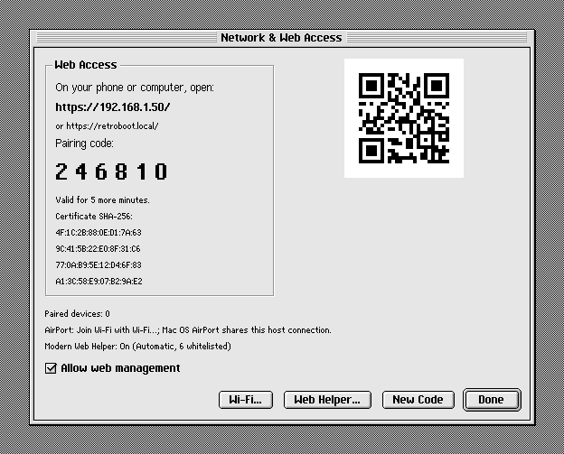

<sub>Example render of RetroBoot's **Network & Web Access** pairing dialog; live installer sessions display your device's own unique pairing code and certificate fingerprint.</sub>

### 7. Installing & First Boot to Finder

During installation, `install-to-disk` creates the 5 GPT partitions (`RBEFI`, `BIOSBOOT`, `RBROOT_A`, `RBROOT_B`, `RBDATA` XFS reflink), copies RetroBoot, writes the GRUB bootloader, and streams selected Mac catalogs directly onto the new `RBDATA` partition with live `MB/s` transfer speed and remaining-time ETA.

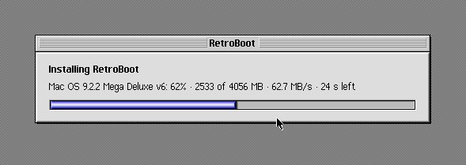

When installation finishes, `rb-live-toram` releases the USB drive so you can pull the stick out safely and click **Restart**:

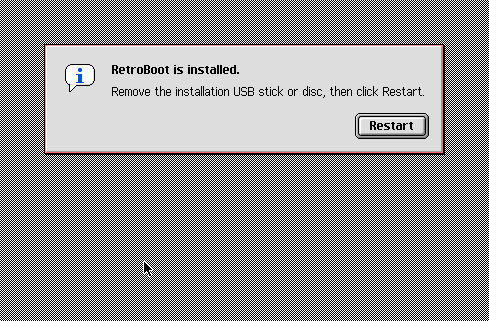

After restarting, RetroBoot transitions directly from the checkerboard into your Mac OS Finder—complete with **RetroBoot Share** and an automatic **Fresh Install** checkpoint (enable **RetroBoot Printer** anytime in **Ctrl+Alt+Delete → Printers…**):

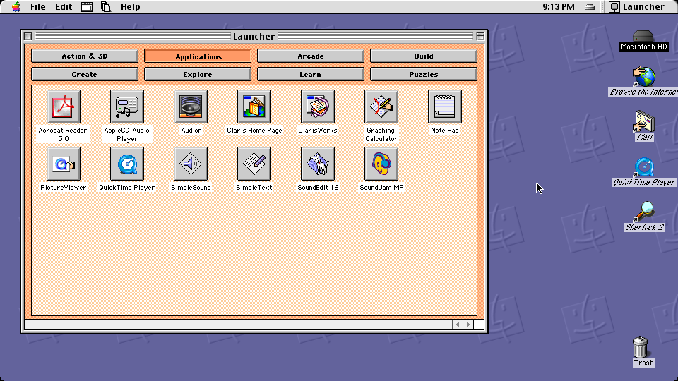

---

## Universal Raw USB / SD Installer

`retroboot-installer-3.5.0-universal-product.img.xz` combines an MBR partition table with a `512 MiB` FAT32 partition (`RBINSTEFI`) containing Raspberry Pi boot firmware/kernel plus `EFI/BOOT/BOOTX64.EFI` for PCs, followed by an ISO 9660 payload partition (`RETROBOOT`) holding both `x86_64` and `aarch64` squashfs roots.

- **On an x86-64 PC or Intel Mac:** Runs the exact same live installer walkthrough above onto an internal or external disk (`>= 8 GiB`).
- **On a Raspberry Pi 4 / 5:** Lets you install either onto **another disk** (such as a USB SSD or second SD card via `--mode disk`), or directly into the **free space at the end of the same SD card/USB stick** (`--mode free-space`). In free-space mode, RetroBoot keeps the installer's partitions intact and saves its configuration as `tryboot.txt`, allowing you to re-enter the installer once at any time via **Recovery → Start Installer…**.

---

## Raspberry Pi 4/5 & Pi Zero 2 W SD Installation

When flashing the dedicated Raspberry Pi SD images (`retroboot-3.5.0-rpi-product.img.xz` or `retroboot-3.5.0-rpi-zero2w-product.img.xz`), no separate PC-style installation step is required:

1. Flash the `.img.xz` to a **16 GB+** microSD card using Raspberry Pi Imager (with OS Customisation **OFF**), balenaEtcher, or `dd`.
2. *(Optional)* Before inserting the card into the Pi, edit `retroboot/network.conf` for Wi-Fi or copy a display preset from `retroboot/displays/` to `retroboot/display.txt` (see `DISPLAY-SETUP.txt` on the `RETROBOOT` FAT partition).
3. Insert the microSD card, connect keyboard/mouse/display, and power on. On first boot, `retroboot-growdata` automatically expands `RBDATA` to fill the rest of the SD card while preserving existing files, and RetroBoot opens its **guided first-start setup**:
   - **Step 1 — Network & Keyboard:** Confirm Ethernet or join a network via **Wi-Fi…**, optionally pair **Bluetooth…** input devices, and choose **Mac-style** vs **PC-style** Command key.
   - **Step 2 — Time Zone:** Automatically detects your city when online (with **Detect**, search, and region filter) so Mac OS's clock matches your local time.

- **Raspberry Pi 4 / 5 / 400 / CM4 / CM5:** Continues into **RetroBoot Setup** so you can pick from the Mac library (68040 and PowerPC Classic editions) or import from USB:

  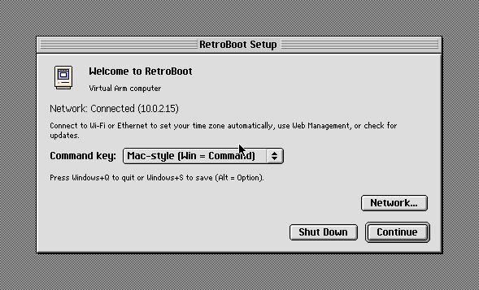

- **Raspberry Pi Zero 2 W:** Connect your keyboard and mouse through a **USB OTG adapter or powered USB hub** (and HDMI or a compatible GPIO DPI display—the Zero 2 W has no DSI port). After Network and Time Zone setup, Zero 2 W lets you choose between its preloaded clean **System 7.5.5 (v2)** and **Mac OS 8.1 (v2)** installs (or click **Download Another Mac…** to browse 68k editions such as **Mac OS 8.1 Mega Deluxe**), then starts Mac OS cleanly and skips onboarding on future boots. *(On the Zero 2 W, PowerPC options are automatically hidden in Startup Disk and Web Storage, and authentic Mac OS icons are extracted locally from your 68k disk by `rbplatinum v8`.)*

  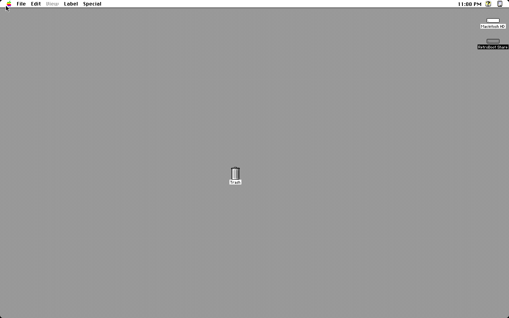

  <sub>Captured on the Raspberry Pi Zero 2 W software profile (`ARM64 QEMU virt` validation); physical Raspberry Pi Zero 2 W hardware testing remains separate.</sub>

---

## Planet Computers Gemini PDA Installation

RetroBoot runs on the Gemini PDA as a dual-boot tree (`/retroboot`) inside Gemian's `PARTNAME=linux` (p29) partition, leaving Gemian intact and keeping a hardware-safe 3-boot fallback (`/.retroboot-boot-attempts` -> `para=boot-recovery` -> Gemian).

1. Boot into **Gemian**, download or copy `retroboot-3.5.0-gemini.tar` onto the device, verify its SHA-256 checksum, and extract it:

   ```sh
   sha256sum -c retroboot-3.5.0-gemini.tar.sha256
   tar -xf retroboot-3.5.0-gemini.tar
   cd retroboot-3.5.0-gemini
   ```

2. Verify payload hashes before modifying any partitions:

   ```sh
   sudo sh gemini-install.sh --verify
   ```

3. Install RetroBoot and activate it for the next boot. For a **fresh install**, run `--activate`; when **upgrading** an existing RetroBoot installation while keeping your Macs, settings, and Wi-Fi profiles, include `--keep-data`:

   ```sh
   # Fresh install and boot into RetroBoot on next restart:
   sudo sh gemini-install.sh --activate

   # Upgrade existing RetroBoot while keeping /var/lib/retroboot data:
   sudo sh gemini-install.sh --keep-data --activate
   ```

   `gemini-install.sh` backs up Gemian's original boot image once to `/retroboot-boot-backup/boot-before-retroboot.img`, unpacks the tree into `/retroboot.new`, swaps `/retroboot` (keeping `/retroboot.old` for rollback), writes `boot.img` to `PARTNAME=boot` with readback verification, and clears `para` so the next reboot starts RetroBoot.

4. **Rollback options:**
   - Return to **Gemian** at any time: `sudo sh gemini-install.sh --rollback` (writes `boot-recovery` into `para`).
   - Restore the **previous RetroBoot tree** (`/retroboot.old` and its matching `boot.img`) from Gemian: `sudo sh gemini-install.sh --rollback previous`.

---

[← Previous](02-architecture-how-it-works.md) · [Table of Contents](README.md) · [Next →](04-first-start-and-mac-library.md)
