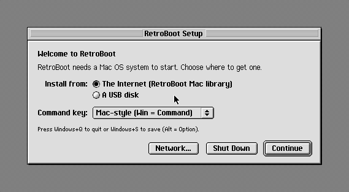
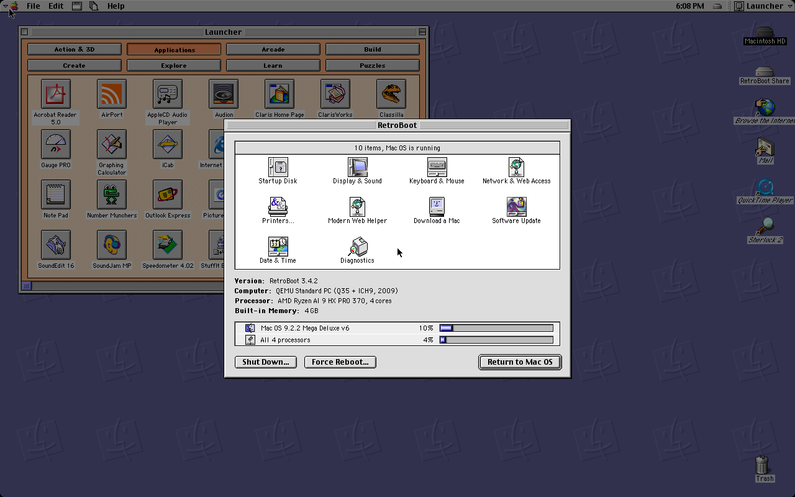
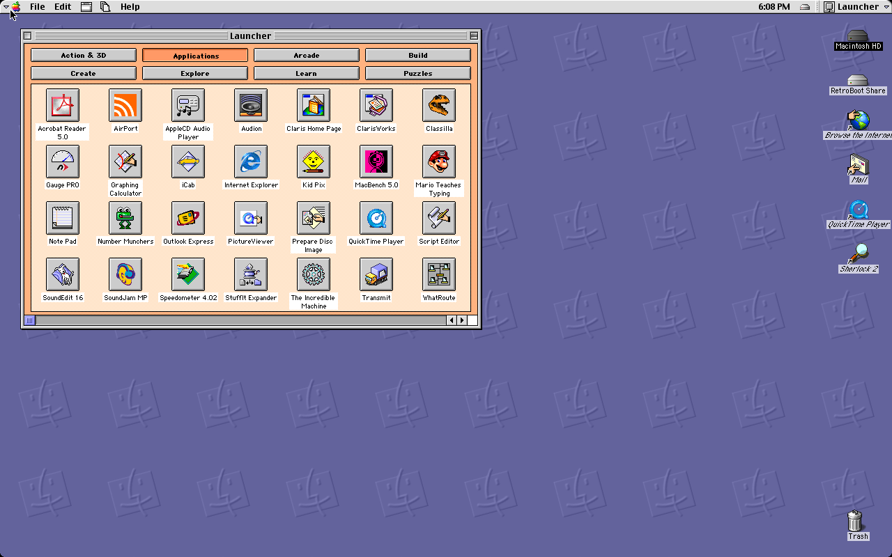
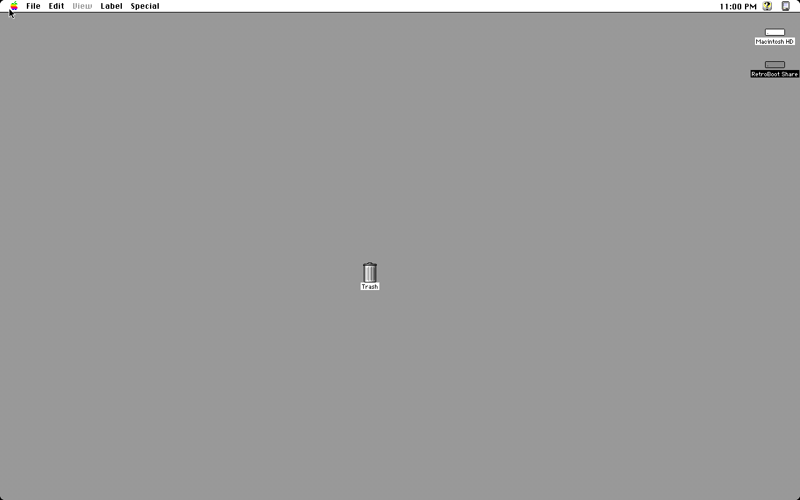
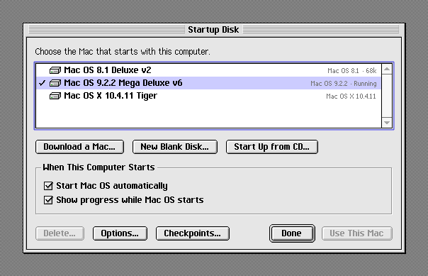
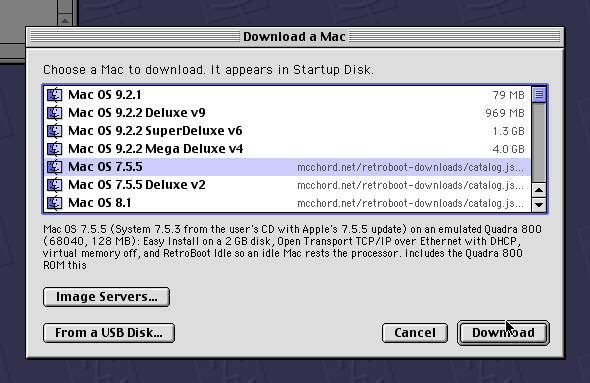
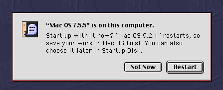

[← Previous](03-installation.md) · [Table of Contents](README.md) · [Next →](05-everyday-use-and-peripherals.md)

# Chapter 4: First Start & The 13-Mac Library

On most installs, turning on the computer plays your startup chime, shows the checkerboard with the Happy Mac progress bar, and hands seamlessly over to your chosen Mac OS desktop. When you install RetroBoot without a pre-staged Mac—such as choosing **Install RetroBoot Only…** on a PC or booting a fresh **Raspberry Pi 4/5** card—first boot opens **RetroBoot Setup** instead.

This chapter covers first-boot setup, every icon in the local **Ctrl+Alt+Delete** Platinum control panel, what RetroBoot prepares automatically on Classic Mac disks, the complete **13-Mac Disk Library** specification, a deep spotlight on **Mac OS 9.2.2 Mega Deluxe v6**, and managing multiple Macs with **Startup Disk** and **Fresh Install** checkpoints.

---

## First-Boot Setup (`RetroBoot Setup`)

If no Mac disk is installed yet when RetroBoot starts, the presenter displays **RetroBoot Setup** (`setup-welcome`) on your screen using RetroBoot's built-in MIT-licensed Platinum interface—no terminal or secondary computer required:

1. **Optional Hardware & Network Prep:**
   - **Command key:** Choose **Mac-style (Win = Command)** or **PC-style (Alt = Command)** right away (also changeable later).
   - **Network…:** Join a Wi-Fi network (or confirm wired Ethernet) before downloading a Mac.
   - **Bluetooth…:** Shown when a Bluetooth adapter is present so you can pair wireless keyboards or mice during setup.
2. **Choose an Install Source:**
   - **The Internet (RetroBoot Mac library):** Browse RetroBoot's built-in **13-Mac catalog** over HTTPS with automatic SHA-256 verification.
   - **A USB disk:** Import a `.tar.gz` Mac archive (with optional `.sha256` sidecar) from an attached USB flash drive.
3. **Time Zone Detection (`3.4.0+`):**
   - If your time zone is still `UTC` and a network connection is up, RetroBoot automatically queries HTTPS geolocation (`ipinfo.io`, `ipwho.is`, `ipapi.co`) to suggest your local IANA time zone. You can click **Detect**, search by city, filter by region, and verify the live local clock preview before clicking **Continue**.
4. **Pick Your Mac in `Download a Mac`:**
   - When **Mac OS 9.2.2 Mega Deluxe** and **Mac OS 9.2.2** are both available and not yet installed, **Download a Mac** highlights them as **Recommended Picks** right at the top:
     - **Mac OS 9.2.2 Mega Deluxe — Recommended:** RetroBoot's flagship family edition with 146 apps and games across 8 Launcher tabs, Kid Pix Studio Deluxe, Zoombinis, Oregon Trail, SimCity, and ClarisWorks 5.
     - **Mac OS 9.2.2 — Classic Clean desktop:** A fast, clean Mac OS 9.2.2 desktop ready for your own software.
   - Check **Browse all 13 Library Macs** to view every 68k, PowerPC Mac OS 9, and Mac OS X edition supported on your hardware.
   - Downloads show live sliding-window transfer speed and ETA (`3.4.0+`), verify SHA-256 checksums, prepare the disk offline, create an automatic **Fresh Install** checkpoint, and prompt you to click **Start Mac OS**.

> [!NOTE]
> If you stop a download partway through, RetroBoot keeps the `.part` file and offers **Resume** next time you open **Download a Mac**, continuing from where it left off.

---

## The Local `Ctrl+Alt+Delete` Platinum Control Panel

Press **Ctrl+Alt+Delete** at any time—whether Mac OS is starting, running normally, or frozen—to open the **RetroBoot** window over the dimmed Mac screen (`hostd/retroboot/panel/controller.py`). Mac OS continues running underneath, and the recovery key chord is intercepted before Mac OS ever sees it. (You can also pause boot on the checkerboard by pressing **Escape** and then **Return** to open **Startup Options**.)

### Control Panel Icons

The icon grid adapts automatically to your hardware capabilities (up to 12 items):

| Icon | Availability | What It Controls |
| --- | --- | --- |
| **Startup Disk** | Always | Choose which Mac starts next, open per-Mac **Options…** (RAM & graphics), manage **Checkpoints…** (including **Fresh Install**), create **New Blank Disk…** (2–64 GB), **Start Up from CD…**, eject mounted USB Share drives, and toggle **Start Mac OS automatically** / **Show progress while Mac OS starts**. |
| **Display & Sound** | Always | Four-tab control panel (`Monitor`, `Sound`, `Keyboard`, plus `Pi Display` on Raspberry Pi) with a live **Main Volume** slider and **Mute** toggle pinned at the bottom. |
| **Keyboard & Mouse** | Always (`3.2.0+`) | Promoted to a top-level icon; opens the `Keyboard` tab directly for Command/Option mapping, recovery chord, pointer speed, **Game controller** (`Arrow keys` / `WASD` / `Off`), **Legacy mouse tracking**, live **Mouse DPI**, **Natural scrolling**, and **Touch gestures**. |
| **Network & Web Access** | Always | Connect to Wi-Fi (**Wi-Fi…**), view the Web UI address, **QR code**, 6-digit pairing code (with **New Code** regeneration), and TLS certificate SHA-256 fingerprint, toggle **Allow web management**, or jump to **Web Helper…**. |
| **Printers…** | Always (`3.3.0+`) | Configure Mac OS 9's virtual **Color LaserWriter 12/600 PS** (`Save as PDF` in `RetroBoot Share/Printed PDFs` or Linux CUPS printer queues), toggle **Also save PDF copy**, run **Test Page**, **Find Printers…** (mDNS/IPP/USB discovery), or **Add by IP…**. |
| **Modern Web Helper** | When available (`3.2.0+`) | Live status and translated page count, enable/disable toggle, **Page view** (`Automatic` / `Simplified pages` / `Full pages`), old home pages → System 7 Today, search engine choice, LAN access toggle, and local **Whitelist…** management. |
| **Bluetooth** | When BT adapter exists | Turn the Bluetooth radio on/off (**Use Bluetooth**), scan and pair keyboards, mice, trackpads, and game controllers, view battery levels, **Forget…** pairings, and toggle **Offer to pair a keyboard when none is connected**. |
| **Download a Mac** | Always | Browse and download from the 13-Mac library, manage custom HTTPS **Image Servers…**, or import `.tar.gz` archives **From a USB Disk…**. |
| **Software Update** | Always | Check for signed over-the-air `.rbu` updates (PC and Raspberry Pi 4/5), install `.rbu` bundles from USB, run **Clean Update** (resetting disks/settings while keeping saved Wi-Fi networks), or roll back on A/B systems. |
| **Date & Time** | Always | Set the Mac OS time zone via region popup, city search, UTC offset, live local clock preview, and network geolocation **Detect**. |
| **Diagnostics** | Always | View RetroBoot & QEMU versions, hardware model, active display mode, Mac OS state & startup timeline, network addresses, last evidence ID, and **Capture Evidence** for troubleshooting bundles. |
| **Start Installer** | Pi cards with installer | Restarts once (`0 tryboot`) into the RetroBoot installer kept on the SD card without overwriting your system. |

### System Facts, Live CPU Meters & Action Buttons

Below the icon grid, the **RetroBoot** window displays an *About This Computer*–style summary and live controls:

- **Hardware Summary:** RetroBoot version, computer model, processor name/core count, and built-in memory.
- **Live CPU Meters (1-second refresh):**
  - **Mac OS bar:** Shows the active Mac's emulator CPU load (or `Paused` / `Not running`).
  - **Host processor bar:** Shows total CPU usage across `All N processors` (or `Processor`).
- **Pending Notices:** Alerts you if a staged Software Update is ready to install or if a newly selected Mac is queued to start on the next restart.
- **Bottom Action Row:**
  - **Shut Down…:** Opens RetroBoot's power dialog (**Restart**, **Cancel**, **Shut Down**) so Mac OS shuts down cleanly before powering off or restarting.
  - **Force Reboot… (`3.2.0+`):** Offers **Force Restart Mac OS** (kills/restarts the stuck emulator) or **Force Reboot Computer** (hard host reboot) with a confirmation warning.
  - **Open:** Opens whichever icon is selected in the grid (clicking an icon once selects it; double-clicking or clicking **Open** launches it).
  - **Return to Mac OS** (or **Start Mac OS** when paused/stopped): Closes the panel and returns immediately to the Mac screen.
- **Unresponsive Mac OS Banner:** If RetroBoot's frozen-guest watchdog detects that Mac OS stopped drawing or answering QMP, a caution banner with **Force Shut Down…** and **Force Restart…** appears automatically above the icon grid.

---

## What `guestprep` Sets Up Automatically on Classic Mac Disks

Whenever a Classic Mac disk is imported—or when a newer RetroBoot update introduces disk-preparation improvements (`PREP_VERSION`)—`rbguestprep` prepares the stopped disk safely on a reflink/sparse copy, verifies every written resource fork, runs `fsck.hfsplus` (or `fsck.hfs` on 68k volumes), and only swaps the updated disk into place once checks pass (`guestprep/rbguestprep/`).

| Automatic Setup | Target OS | What RetroBoot Configures & Why |
| --- | --- | --- |
| **RetroBoot Printer (`Color LaserWriter 12/600 PS`)** | Mac OS 9 | Provisions an LPR Desktop Printer named **`RetroBoot Printer`** (`10.0.2.2`, queue `retroboot`, `LaserWriter 8`, matching `LaserWriter Color 12/600 PS` PPD) with **AppleTalk OFF** (`printer.py`, controlled by `printer.mac_auto_setup`). Preserves any user-created Desktop Printer untouched. |
| **AirPort Software Base Station Disabled on Ethernet** | Mac OS 9 | Moves `System Folder:Extensions:AirPort AP` (1.3) to `Extensions (Disabled)` when using Ethernet (`basestation.py`), avoiding ~0.8–1.6 vCPU seconds of post-Finder startup work; automatically restores it if you switch to the emulated AirPort card. |
| **AppleTalk Inactive** | Mac OS 7.5.5–9.2.2 | Configures AppleTalk Preferences as inactive (`appletalk.py` / `prep68k.py`) unless you customized it, saving ~5 seconds of AARP/ZIP/NBP probing at every startup. |
| **Virtual Memory Off** | Mac OS 7.5.5–9.2.2 | Keeps Virtual Memory off for deterministic emulation performance and clean idle behavior (`prep68k.py` checks `'vm  ' 0` before installing `rbidle`). |
| **Time Synchronizer & City Seeding** | Mac OS 9 | Reads the guest's `loc#` city table (`macloc.py`) and passes `-prom-env retroboot-location=...` at each boot (`macclock.py`) so Mac OS 9.2.2 Time Synchronizer matches your zone without stalling Restart/Shut Down for ~100 s. |
| **USB Overdrive 1.4** | Mac OS 8.5–9.2.2 | Preinstalled and registered on prepared OS 9 disks (`usboverdrive.py`): maps right-click to Control-click, scroll wheel to 3 lines/notch, and middle-click to Command-click when QEMU's `usb-mouse` is attached. |
| **`rbdisplay` (`RetroBoot Display`)** | Mac OS 9 | Installs `RetroBoot Display` and ` RetroBoot Display Startup` in `Extensions` (`ati.py`) so ATI Radeon boots switch automatically from 640×480 to your configured RetroBoot resolution during the extension parade. |
| **`rbidle` (`RetroBoot Idle`)** | 68k (7.5.5–8.1) | Installs `RetroBoot Idle` (`INIT`/`RBid`) in `Extensions` (`prep68k.py`) to keep idle CPU low on Quadra 800 guests (respects user disabling and stays off if Virtual Memory is enabled). |
| **Clean Boot, Awake & DHCP** | Mac OS 7.5.5–9.2.2 | Disables General Controls' improper-shutdown dialog (`'Smrt'` bit `0x40` + removes `Shutdown Check` on 68k), sets Energy Saver desktop (`-300`) and portable (`-360`) sleep timers to **Never**, turns off Software Update's weekly auto-check (`'scpp'` bit `0x8000` so dead Apple servers don't hang Shut Down), and configures TCP/IP for DHCP on `Ethernet` or `AirPort` (preserving custom user configs). |

---

## Complete 13-Mac Disk Library Reference

All **13 ready-to-run Macs** in RetroBoot's built-in public catalog (`lab/catalogs/retroboot-public.json`, minimum app version `3.0.0`) are free to download straight from **Download a Mac** or the RetroBoot installer—no account, password, or manual server configuration required.

- **68k (`quadra800`):** Runs on **x86-64 PCs**, **Raspberry Pi 4/5**, **Raspberry Pi Zero 2 W**, and **Gemini PDA**.
- **PowerPC Classic (`powerMacG4`):** Runs on **x86-64 PCs**, **Raspberry Pi 4/5**, and **Gemini PDA**.
- **PowerPC Mac OS X (`powerMacOSX`):** Runs on **x86-64 PCs** only.

### 1. 68k Classic Macs (`quadra800` — 68040, 2 GiB HFS Disk)

| Catalog ID | Name & OS | Download Size | Installed / Disk Capacity | Required Free Space | Highlights |
| --- | --- | --- | --- | --- | --- |
| `mac-os-7.5.5-v1` | **Mac OS 7.5.5** (`7.5.5`) | `17,354,015` bytes (`16.6 MiB`) | `2,148,532,739` bytes (`2 GiB` cap) | `49,283,072` bytes (`47.0 MiB`) | Clean System 7.5.5 on emulated Quadra 800 (68040, 128 MB default), fast boot with Ethernet & DHCP |
| `mac-os-7-5-5-deluxe-v2` | **Mac OS 7.5.5 Deluxe v2** (`7.5.5`) | `163,596,031` bytes (`156.0 MiB`) | `2,148,532,749` bytes (`2 GiB` cap) | `365,953,024` bytes (`349.0 MiB`) | 23 classic 1990s games, ClarisWorks 5, After Dark, Speedometer 4.02, retro browsers; smooth on Pi Zero 2 W |
| `mac-os-8.1-v1` | **Mac OS 8.1** (`8.1`) | `60,851,270` bytes (`58.0 MiB`) | `2,148,532,737` bytes (`2 GiB` cap) | `204,472,320` bytes (`195.0 MiB`) | Clean Mac OS 8.1 Platinum desktop, Java, OpenDoc, MacLink Plus, Ethernet & DHCP |
| `mac-os-8-1-deluxe-v2` | **Mac OS 8.1 Deluxe v2** (`8.1`) | `219,803,734` bytes (`209.6 MiB`) | `2,148,532,748` bytes (`2 GiB` cap) | `688,914,432` bytes (`657.0 MiB`) | 23 classic games with automatic color mode switching, Thousands of colors, ClarisWorks 5, After Dark; great for Pi Zero 2 W |

### 2. PowerPC Classic Macs (`powerMacG4` — 32 GiB HFS+ Disk)

| Catalog ID | Name & OS | Download Size | Installed / Disk Capacity | Required Free Space | Highlights |
| --- | --- | --- | --- | --- | --- |
| `os921-full-v4` | **Mac OS 9.2.1 (v4)** (`9.2.1`) | `205,784,328` bytes (`196.3 MiB`) | `34,359,738,651` bytes (`32 GiB` cap) | `522,190,848` bytes (`498.0 MiB`) | Clean Mac OS 9.2.1, QuickTime 5, AirPort 2.0.4 wireless, StuffIt, classic browsers |
| `os922-full-v5` | **Mac OS 9.2.2 (v5)** (`9.2.2`) | `207,111,795` bytes (`197.5 MiB`) | `34,359,738,651` bytes (`32 GiB` cap) | `533,725,184` bytes (`509.0 MiB`) | Clean Mac OS 9.2.2, QuickTime 6, AirPort, Classilla & iCab, Acrobat 5, ATI 3D software, crisp RetroBoot Display |
| `os922-deluxe-v10` | **Mac OS 9.2.2 Deluxe v10** (`9.2.2`) | `1,014,419,806` bytes (`967.4 MiB`) | `34,359,738,724` bytes (`32 GiB` cap) | `1,655,701,504` bytes (`1.54 GiB`) | 16 classic games, Audion MP3 player & Groove Salad preset, 3 QuickTime movies, After Dark, on-demand Myst CD, 2 s GoMac delay |
| `os922-superdeluxe-v7` | **Mac OS 9.2.2 SuperDeluxe v7** (`9.2.2`) | `1,382,848,133` bytes (`1.29 GiB`) | `34,359,738,728` bytes (`32 GiB` cap) | `2,249,195,520` bytes (`2.09 GiB`) | 59 classic games (*Harry*, *Mighty Mike*, *Wolfenstein 3D*, *Cro-Mag Rally*), ClarisWorks 5, Home Page 3, SoundEdit 16, Audion, full After Dark, 2 s GoMac delay |
| `os922-mega-deluxe-v6` | **Mac OS 9.2.2 Mega Deluxe v6** (`9.2.2`) | Thin: `4,253,676,005` bytes (`3.96 GiB`) · Classic: `4,288,304,249` bytes (`3.99 GiB`) | `34,359,738,771` bytes (`32 GiB` cap) | `6,847,201,280` bytes (`6.38 GiB`) | Flagship Kids & Family edition: 146 unique apps across 8 tabs in a 4-row Launcher, ACTION Menus™, 7 on-demand Virtual CDs (0 mounted at boot), 2 s GoMac delay, host-governed resolution |

### 3. PowerPC Mac OS X Editions (`powerMacOSX` — x86-64 PCs Only)

| Catalog ID | Name & OS (Build) | Download Size | Installed / Disk Capacity | Required Free Space | Auto-Applied Recommended Settings | Highlights |
| --- | --- | --- | --- | --- | --- | --- |
| `mac-os-x-10-2-8-jaguar-period-v1` | **Mac OS X 10.2.8 Jaguar · Period Edition** (`10.2.8`, `6R73`) | `561,636,513` bytes (`535.6 MiB`) | `17,179,885,838` bytes (`16 GiB` cap) | `1,513,095,168` bytes (`1.41 GiB`) | Default | Classic 2002 Aqua Mac OS X 10.2.8, Camino 0.7, VLC 0.6.2, BBEdit Lite 6.1.2, GLtron 0.70, OnyX 1.3.1 |
| `mac-os-x-10-3-9-panther-period-v1` | **Mac OS X 10.3.9 Panther · Period Edition** (`10.3.9`, `7W98`) | `1,275,715,952` bytes (`1.19 GiB`) | `17,179,885,838` bytes (`16 GiB` cap) | `3,510,632,448` bytes (`3.27 GiB`) | `1024 MB` RAM, `ati-radeon` | Brushed-metal Panther with Exposé, Camino 0.8.4, Smultron 1.1, VLC 0.7.2, Fugu 1.1.3, Maelstrom 3.0.6, GLtron 0.70 |
| `mac-os-x-10-4-11-tiger-period-v1` | **Mac OS X 10.4.11 Tiger · Period Edition** (`10.4.11`, `8S165`) | `1,155,121,688` bytes (`1.08 GiB`) | `34,359,755,020` bytes (`32 GiB` cap) | `3,078,619,136` bytes (`2.87 GiB`) | `1024 MB` RAM, `ati-radeon` | Mac OS X 10.4.11 Tiger with Spotlight & Dashboard, Camino 1.0, Audacity 1.2.6a, Smultron 1.2.5, VLC 0.8.4a, GLtron 0.70 |
| `mac-os-x-10-4-11-tiger-deluxe-v1` | **Mac OS X 10.4.11 Tiger Deluxe** (`10.4.11`, `8S165`) | `8,419,440,145` bytes (`7.84 GiB`) | `34,359,755,072` bytes (`32 GiB` cap) | `12,509,511,680` bytes (`11.65 GiB`) | `2048 MB` RAM, `ati-radeon` | Loaded Tiger edition with **iLife ’06**, **Quake III Arena**, period PowerPC games, creative tools & screensavers |

> [!NOTE]
> `installedBytes` and `diskCapacityBytes` reflect the **logical sparse disk capacity** (2 GiB, 16 GiB, or 32 GiB). Actual disk space consumed on RetroBoot's `RBDATA` XFS partition matches `requiredStorageBytes` and grows only as you save new files inside Mac OS.

---

## Spotlight: Mac OS 9.2.2 Mega Deluxe v6

**Mac OS 9.2.2 Mega Deluxe v6** (`os922-mega-deluxe-v6`) is RetroBoot's flagship Kids & Family edition, bringing together creative studios, classic educational adventures, productivity suites, and arcade favorites in one curated desktop (`apps/reports/mega-deluxe-v6-20261125.md`):

- **146 Unique Titles Across 8 Launcher Tabs:** Apple's **Launcher** is pre-sized to **4 full rows × 7 columns** (28 icons per screen) with **8 category tabs** arranged cleanly across two header rows (**150 Launcher buttons** covering **146 unique applications**, plus **118 Start Menu targets** in ACTION GoMac), verified across `800×600`, `960×540`, and `1280×800`.
- **Featured Family & Creative Favorites:** **Kid Pix Studio Deluxe**, **Kid Pix Studio**, **Logical Journey of the Zoombinis**, **The Oregon Trail**, **Amazon Trail 3rd Edition**, **Magic School Bus (Human Body & Ocean)**, **The Way Things Work**, **SimCity Classic / SimCity 2000**, **DinoPark Tycoon**, **Marble Drop**, **Myst**, and **ClarisWorks 5**.
- **ACTION Menus™ Re-Enabled:** `dACTION Menus™` is active in `System Folder:Extensions`, giving you hierarchical Apple menu submenus (such as **Control Panels ▸**) and the **ACTION Menus Open Windows** menu bar switcher (with startup tips disabled and *Internet Explorer* added to the Compatibility exclusion list).
- **2-Second ACTION GoMac Hover Delay (`dlay=120`):** Moving the pointer to the bottom edge reveals the ACTION GoMac Start Menu and tray only after a **2.0-second** intentional hover—preventing accidental popups while drawing in Kid Pix or playing full-screen games.
- **7 On-Demand Virtual CDs (0 CDs Mounted at Boot):** In v6, all 7 CD-based titles (*Kid Pix Studio*, *The Way Things Work*, *Kid Pix Studio Deluxe*, *Magic School Bus - Human Body*, *Magic School Bus - Ocean*, *Zoombinis Logical Journey*, and *Amazon Trail 3*) plus *Myst* live as standalone `GImg`/`VCDM` `.iso` images on `Macintosh HD` paired with stay-open AppleScript launcher applets. Clicking an app mounts its virtual CD automatically, closes any auto-opened CD Finder window, launches the game, and cleanly unmounts the CD when you quit—leaving **zero CDs cluttering the Desktop at boot**.
- **Host-Governed Boot Resolution:** Mega Deluxe v6 removes the legacy `Display Preferences` (`1024×768`) override while keeping ` RetroBoot Display Startup` enabled, so every screen size (`800×600`, `960×540`, `1280×800`, etc.) boots directly at the resolution RetroBoot chooses for your display.

> [!IMPORTANT]
> **Zero Kid-Proofing Locks (Decision D087):** By design, RetroBoot includes **no PIN gates, parental lockouts, or Web Helper allowlist filters**. Letting kids explore Classic Mac OS freely—clicking into control panels, moving folders, and trying out apps—is part of the experience. Automatic **Fresh Install** checkpoints let you restore a clean system in seconds whenever needed.

---

## Overview of the Other Editions

- **Clean Mac OS 9.2.2 (v5) & Mac OS 9.2.1 (v4):** Fast, minimal bases with QuickTime 6 (v5) or QuickTime 5 (v4), AirPort 2.0.4, Classilla, iCab, Internet Explorer, Netscape, Acrobat Reader 5, and StuffIt. Choose **9.2.2 (v5)** if you want ATI 3D software preinstalled and plenty of room to install your own discs.
- **Mac OS 9.2.2 Deluxe v10:** Includes **16 classic games** (including *Shanghai II*, *Snood*, *Glider PRO*, *Crystal Quest*, *SimCity Classic/2000*, *Bolo*, *Escape Velocity*, *Myst*, *Marathon 2*, *Quake*, *Quake III Arena Demo*), **Audion 3** with 6 extra faces, 6 visualizers, and a ready SomaFM **Groove Salad** playlist, 3 original Apple QuickTime sample movies, **After Dark 4.94** (*2.0 Flying Toasters*), a clean Desktop, and a 2-second ACTION GoMac delay.
- **Mac OS 9.2.2 SuperDeluxe v7:** Expands the game library to **59 classic games** across Arcade, Puzzle & Cards, Strategy & Simulation, Adventure, and Action & 3D (including *Harry the Handsome Executive*, *Mighty Mike*, *Bub & Bob*, *Wolfenstein 3D*, *Angband*, *King's Quest VI*, *Nanosaur*, and *Cro-Mag Rally*), adds **ClarisWorks 5**, **Claris Home Page 3**, **SoundEdit 16**, and the **complete After Dark collection**, with classic Apple menus (`dACTION Menus™` disabled), clean Desktop, and 2-second GoMac delay.
- **System 7.5.5 & Deluxe v2 / Mac OS 8.1 & Deluxe v2 (68k Quadra 800):** Lightweight 68040 editions on 2 GiB HFS disks that boot rapidly and run smoothly even on a **Raspberry Pi Zero 2 W** (512 MB RAM, capped at 128 MB guest RAM on Zero 2 W). The **Deluxe v2** editions pack **23 classic 1990s games**, **ClarisWorks 5**, **After Dark**, **Speedometer 4.02**, retro browsers, and automatic color-depth switching on Mac OS 8.1 Deluxe v2.

- **Mac OS X 10.2.8 Jaguar, 10.3.9 Panther & 10.4.11 Tiger (Period & Tiger Deluxe):** For x86-64 PCs wanting PowerPC Aqua nostalgia. The Period editions bundle period-authentic apps (Camino, VLC, Smultron, Audacity, Fugu, Maelstrom, GLtron), while **Tiger Deluxe** adds **iLife ’06**, **Quake III Arena**, and period PowerPC games and automatically selects **2048 MB RAM** and **ATI Radeon** graphics (`Quartz Extreme` and `OpenGL`) on capable PCs.

---

## Switching Macs, Downloading & Checkpoints (`Startup Disk`)

You can keep multiple Macs installed side by side—for example, Mega Deluxe v6 for family gaming, Clean 9.2.2 for software tinkering, System 7.5.5 for 68k nostalgia, and Tiger Deluxe on an x86 PC.

<table>
  <tr>
    <td align="center">
      
    </td>
    <td align="center">
      
    </td>
  </tr>
</table>

### Switching Macs & Per-Mac Options

1. Press **Ctrl+Alt+Delete** and open **Startup Disk**.
2. Select any installed Mac in the list and click **Use This Mac**.
   - If Mac OS is currently stopped, the new Mac becomes active immediately.
   - If another Mac is currently running, **Startup Disk** marks your selection **Starts next** alongside the **Running** Mac and offers **Restart Now** (or you can finish saving your work and restart later).
3. Click **Options…** on any selected Mac to configure per-Mac **Memory (RAM)** (`64–256 MB` on 68k, `256–896 MB` on PowerPC OS 9, `Automatic` or `128–2048 MB` on Mac OS X—`256–2048 MB` for Tiger) and **Graphics** (`Standard VGA` vs `ATI Radeon (3D)` on PowerPC). These per-Mac overrides are shared directly with the Web UI.
4. You can also create a **New Blank Disk…** (`2–64 GB` sparse disk for installing from a physical CD or ISO), boot once from an optical disc or ISO via **Start Up from CD…** (or **Start Up from Disc…** for OS X), **Eject** attached USB Share flash drives, or **Delete…** unused Macs (RetroBoot protects the currently running, active startup, and sole remaining Mac from accidental deletion).

### Downloading Additional Macs

Open **Ctrl+Alt+Delete → Download a Mac** (or click **Download a Mac…** inside **Startup Disk**) to browse the library, add third-party HTTPS catalogs via **Image Servers…**, or import `.tar.gz` archives **From a USB Disk…**. When a download completes while another Mac is running, RetroBoot asks whether to restart into your new Mac right away or keep it ready in **Startup Disk**:

### Automatic **Fresh Install** & Manual Checkpoints

Every time you download or import a Mac, RetroBoot automatically creates an instant XFS reflink snapshot named **Fresh Install** (`kind="fresh-install"` in `hostd.py`). RetroBoot also takes an automatic pre-repair snapshot before running offline `fsck.hfsplus` / `fsck.hfs` after an unclean shutdown.

- **Save a checkpoint anytime:** Open **Startup Disk → Checkpoints… → Save Checkpoint**. If that Mac is currently running, RetroBoot shuts it down cleanly first so the snapshot is always consistent.
- **Restore a checkpoint:** Select **Fresh Install** (or any saved checkpoint) in **Checkpoints…** and click **Restore…** to return that Mac's disk (and startup memory/NVRAM on Mac OS X) to its exact earlier state in seconds.

[← Previous](03-installation.md) · [Table of Contents](README.md) · [Next →](05-everyday-use-and-peripherals.md)
