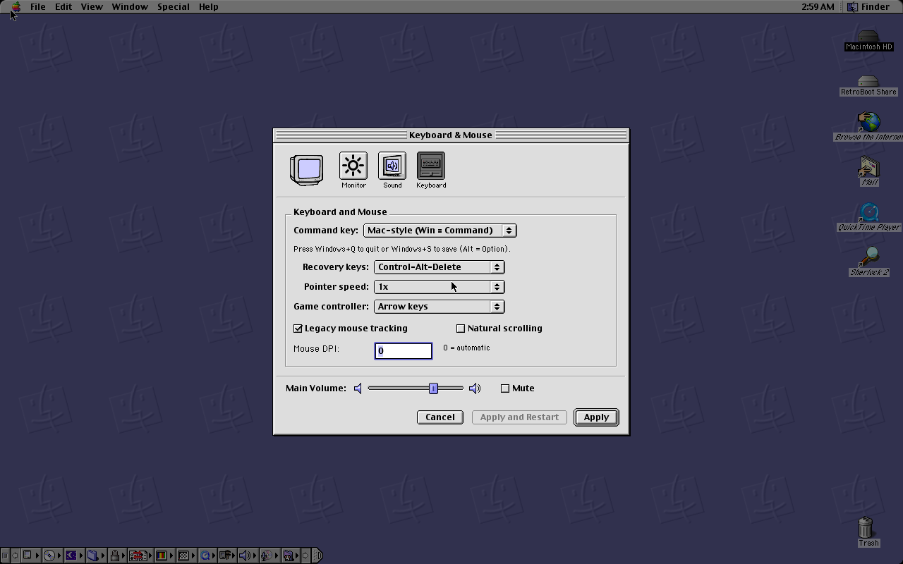
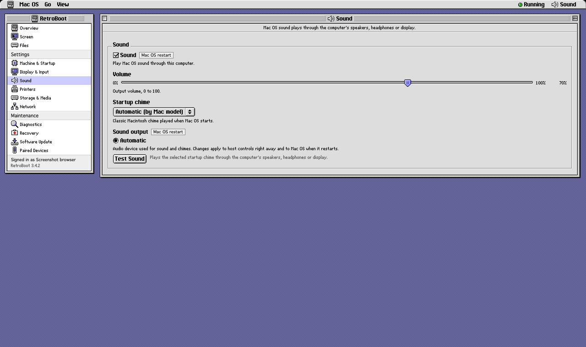
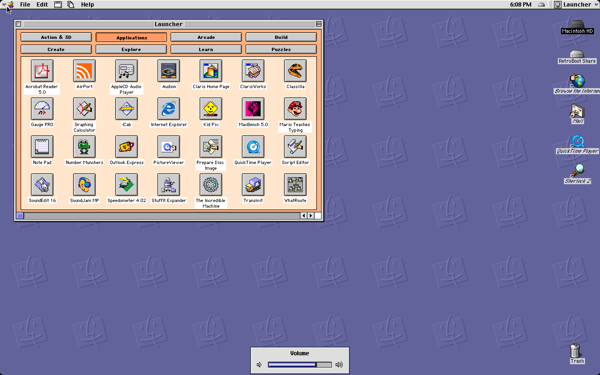
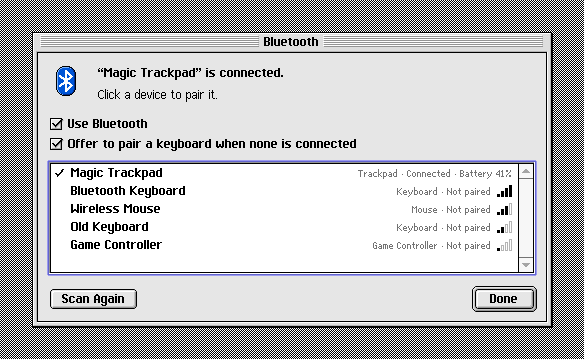

[← Previous](04-first-start-and-mac-library.md) · [Table of Contents](README.md) · [Next →](06-display-and-3d-graphics.md)

# Chapter 5: Everyday Use, Input & Peripherals

In day-to-day use, RetroBoot behaves like a dedicated classic Macintosh: press power to boot directly to the Finder, use your keyboard, mouse, game controller, speakers, or laptop hardware naturally, and choose **Special ▸ Shut Down** when finished. This chapter covers startup chimes, boot progress, clean shutdown and power-button behavior, keyboard and Legacy mouse tracking, game controllers, ALSA `softvol` audio, Bluetooth pairing, and laptop, touchscreen, and stylus support.

---

## Power-On Startup Chimes & Happy Mac Progress

### Startup Chimes

When the boot checkerboard appears, RetroBoot plays a Macintosh power-on chime (when `.wav` chime assets are staged in `/usr/share/retroboot/chimes/` or `RB_CHIMES_DIR`, and host audio is neither muted nor set to `0`). You can choose your favorite chime in **Ctrl+Alt+Delete → Display & Sound → Sound** (or Web **Sound**) via `audio.startup_chime` (`hostd/retroboot/audio.py`):

| Setting | Behavior |
| --- | --- |
| **Automatic (by Mac model)** *(default)* | Plays `quadra` on 68k Quadra 800 Macs (`System 7.5.5` / `8.1`) and `os9` on PowerPC Macs. |
| **Mac OS 9** | Classic Power Mac G3/G4 chime (`os9`). |
| **Quadra** | Early-1990s 68040 Quadra chord (`quadra`). |
| **Power Mac** | PCI Power Macintosh chime (`powermac`). |
| **Mac II** | Macintosh II startup chord (`macii`). |
| **Macintosh SE** | Classic 68000 single-beep chime (`se`). |
| **Off** | Silent startup (`off`). |

RetroBoot prepares the audio output stage (`ucm_prepare`, `hda_output_stage`, `vc4_softvol` / `ensure_softvol`, and `warm_up` on ES8336 codecs) before playing the chime once per launch and waiting for it to finish cleanly before starting QEMU so amplifiers never pop or get cut off on cold boot.

### Happy Mac Progress Bar

While Linux, audio, and the emulator initialize silently underneath the checkerboard, a classic **Happy Mac** sits in the exact coordinates where Mac OS will draw its own startup icon (`presenter/src/startup.c`). Its screen displays a progress bar learned from your machine's recent startup timings (`LAUNCH_MS` / `startup.py`), advancing smoothly until Mac OS draws its first frame—then fading into the smiling Happy Mac in roughly a quarter of a second.

- To show a plain checkerboard without the progress bar on Classic Mac OS, uncheck **Show progress while Mac OS starts** in **Ctrl+Alt+Delete → Startup Disk** (`startup.progress_indicator`).
- Mac OS X guests display Apple's own startup gray screen and spinner instead.

---

## Clean Shut Down, Restart, Power Button & Screensaver Wake

- **Shut Down:** Choose **Special ▸ Shut Down** (Classic Mac OS) or **Apple ▸ Shut Down…** (Mac OS X). Once Mac OS finishes closing its volumes cleanly, RetroBoot powers off the computer automatically without flashing Linux text.
- **Restart:** Choose **Special ▸ Restart** to reboot Mac OS cleanly back through the checkerboard. (On 68k Quadra 800 Macs, RetroBoot implements Restart cleanly as a full guest shutdown followed by a fresh emulator start.)
- **Power Button:** Pressing the computer's physical power button matches a real Macintosh (`hostd/retroboot/supervisor.py`):

| Current State | What Pressing the Power Button Does |
| --- | --- |
| **Mac OS is running** | Sends the Mac ADB power key so Mac OS asks whether to **Restart**, **Cancel**, or **Shut Down** (and offers **Sleep** on laptops). |
| **Mac OS is still starting** | RetroBoot holds the press until the Finder appears, then opens Mac OS's shutdown dialog automatically a few seconds later. |
| **Mac OS is asleep (laptop)** | Wakes Mac OS immediately. |
| **Mac OS is not running** | Shows RetroBoot's own Platinum alert with **Restart**, **Cancel**, and **Shut Down**. |

### Automatic After Dark Screensaver Wake Before Shut Down

Curated editions such as **Deluxe v10**, **SuperDeluxe v7**, **7.5.5 Deluxe v2**, and **8.1 Deluxe v2** include **After Dark** (*Flying Toasters*), which activates after 30 idle minutes. After Dark keeps the emulated Mac busy, draws over Mac OS's Shut Down dialog, and does not dismiss on an ADB power key alone.

Before sending a clean Shut Down or Restart request (from the power button, **Ctrl+Alt+Delete → Shut Down…**, Web Overview, or Software Update), RetroBoot checks whether the Mac menu bar is obscured (`supervisor._wake_screen`). If a screensaver is active, RetroBoot automatically nudges the pointer 8 pixels for 0.5 seconds and back (`qmp.pointer_nudge()`), waits up to `4.0` seconds (`power_wake_settle_s`) for Mac OS to redraw the desktop, and then opens the Shut Down dialog cleanly.

---

## Keyboard & Mouse (`Keyboard & Mouse`)

Open **Ctrl+Alt+Delete → Keyboard & Mouse** (or the **Keyboard** tab inside **Display & Sound**, or **Display & Input** in the Web UI) to tune keyboard shortcuts and pointer feel:

### PC-to-Mac Key Mapping & Recovery Chords

| PC Key | Mac OS Key | Notes |
| --- | --- | --- |
| **Windows** (or Super) | **Command (`⌘`)** | Default **Mac-style (Win = Command)**. |
| **Alt** | **Option (`⌥`)** | Default **Mac-style**. |
| **Ctrl** | **Control** | Used for Control-clicks and terminal/app shortcuts. |
| **Ctrl+Alt+Delete** | Opens **RetroBoot** window | Intercepted by RetroBoot; Mac OS never sees it. |

- **Swap Command and Option (`Command key`):** Switch between **Mac-style (Win = Command)** and **PC-style (Alt = Command)** anytime (`input.swap_command_option`, applies live). If you plug in an Apple keyboard where `⌘` and `⌥` are already in Mac positions, leave this setting on **Mac-style**. (On the Planet Computers Gemini PDA, the presenter's Gemini layer maps Alt to Command and Fn+Alt/Ctrl to Option automatically.)
- **Recovery keys (`input.recovery_chord`):** Choose **Control-Alt-Delete** (default on PC/Pi), **Control-Alt-Backspace** (default on Gemini PDA, where Delete is Fn+Backspace), or **Control-Alt-Escape**.

### Legacy Classic Mac Mouse Tracking (Default ON Since 3.2.0)

Classic Mac OS (System 7, Mac OS 8, and Mac OS 9) was designed around a low-DPI relative mouse whose ballistics are handled inside Mac OS's own **Mouse** control panel. Starting in RetroBoot **3.2.0** (decision D088), **Legacy mouse tracking** (`input.legacy_mouse`) is **enabled by default** (`True`):

- **How it works (`presenter/src/input.c`, `pointer.c`):** When Classic Mac OS is active and you move a local relative mouse, touchpad, or pointing stick, RetroBoot reads unaccelerated raw sensor counts (`libinput_event_pointer_get_dx_unaccelerated` / `dy_unaccelerated`), converts your mouse's physical travel to a nominal **200 DPI** virtual guest mouse (`dpi / 200`), and passes those relative deltas into Mac OS—leaving acceleration curves to Mac OS itself.
- **Mouse DPI (`input.mouse_dpi`, applies live):** Leave at **`0` (automatic)** to let RetroBoot read your device's `udev` `MOUSE_DPI` property (falling back to `1000` DPI if unreported), or type an explicit DPI between **`100` and `100,000`** to fine-tune sensitivity for high-DPI gaming mice.
- **Pointer speed (`input.pointer_speed`, applies live):** Multiplies pointer travel (`0.5×` to `3.0×` in the local panel; `0.25×` to `4.0×` via Web/API).
- **When Legacy tracking stays inactive:** Absolute input sources (touchscreens, stylus pens, KVM tablets, and the Web **Screen** page) and **Mac OS X** guests continue using direct absolute/relative coordinates automatically. Unchecking **Legacy mouse tracking** takes effect when Mac OS restarts.

### USB Overdrive 1.4 & Natural Scrolling

- **Right-click, middle-click & scroll wheel (`pointer.py`, `usboverdrive.py`):** Prepared Mac OS 8.5–9.2.2 disks include registered **USB Overdrive 1.4**, and RetroBoot attaches a virtual `usb-mouse` (with `wheel-per-report=1`) alongside the virtio tablet:
  - **Right mouse button:** Sends **Control-click** to open Mac OS contextual menus.
  - **Scroll wheel:** Scrolls **3 lines per notch** (avoiding USB Overdrive's runaway acceleration mode).
  - **Middle mouse button:** Sends **⌘ Command-click** (open links in new browser windows or toggle Finder selections).
  - **68k Macs (`7.5.5` / `8.1`):** USB Overdrive requires Mac OS 8.5–9.2.2; on 68k Macs, hold **Control** while clicking for contextual menus.
- **Natural scrolling (`input.natural_scroll`, applies live):** Reverses vertical and horizontal scroll direction so window contents move in the same direction as your fingers or wheel.

---

## Game Controllers (`Arrow keys`, `WASD`, or `Off`)

USB gamepads and paired Bluetooth controllers (Xbox, PlayStation, Switch Pro, 8BitDo) work automatically in Classic Mac games without needing Mac OS joystick drivers (`presenter/src/gamepad.c`). While Mac OS is focused (and no RetroBoot panel or diagnostics overlay is open), RetroBoot translates up to 8 connected controllers into refcounted Mac key presses:

Choose **Game controller** in **Keyboard & Mouse** (`input.gamepad_mode`, applies live):
- **`Arrow keys`** *(default)* — D-pad, HAT0, and left analog stick (50% press / 35% release hysteresis) send **Up / Down / Left / Right** arrow keys.
- **`WASD`** — D-pad, HAT0, and left analog stick send **`W` / `S` / `A` / `D`**.
- **`Off`** — Disables gamepad-to-keyboard translation.

| Controller Input | Mapped Mac Key (`Arrows` / `WASD`) |
| --- | --- |
| **D-Pad / Hat / Left Stick** | Arrow keys (or `W` / `A` / `S` / `D`) |
| **South button** (A / Cross) | **Space** |
| **East button** (B / Circle) or **R1** | **Option (`⌥`)** |
| **West button** (X / Square) or **L1** | **Control** |
| **North button** (Y / Triangle) or **Start** | **Return** |
| **Select** (Back / View) | **Escape** |

---

## Sound & ALSA `softvol` (`3.3.0+`)

Manage Mac OS sound, output devices, startup chimes, and volume in **Ctrl+Alt+Delete → Display & Sound → Sound** or the browser **Sound** page (`hostd/retroboot/audio.py`, `network.py`):

<table>
  <tr>
    <td align="center">
      
    </td>
    <td align="center">
      
    </td>
  </tr>
</table>

### Output Selection & Automatic Priority

- **Automatic (`auto`):** At every guest launch, RetroBoot inspects `/proc/asound` and DRM/EDID audio status to pick a real playback PCM:
  - **Desktop PCs:** Prefers an **HDMI / DisplayPort** monitor with valid audio EDID → **Built-in analog speakers / headphone jack** → **USB Audio**.
  - **Laptops (built-in screen as main):** Prefers **Built-in Speakers / headphones** (`analog`) over HDMI so connecting a silent monitor or capture KVM does not steal sound away from the laptop's speakers.
  - **Raspberry Pi 4 / 5:** Prefers the actively driven **vc4-hdmi** port (`HDMI-A-1` / `HDMI-A-2` when EDID advertises audio) → **USB Audio** → Pi 4's 3.5 mm jack (`bcm2835 Headphones`; Pi 5 has no analog jack).
  - **Bluetooth audio:** If a PipeWire/PulseAudio sound server is active and exposes a `bluez` sink (`pactl list short sinks`), **Bluetooth Audio** also appears in **Sound output** (`bluetooth` / `bt:<sink>`). Standard minimal RetroBoot appliance images ship pure ALSA without a PipeWire audio server, so Bluetooth audio sinks only appear when that stack is running.
- **Play Mac OS sound (`audio.enabled`):** Enables or disables QEMU's emulated Screamer/audio device (takes effect when Mac OS restarts).
- **Sound output (`audio.output`):** Pick **Automatic**, **Built-in Speakers**, **HDMI / DisplayPort**, **USB Audio**, or **Bluetooth**. Host controls and **Test Sound** switch immediately; Mac OS audio switches at the next Mac OS restart.
- **Test Sound:** Plays the active startup chime (or a 440 Hz diagnostic tone if chime WAVs are absent) directly through the selected output so you can verify cabling and volume without waiting for Mac OS. Note that **Test Sound** warns if the output is currently muted.

### ALSA `RetroBoot` `softvol` for Mixerless Outputs (`3.3.0+`)

Many HDMI/DisplayPort codecs (such as AMD HD Audio HDMI outputs exposing only `IEC958` switches) and some USB DACs have no hardware playback volume control (`pvolume`). Starting in **RetroBoot 3.3.0** (decision D091):

- RetroBoot's `/etc/alsa/conf.d/50-retroboot.conf` defines `pcm.rb_softvol_keepalive` (for aligned/keepalive HDA and ES8336 codecs) and `pcm.rb_softvol`, wrapping an ALSA `softvol` control named **`RetroBoot`** (`"RetroBoot Playback Volume"`, `-51.0` to `0.0 dB`, 256 steps) over shared `audio`-group `dmix` IPC (`ipc_perm 0660`).
- Before launching QEMU or probing the mixer, `hostd` plays 10 ms of silence (`ensure_softvol`, or `vc4_softvol` on Raspberry Pi `vc4-hdmi` `PCM`) so the software volume control exists immediately. Both `hostd` (`root`) and QEMU (`rbguest`) share the `dmix` sink cleanly—so **Test Sound**, chimes, key clicks, and Mac OS audio all work together without blocking each other.

### Perceptual Volume Hotkeys (`3.2.0+`) & Mute Sync

- Pressing **Volume Up / Down** steps `audio.volume` by **`6%`** (`VOLUME_STEP = 6`).
- `AudioMixer` (`network.py`) applies perceptual loudness scaling rather than raw linear percentages:
  - Controls with ALSA dB metadata (including `RetroBoot` `softvol`) use `amixer -M`.
  - Controls without dB metadata use a **`2.2` power law** (`(percent / 100)^2.2`, clamped to `>= 1%` for non-zero levels).
  - PipeWire/Bluetooth sinks use `pactl set-sink-volume` and `pactl set-sink-mute`.
- **Mute Sync:** Toggling **Mute** in **Display & Sound** or pressing the **Mute** key keeps `laptop.muted` synchronized across the mixer, panel checkbox, and OSD; pressing **Volume Up** or moving the **Main Volume** slider automatically unmutes.

---

## Bluetooth (`Bluetooth`)

On computers equipped with a Bluetooth adapter, **Ctrl+Alt+Delete → Bluetooth** (and **Network → Bluetooth** in the Web UI) manages wireless keyboards, mice, trackpads, and game controllers (`hostd/retroboot/bluetooth.py`). Pairings are stored under `/var/lib/retroboot/bluetooth` on `RBDATA`, so they survive Software Updates and A/B rollbacks.

### Pairing Devices

1. Put your keyboard, mouse, trackpad, or controller into pairing mode.
2. Open **Ctrl+Alt+Delete → Bluetooth** (or click **Scan Again**). Devices in pairing mode appear below already-paired devices, sorted by signal strength.
3. Select the device and click **Pair** (or press **Return**):
   - **Keyboards (Passkey / PIN):** RetroBoot displays a 6-digit code (and counts digits as classic keyboards report them). Type the code on the **Bluetooth keyboard itself** and press **Return** on it. *(If pairing from the Web UI, the code is shown only in the browser that started the pairing.)*
   - **Mice, trackpads & game controllers:** Pair automatically via Just Works (or legacy `0000` PIN).
   - **Numeric comparison devices:** If a device with a screen shows a 6-digit number, verify it matches RetroBoot's prompt and click **Pair**.
4. Paired devices show a **check mark** when connected, their device kind, and **battery percentage** when reported. Use **Connect** to wake an idle paired device, **Forget…** to remove a pairing, or **Use Bluetooth** (`bluetooth.enabled`) to switch the radio off without losing pairings.

### Zero-Keyboard Automatic Setup Assistant

If you start RetroBoot without a wired keyboard attached, RetroBoot never interrupts Mac OS's boot animation:

- **With a mouse/trackpad but no keyboard:** Roughly **25 seconds** after Mac OS reaches the Finder (or is stopped), or **10 seconds** in first-time setup/installer, RetroBoot asks: *“No keyboard is connected. Pair a Bluetooth keyboard?”* Clicking **Not Now** dismisses the prompt until the next restart or keyboard hotplug; uncheck **Offer to pair a keyboard when none is connected** to disable it permanently.
- **With neither a keyboard nor a mouse:** RetroBoot opens its unattended **Bluetooth Setup** window (matching a Mac's Setup Assistant) and automatically pairs the first Bluetooth keyboard or mouse it finds in pairing mode (giving up after **3 minutes** / 180 seconds over the Finder so Mac OS gets the screen back).

### Bluetooth Limits

- **Not available in pre-boot firmware:** Bluetooth keyboards connect once RetroBoot's kernel and checkerboard are running (they cannot open PC BIOS/UEFI menus, though **Escape** on the checkerboard works once connected).
- **Audio vs. HID:** RetroBoot's Bluetooth manager pairs HID input devices; Bluetooth audio sinks are only usable when a PipeWire/Pulse `bluez` sink is present on the host.
- **Unsupported pairing mode:** Devices that ask you to type a code shown on the *device's own screen* onto the computer are not supported.

---

## Laptops, Touchscreens & Stylus Pens

On laptops with a battery, RetroBoot runs PowerPC Mac OS as a **PowerBook** (`via=pmu-adb`, `via-pmu.battery=on`, `hostd/retroboot/battery.py`, `laptop.py`, `keys.py`).

### PowerBook Battery Gauge & Low-Battery Protection

- Mac OS displays real battery charge in the **Control Strip Battery Monitor** and **menu bar** (with a lightning bolt while charging), updating within ~5 seconds of plugging or unplugging AC power. `guestprep` sets Energy Saver's portable **Battery** and **Power Adapter** sleep timers to **Never** so Mac OS doesn't nap unexpectedly while you read.
- RetroBoot's `DrainEstimate` tracks actual discharge slope (`percent/min`) over a rolling window and overrides inaccurate firmware `power_now` estimates when calculating time remaining.
- **Low-battery thresholds:**
  - **15%:** Mac OS shows its own *“You are now running on reserve battery power.”* alert.
  - **8%** *(or <3 minutes projected to floor)*: RetroBoot warns briefly, wakes Mac OS if asleep, triggers a **clean Mac OS Shut Down**, and powers off the laptop.
  - **5%:** If Mac OS is still running, Mac OS puts itself to sleep.
  - **2%** *(or <1 minute projected / 180 s critical timeout)*: RetroBoot forces power-off to protect hardware before battery cut-out.
- Turning off **Show the battery in Mac OS** (`system.battery_passthrough`) in Web **Machine & Startup** switches to desktop Power Mac mode (using RetroBoot's 10% caution and 4% clean shutdown thresholds).

### Brightness, Volume & Mute Keys (Native Mac OS HUD vs. RetroBoot HUD)

- **When Mac OS is at the Finder (`input.mac_os_keys` on):**
  - **Volume Up / Down & Mute** control Mac OS's own sound level and mute state, displaying Mac OS's native **Volume** and **Mute On/Off** HUDs.
  - **Brightness keys** (and the **Brightness** slider in Mac OS's **Monitors** control panel for **Color LCD**) adjust your laptop's real backlight along a 16-step perceptual square-law curve and display Mac OS's native **Brightness** HUD.
- **Outside the Finder** (during boot, while stopped/paused/asleep, or while the **Ctrl+Alt+Delete** panel is open): RetroBoot handles the keys directly on the host and displays a matching Platinum-styled HUD (shown in the sound section above) with a crisp key-click feedback sound.

### Lid, Sleep & Built-in vs. External Displays

- **Closing the lid:** Blanks only the built-in laptop panel (`display_power`). Mac OS continues running—and any connected external display keeps showing Mac OS normally. Opening the lid restores the built-in screen. *(Full host ACPI S3 suspend/resume is not implemented yet.)*
- **Mac OS Sleep:** Choosing **Special ▸ Sleep** (or **Sleep** in the PowerBook power-button dialog) halts the emulated CPU and blanks displays; press any key, click, or press the power button to wake in under a second (moving the pointer alone does not wake it).
- **Main display (`display.primary`):** When an external monitor is plugged into a laptop, **Display & Sound → Monitor → Main** lets you choose **Built-in display** or **External display when connected**. Mac OS sizes itself to the main display and plays audio through its speakers; the secondary display mirrors the picture scaled to fit.

### Touchpad, Touchscreens & Stylus Pens

- **Touchpad:** Tap to click, right-hand area or two-finger click for right-click (Control-click via USB Overdrive), and two-finger drag to scroll 3 lines per step.
- **Touchscreen (`input.touch_gestures`, shown when a touch screen is attached):** Built-in touchscreens map automatically to the internal panel; USB touch monitors pair with external displays by name (`RETROBOOT_OUTPUT` udev override available if needed):

| Touch Gesture | Action in Mac OS / RetroBoot |
| --- | --- |
| **Tap / Tap twice** | Left-click / Double-click |
| **Drag** | Press and drag icons, windows, scroll bars, or text |
| **Touch and hold** | Right-click (Control-click contextual menu; slide to choose an item). On the boot **checkerboard**, opens **Startup Details** (same as **Escape**) |
| **Tap with two fingers** | Right-click (Control-click contextual menu) |
| **Drag two fingers** | Scrolls the window under the pointer (requires USB Overdrive; also scrolls lists in the RetroBoot panel) |

Unchecking **Touch gestures** turns touch into a plain single-button mouse (press, drag, release).

- **Stylus Pens:** Hovering moves the Mac OS pointer accurately; touching the screen with the pen tip acts as a left-click, and pressing the pen's **barrel button** sends a right-click (Control-click contextual menu).

[← Previous](04-first-start-and-mac-library.md) · [Table of Contents](README.md) · [Next →](06-display-and-3d-graphics.md)
