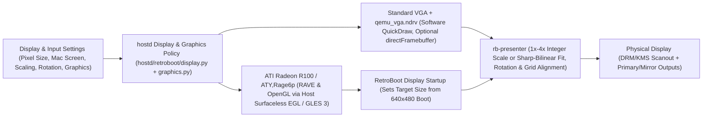
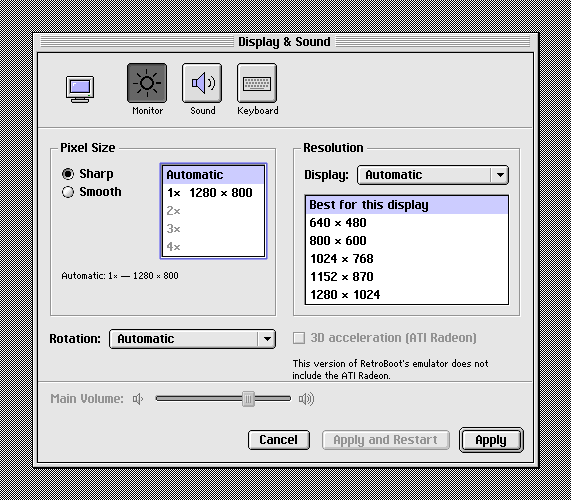
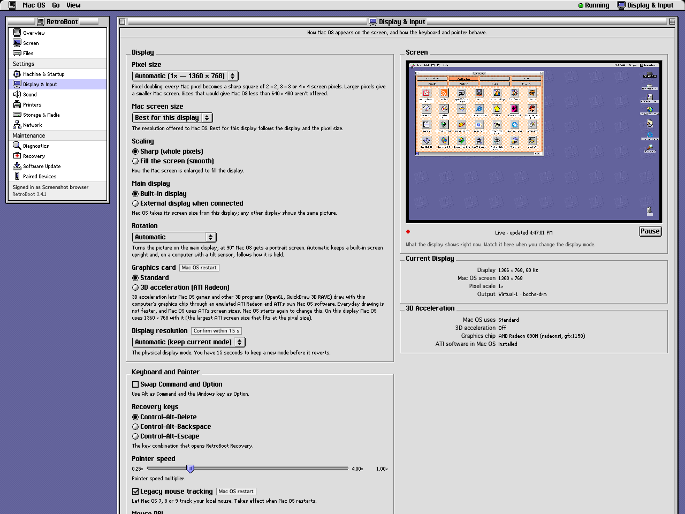

[← Previous](05-everyday-use-and-peripherals.md) · [Table of Contents](README.md) · [Next →](07-networking-airport-and-web-helper.md)

# Chapter 6: Display Scaling & 3D Graphics

Classic Mac OS was designed pixel-by-pixel for crisp 72-dpi displays. RetroBoot preserves that razor-sharp look on modern high-DPI monitors, laptops, and Raspberry Pi screens by aligning the bootloader checkerboard, the local Platinum panel, and Mac OS itself onto a single shared integer pixel grid. This chapter explains integer pixel scaling, the anchored checkerboard, per-Mac screen sizes and physical display modes, **ATI Radeon (`ATY,Rage6p`) 3D acceleration**, **Raspberry Pi DSI/DPI displays**, and **screen rotation and multi-display mirroring**.

---

## Display Composition, Integer Scaling & ATI Radeon EGL Pipeline

---

## Integer Pixel Scaling vs. Smooth `Fill the screen`

Open **Ctrl+Alt+Delete → Display & Sound → Monitor** (or **Display & Input** in the Web UI) to configure how Mac pixels map onto your physical display (`hostd/retroboot/display.py`, `presenter/src/scale.c`):

<table>
  <tr>
    <td align="center">
      
    </td>
    <td align="center">
      
    </td>
  </tr>
</table>

### `Scaling`: `Sharp (whole pixels)` vs. `Fill the screen (smooth)`

- **`Sharp (whole pixels)` (`integer`, default):** Every Mac pixel is drawn as an exact `s × s` square of physical display pixels using nearest-neighbor scaling, centered on a grid-aligned origin. Nothing blurs or shimmers.
- **`Fill the screen (smooth)` (`fit`):** Preserves Mac OS's aspect ratio while stretching to fill the display edge-to-edge using **sharp bilinear** filtering (an exact integer prescale `k = floor(factor)` followed by a single-pass bilinear filter), useful when you choose a fixed 4:3 Mac screen such as `1024 × 768` on a widescreen monitor and prefer no black borders.

### `Pixel size` (`1×`–`4×` and `Automatic`)

RetroBoot offers integer pixel sizes from **`1×`** up to **`4×`**. A numeric scale `s` is offered whenever dividing your display gives a Mac OS screen of at least **`640 × 480`** (up to `3840 × 2160` landscape, or `512 × 640` to `2160 × 3840` portrait), with width rounded down to a multiple of 8 pixels (`floor(W / s / 8) * 8 × floor(H / s)`).

**`Automatic`** picks the largest whole factor `s` that keeps the Mac screen at least **`720 × 540`**:

| Physical Display | `Automatic` Scale | Resulting Mac Screen (`Best for this display`) | Math Check (`long / s >= 720` and `short / s >= 540`) |
| --- | --- | --- | --- |
| **`1280 × 800`** | **`1×`** | `1280 × 800` | `800 / 2 = 400 < 540`, so `1×` is used |
| **`1920 × 1080`** (1080p) | **`2×`** | `960 × 540` | `1920 / 2 = 960`, `1080 / 2 = 540` (`3×` → `360 < 540`) |
| **`2160 × 1440`** (N5105) | **`2×`** | `1080 × 720` | `2160 / 2 = 1080`, `1440 / 2 = 720` (`3×` → `480 < 540`) |
| **`2560 × 1440`** (1440p) | **`2×`** | `1280 × 720` | `2560 / 2 = 1280`, `1440 / 2 = 720` (`3×` → `480 < 540`) |
| **`2560 × 1600`** | **`2×`** | `1280 × 800` | `2560 / 2 = 1280`, `1600 / 2 = 800` (`3×` → `533 < 540`) |
| **`3840 × 2160`** (4K) | **`4×`** | `960 × 540` | `3840 / 4 = 960`, `2160 / 4 = 540` (`5×` → `432 < 540`) |

---

## Anchored DPI-Aware Checkerboard & Seamless Handoff

From the moment the bootloader hands off to the kernel, RetroBoot draws a classic **50% black-and-white dithered checkerboard** (`presenter/src/startup.c`):

- **Exact Alignment:** The checkerboard's origin is anchored to the top-left corner of Mac OS's active screen area (starting with a black square, matching Classic Mac OS's desktop gray pattern). Because GRUB (`rb-bootdisplay` via `retroboot.pixel_scale=`), the early splash, and `rb-presenter` use the exact same geometry rules, nothing jumps or shifts during boot.
- **DPI-Aware Square Size (`rb_checker_multiple`):** On very dense, small screens, single-pixel dither squares blur into flat gray. When DRM/EDID (or RetroBoot's panel quirk table) reports physical dimensions, RetroBoot chooses an integer square multiple (`1`–`8`) targeting **72–110 squares per inch**—for example, `3 × 3`-pixel squares on the GPD MicroPC's 6-inch `1280 × 720` screen.
- **Seamless Handoff:** The Happy Mac progress indicator sits over the checkerboard at the exact coordinates Mac OS will draw its own Happy Mac. As soon as Mac OS paints its startup screen, the progress bar fades into the smiling face in 0.25 seconds.

---

## Per-Mac Screen Size, Physical Modes & 15-Second Auto-Revert

- **Mac screen (`display.guest_size`, applies live):**
  - **`Best for this display` (`auto`):** Gives Mac OS your display divided by the active pixel size (`960 × 540` at `2×` on 1080p, `1280 × 720` at `2×` on 1440p, etc.), using `qemu_vga.ndrv` (or `RetroBoot Display` with ATI Radeon) so Mac OS boots directly to that resolution.
  - **Fixed sizes (`640×480`, `800×600`, `1024×768`, `1152×870`, `1280×1024`):** Centered on the screen. With **Sharp** scaling, RetroBoot draws at your chosen pixel size if it fits, or the largest integer factor that fits (for example, `1024 × 768` on a `1920 × 1080` display drops from `2×` to `1×` with black margins); if a fixed size exceeds the physical display, it smoothly downscales to fit.
  - **In-guest mode changes:** Resolutions chosen inside Mac OS's **Monitors** control panel or by full-screen games (such as *Zoombinis* or *Quake III* switching to `640 × 480`) are preserved and scaled live without fighting the game.
- **Physical Display Resolution (`display.host_mode`):**
  - **`Automatic` (default):** Keeps the firmware's current video mode so the monitor never blanks or switches modes during startup.
  - **Explicit mode (`WxH@R Hz`):** Switches your monitor or TV to any hardware mode it advertises. To protect against out-of-range modes, RetroBoot displays a **15-second confirmation prompt** (**Keep** / **Revert**, with **Revert** as the default). If you do not confirm within 15 seconds—or if you triggered the change from the Web UI without confirming—RetroBoot automatically restores the previous display mode.

---

## 3D Acceleration (Emulated ATI Radeon R100 / `ATY,Rage6p`)

Checking **3D acceleration (ATI Radeon)** in **Display & Sound** (or selecting it under **Graphics card** in the Web UI or per-Mac **Options…**) replaces QEMU's standard VGA card with an emulated **ATI Radeon R100** (`ati-vga,model=r100,vgamem_mb=32`, reported in Apple System Profiler as **`ATI,Rage6p`**, vendor ID `1002`, `32 MB` VRAM). Changes take effect when Mac OS restarts.

### Mac OS 9 vs. Mac OS X Support

- **Mac OS 9 (`RAVE` & `OpenGL`):** Uses Apple/ATI's own Mac OS 9 software (`ATI Driver Update` 1.9.5, `ATI Radeon 3D Accelerator`, `ATI Resource Manager`, and `OpenGLRendererATI`) plus RetroBoot's `RetroBoot Display` (`rbdisplay`) helper and ` RetroBoot Display Startup` extension (`guestprep/rbguestprep/ati.py`). Because ATI's driver always initializes at `640 × 480` on an empty NVRAM, RetroBoot's startup extension switches to your configured screen size during the extension parade.
  - *Missing ATI software on older disks:* Clean `os922-full-v5` and later curated editions already include ATI's software. On older OS 9 disks (such as 9.2.1), add your Mac OS 9.2.1 CD image in **Storage & Media** and click **Install ATI Software…** on Web **Display & Input**.
- **Mac OS X Panther & Tiger (`Quartz Extreme` & `OpenGL`):** On qualified x86-64 builds (`hostd/retroboot/osx_graphics.py`), **Mac OS X 10.3.9 Panther (`7W98`)** and **10.4.11 Tiger (`8S165`)** support hardware-accelerated **Quartz Extreme** and **OpenGL** through the emulated ATI Radeon. Desktop resolution is managed inside Mac OS X **System Preferences → Displays** (when `Best for this display` is selected, `osx_ati_screen` avoids sub-`1024×600` modes like `960×540` and defaults to `1024×768` or `800×600`). **Tiger Deluxe** enables ATI Radeon automatically on capable PCs.
- **68k Macs:** Quadra 800 (`System 7.5.5` / `8.1`) guests use their built-in 68k framebuffer only; ATI Radeon is not offered.

### Host GPU Requirement (`EGL` / `GLES 3`)

At startup, `hostd` probes the host GPU as the unprivileged `rbguest` user (`graphics.probe_host_gl()`):
- Requires `libEGL.so.1`, `libGLESv2.so.2`, an accessible `/dev/dri/renderD*` hardware render node, and an EGL surfaceless **OpenGL ES 3** context (non-software renderer in normal product builds; lab VMs with `graphics_allow_software` can test with Mesa software GL).
- If the host lacks hardware GL or the Mac lacks ATI drivers, RetroBoot disables the option with an explicit explanation and boots safely with the standard card.

### Supported ATI Resolutions & 162 MHz Pixel-Clock Cap

- With emulator packages supporting `ati-edid-modes`, RetroBoot embeds your exact Mac screen size (`640 × 480` through `1920 × 1440`, landscape, width divisible by 8) into the emulated monitor's EDID detailed timing (`hostd/retroboot/graphics.py`).
- Because ATI's Mac OS 9 driver ignores the EDID when the pixel clock exceeds ~165 MHz, RetroBoot tries **`75 Hz`**, **`60 Hz`**, and **`50 Hz`** in order and selects the highest refresh keeping the pixel clock **`<= 162,000 kHz` (`162 MHz`)**.
- **Fallbacks:** Portrait modes, resolutions above `1920 × 1440` (such as `3840 × 2160` at `1×`), or modes exceeding 162 MHz even at 50 Hz automatically select the largest fitting fixed ATI mode (`640×480`, `800×600`, `832×624`, `1024×768`, `1152×870`, `1280×800`, `1280×960`, `1280×1024`, `1600×1200`, `1792×1344`, `1856×1392`, `1920×1080`, `1920×1200`, or `1920×1440`).

### Why 2D Drawing Stays in Software & `directFramebuffer` Compatibility

- **2D stays in software on purpose:** During installation of the `radeon-3d` driver set, `rbguestprep` deliberately leaves `ATI Graphics Accelerator` (ATI's 2D QuickDraw extension) in `Extensions (Disabled)`. Under QEMU emulation, enabling ATI's 2D accelerator made offscreen `CopyBits` operations roughly **40× slower** (`ati.py`). QuickDraw draws directly into VRAM in software while 3D RAVE/OpenGL runs on your host GPU.
- **`directFramebuffer` (`VGA.untracked-vram=on`):** On the standard VGA card, some classic Mac games write directly to framebuffer memory without triggering dirty-page tracking. Machine templates can opt in to `directFramebuffer: true` (`hostd/retroboot/machines.py`), instructing QEMU to scan framebuffer rows and emit only changed lines so idle Finder screens stay low-CPU (used by Deluxe/SuperDeluxe images; off by default).

### Real Benchmark & Compatibility Caveats

Because Mac OS 9's OpenGL and RAVE geometry pipeline runs on the emulated PowerPC CPU before sending triangles to your host GPU, 3D frame rates still depend heavily on single-core host CPU speed:

- ***Quake III Arena* Timedemo (Mac OS 9.2.2, Physical Hardware):** **88 fps** on the AMD Ryzen AI 9 HX 370 mini PC (package r18), **17 fps** on the Intel Celeron N5105 laptop (r18), and **7.2 fps** on the GPD MicroPC Celeron N4100 (r16). *(Unplayable in Apple's software renderer on the standard VGA card.)*
- ***Cro-Mag Rally* (Mac OS 9.2.2, Ryzen HX 370, `1920 × 1080`):** Runs with full sound at **~175 fps** in menus and **30–36 fps** in races (RetroBoot `2.0.0+` non-blocking GPU readback and GPU back-buffer clear), bounded by Mac OS OpenGL on the emulated G4.
- ***Speedometer 4.02* Monochrome Graphics Test:** When ATI Radeon 3D acceleration is enabled, Speedometer skips its monochrome Graphics benchmark (*“does not support monochrome graphics”*). Switch back to Standard graphics if you want a full 4-part Speedometer score.
- **VM vs. Physical Hardware Caveat:** Proxmox VM QA verifies driver loading, modesetting, and rendering correctness (typically via Mesa software GL when no GPU is passed through); real 3D frame rates and display sync require testing on physical GPU hardware.

---

## Raspberry Pi Displays (`Pi Display`)

HDMI displays work out of the box on all Raspberry Pi models, and official Raspberry Pi DSI touchscreens are auto-detected on Pi 4 and Pi 5 (`hostd/retroboot/rpidisplay.py`, `docs/guide/raspberry-pi-displays.md`). Note that the Raspberry Pi Zero 2 W has no DSI connector.

### Supported Presets

| Preset File (`retroboot/displays/`) | Display | Supported Boards & Notes |
| --- | --- | --- |
| `auto.txt` *(default)* | Automatic (`HDMI` or official `DSI` auto-detect) | Pi 4, Pi 5, Zero 2 W (HDMI only) |
| `hdmi.txt` | HDMI (`display_auto_detect=0`) | Pi 4, Pi 5, Zero 2 W |
| `dsi-touch.txt` | Original Raspberry Pi 7-inch Touch Display (`800 × 480`) | Pi 4, Pi 5 (`vc4-kms-dsi-7inch`; connect to Pi 5 **CAM/DISP1**) |
| `dsi-touch2-5.txt` | Raspberry Pi 5-inch Touch Display 2 (`720 × 1280`) | Pi 4, Pi 5 (`vc4-kms-dsi-ili9881-5inch`; Pi 5 **CAM/DISP1**, 22-way to 15-way cable; use Rotation for landscape) |
| `dsi-touch2-7.txt` | Raspberry Pi 7-inch Touch Display 2 (`720 × 1280`) | Pi 4, Pi 5 (`vc4-kms-dsi-ili9881-7inch`; Pi 5 **CAM/DISP1**) |
| `hyperpixel4.txt` | Pimoroni HyperPixel 4.0 (`800 × 480` landscape) | Pi 4, Pi 5, Zero 2 W (`vc4-kms-dpi-hyperpixel4,rotate=90`) |
| `hyperpixel4-square.txt` | Pimoroni HyperPixel 4.0 Square (`720 × 720`) | Pi 4, Pi 5, Zero 2 W (`vc4-kms-dpi-hyperpixel4sq`; touch requires newer board marked **HyperPixel XP**—pre-2021 Square boards need a legacy driver outside this preset's touch support) |

> [!WARNING]
> **HyperPixel GPIO & Audio Trade-offs:** HyperPixel 4.0 and 4.0 Square occupy the 40-pin GPIO header and automatically disable GPIO serial (`enable_uart=0`), I2C (`dtparam=i2c_arm=off`), SPI (`dtparam=spi=off`), and analog audio (`dtparam=audio=off`). Remove other GPIO accessories before connecting, and use HDMI or USB audio for sound. On **Pi 5**, DSI/DPI panels and HDMI are separate display devices—simultaneous mirroring between them is not implemented.

### Safe One-Start Trial & Offline SD Card Recovery

1. **Changing displays safely (`Ctrl+Alt+Delete → Display & Sound → Pi Display` or Web `Display & Input`):**
   - Pick your connected display preset and click **Try Next Start**, then click **Restart Computer** (restarting Mac OS alone does not reload Raspberry Pi device-tree overlays).
   - Before Mac OS launches on that trial boot, `hostd` writes the previous working preset back onto the SD card (`retroboot/display.txt`) while letting the trial boot continue.
   - Once you see the display working, open **Pi Display** and click **Keep Display** to save it permanently. If the screen stays blank or unreadable, simply power-cycle or restart the Pi once—it reverts automatically to your previous working display.
2. **Offline SD recovery:** If a manual edit or incompatible overlay prevents RetroBoot from booting far enough to run the trial recovery, power off the Pi, insert the SD card into another computer, copy `retroboot/displays/auto.txt` (or `hdmi.txt`) over `retroboot/display.txt` (keeping the exact filename `display.txt`), eject safely, and boot again. (`DISPLAY-SETUP.txt` on the boot partition summarizes these same steps.)

---

## Rotation & Multi-Display Outputs

Open **Display & Sound → Monitor → Rotation** (or Web **Display & Input**) to rotate the display (`docs/guide/rotation-and-touch.md`):

- **Rotation modes (`display.rotation`, applies live):**
  - **`Automatic` (`auto`, default):** Keeps sideways built-in panels upright automatically (such as the GPD MicroPC's portrait-mounted `720 × 1280` panel), and on convertibles/tablets with an accelerometer, rotates smoothly after holding still for 0.5 seconds (laying flat preserves the current orientation).
  - **`Standard` (`0°`)**, **`90° clockwise` (`90°`)**, **`180°` (`180°`)**, and **`90° counterclockwise` (`270°`)**.
- **Rotation Lock (`display.rotation_lock`):** Shown only when an accelerometer is detected; locks the current orientation while **Automatic** is selected.
- **Portrait Mac OS screens:** At `90°` or `270°`, **Mac OS itself switches to a portrait resolution** (`536 × 960` at `2×` on 1080p, `800 × 1280` on `1280 × 800`; fixed sizes `1024 × 768`, `800 × 600`, and `1280 × 1024` turn to `768 × 1024`, `600 × 800`, and `1024 × 1280`, while `640 × 480` and `1152 × 870` stay centered). On subsequent boots, the checkerboard and Happy Mac also start in the saved rotation.
- **Primary vs. Mirror Outputs (`display.primary`):** On laptops or multi-display systems, **Main** selects whether Mac OS takes its resolution from the **Built-in display** or **External display when connected**. The secondary display mirrors the Mac screen scaled to fit (upright with pillarbox bars if the primary display is rotated to portrait).

[← Previous](05-everyday-use-and-peripherals.md) · [Table of Contents](README.md) · [Next →](07-networking-airport-and-web-helper.md)
