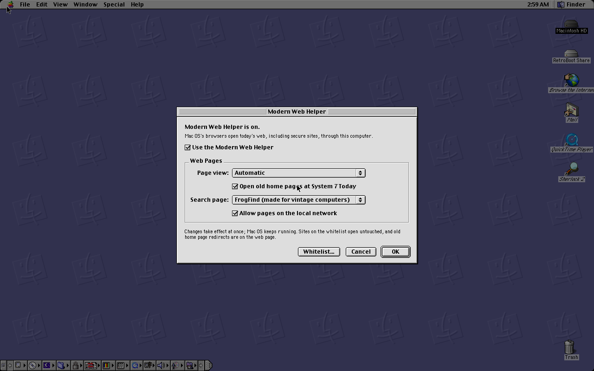
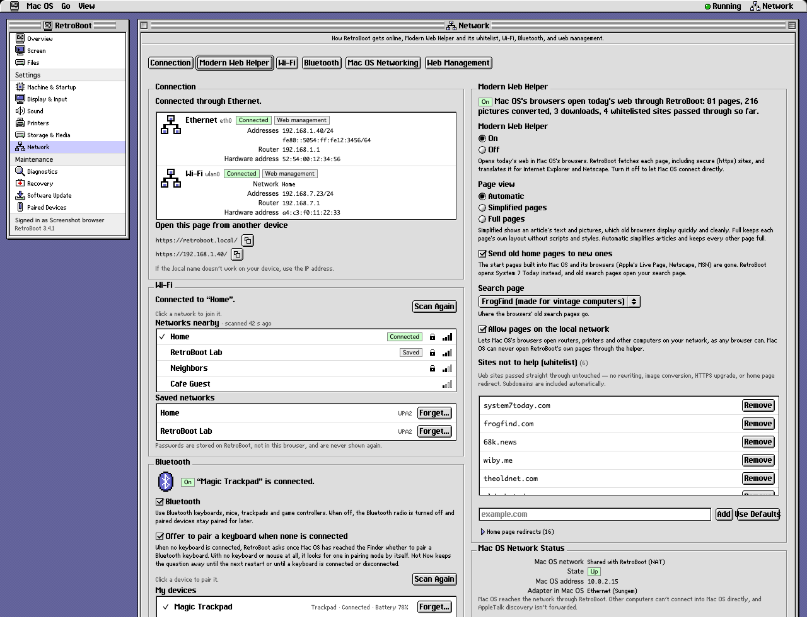
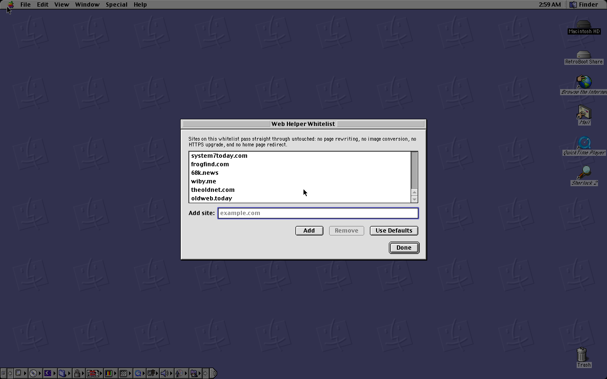
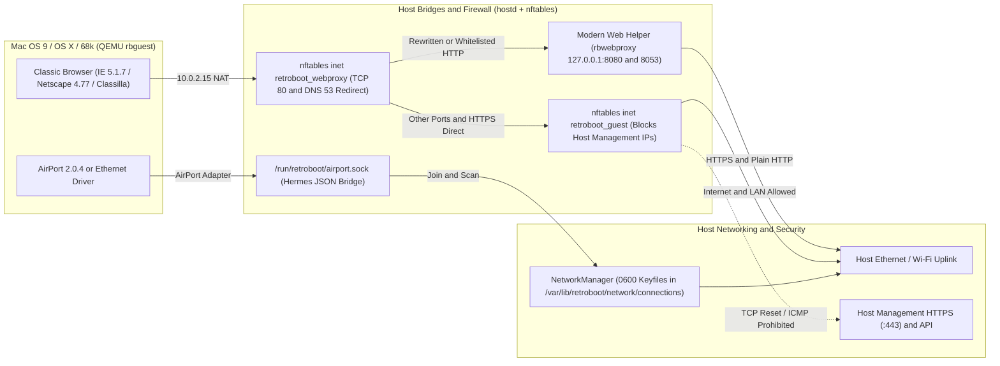

[← Previous](06-display-and-3d-graphics.md) · [Table of Contents](README.md) · [Next →](08-files-usb-and-printing.md)

# Chapter 7: Networking, AirPort, and the Modern Web Helper

RetroBoot separates **how the host computer gets online** from **how Mac OS sees the network**. The host manages Ethernet and Wi-Fi through Linux's NetworkManager, shares that uplink with Mac OS over an isolated virtual subnet, and can either present a classic **Ethernet** card (the default) or an emulated **Apple AirPort** card controlled by Apple's original AirPort 2.0.4 software. On top of that connection, RetroBoot's **Modern Web Helper** (`rbwebproxy`) lets 1999 browsers open modern HTTPS websites cleanly without exposing RetroBoot's management services to Mac OS.

---

## 7.1 Host Wi-Fi & Ethernet

RetroBoot itself connects to your network over wired **Ethernet**, **Wi-Fi**, or both. Mac OS never waits for a network connection at startup—even offline, Mac OS boots directly to the Finder.

### Connecting from the Local Panel or Web UI

You can manage host Wi-Fi from either the local classic panel or the paired Web UI:

- **Local panel:** Press **Ctrl+Alt+Delete** (or your configured recovery chord) and open **Network & Web Access… ▸ Wi-Fi…**.
- **Web UI:** Open **Network** and scroll to the **Wi-Fi** window.

Both interfaces work like the classic AirPort menu:

1. Nearby networks are listed by signal strength, with a check mark (**✓**) next to the currently joined network and a padlock icon on secured networks.
2. Click any network once to join it. Secured networks prompt for a password (8–63 characters, or a 64-digit hex key) with a **Show password** checkbox.
3. Previously joined networks appear under **Saved networks** and can be removed at any time with **Forget…**.

> **Realtek RTL8821CE adapters:** RetroBoot automatically disables Wi-Fi power saving on Realtek RTL8821CE and related adapters. In hardware testing on the Celeron N5105 laptop, deep power saving caused system freezes and light power saving slowed network responses by 50–100×.

### Headless Wi-Fi Setup (`retroboot/network.conf`)

Before booting the installer or Raspberry Pi image for the first time, you can pre-configure Wi-Fi by renaming `retroboot/network.conf.example` to `retroboot/network.conf` on the **RBINSTEFI** FAT partition (PC installer) or the **RETROBOOT** FAT boot partition (Raspberry Pi):

```ini
WIFI_SSID=My Network
WIFI_PASSWORD=my wifi passphrase
# WIFI_SECURITY=wpa-psk   # wpa-psk (default for passwords), sae (WPA3-only), or open
# WIFI_HIDDEN=no          # set to yes for hidden SSIDs
```

The file must be 4 KB or smaller. RetroBoot imports it once on boot into a NetworkManager profile and never prints or logs the password.

### Credential Isolation

Wi-Fi passwords stay strictly on the host computer:

- Profiles are written as `0600` root-owned NetworkManager keyfiles under `/var/lib/retroboot/network/connections` (on the `RBDATA` partition, so saved networks survive A/B system updates and **Clean Update**).
- Passwords are never passed on `nmcli` command lines, never stored inside Mac OS, never returned to browsers, and automatically redacted from logs and diagnostic evidence bundles.

---

## 7.2 Mac OS NAT Networking & Firewall Isolation

In **Network ▸ Mac OS Networking**, two settings govern how Mac OS connects (both require a **Mac OS restart** to take effect):

| Setting | Choices | Default | Notes |
| --- | --- | --- | --- |
| **Mac OS networking** (`network.guest`) | *Share this computer's connection* (`nat`), *No network* (`none`) | Share (`nat`) | `none` disconnects Mac OS completely (`-nic none`). |
| **Mac OS network adapter** (`network.guest_adapter`) | *Ethernet*, *AirPort* | Ethernet | PowerMac only; falls back to Ethernet if AirPort software is absent. |

With sharing enabled, QEMU's user-mode network stack (SLIRP) assigns Mac OS fixed DHCP values:

- **IP Address:** `10.0.2.15`
- **Router / Gateway:** `10.0.2.2`
- **DNS Server:** `10.0.2.3`

Because Mac OS sits behind NAT:
- Mac OS can make outbound connections to the internet and local network, but computers on your LAN cannot initiate connections into Mac OS, and AppleTalk broadcasts do not cross the NAT boundary.
- RetroBoot only updates Mac OS's TCP/IP preferences if the disk is still using RetroBoot's DHCP setup; any custom manual IP configuration you create in Mac OS is left untouched.

### Host Protection (`nftables inet retroboot_guest`)

QEMU's user-mode NAT maps the guest's `10.0.2.2` (and `10.0.2.0/24` other than the DNS proxy) directly to host loopback. To prevent software running inside Mac OS from reaching RetroBoot's management web server, API, or host services, `retroboot-guestnet.service` loads a permanent `nftables` filter table (`inet retroboot_guest`) before the guest starts, and `hostd` verifies it on startup and before every launch.

Every packet sent by the unprivileged `rbguest` QEMU user (`meta skuid`) toward any local host address (`fib daddr type local`, covering `127.0.0.0/8`, `::1`, and all host interface IPs) is blocked **except** for the specific internal bridges Mac OS needs:

- **DNS:** UDP/TCP port `53` (host resolver stub) and port `8053` (Modern Web Helper DNS forwarder).
- **Modern Web Helper:** TCP port `8080` (transparent HTTP redirect / explicit proxy).
- **Virtual Printer:** TCP ports `515` (LPD), `631` (IPP), and `9100` (AppSocket/JetDirect).

All other connections from Mac OS to the host receive an immediate TCP reset or ICMP `admin-prohibited` rejection rather than hanging. Inbound management traffic from your LAN and host-side services are unaffected.

---

## 7.3 Native Apple AirPort 2.0.4

When **Mac OS network adapter** is set to **AirPort** (Power Mac guests only), QEMU replaces the default `sungem` Ethernet controller with an emulated Lucent/Apple Hermes wireless card (`retroboot-airport`) attached to `hostd` over `/run/retroboot/airport.sock` (`AF_UNIX` `SOCK_STREAM`, newline-delimited JSON).

Inside Mac OS 9, Apple's original **AirPort 2.0.4** software (AirPort application, Control Strip module, and Admin Utility—preinstalled in RetroBoot's Mac OS 9 systems) sees and drives the card natively:

- **Control Strip & AirPort application:** Open the AirPort Control Strip tile or the **AirPort** application to toggle the card on/off, watch the animated radar signal meter, inspect the AirPort ID and Base Station ID, and scan nearby networks.
- **Real Wi-Fi vs. Wired/VM fallback:** When the host has a supported Wi-Fi adapter, Mac OS lists the networks the host radio sees. On a computer without Wi-Fi hardware (such as a wired desktop or Proxmox VM), the bridge presents a single open network named **RetroBoot** that mirrors the wired connection.
- **Name translation:** Host UTF-8 SSIDs are converted to the Mac OS Roman character set and truncated to 32 bytes (outside characters simplify where possible or become `?`). Duplicate names receive sticky `" 2"`, `" 3"` suffixes stored in `/var/lib/retroboot/state/airport-names.json`. Hidden networks do not appear in the scan list, but can be joined by name via **Other…**; 802.1X Enterprise networks are omitted.

### Provisional Association & Local Password Window

Classic AirPort 2.0.4 only understands open networks and legacy 40/128-bit WEP keys—it has no concept of WPA2 or WPA3, and it abandons any join attempt that takes longer than about **2 seconds**. RetroBoot bridges that gap without weakening security:

1. **No fake WEP keys:** Joinable networks are advertised to Mac OS without the legacy privacy bit, so Mac OS 9's old WEP password box never appears.
2. **Provisional association:** When you pick a network in Mac OS, `hostd` answers immediately with a provisional association so AirPort 2.0.4 does not time out, while performing the real NetworkManager join in the background.
3. **Local password prompt:** If the chosen WPA/WPA2/WPA3 network has no saved NetworkManager profile on the host, `hostd` dims the Mac OS screen and displays RetroBoot's own classic **Wi-Fi Password** window (`airport-password`) locally on the computer. Your passphrase goes straight to NetworkManager—never into Mac OS. Wrong passwords re-prompt up to 3 times; clicking **Cancel** suppresses another prompt for that network for 60 seconds and keeps Mac OS aligned with the host's active network.
4. **Startup & Radio Off:** At Mac OS startup, `hostd` (`AirPort.prepare_launch`) seeds AirPort's preferences with the host's current network so Mac OS arrives at the Finder already online, without ever altering host Wi-Fi or showing a password dialog during boot. Choosing **Turn AirPort Off** in Mac OS disconnects only the emulated card—the host Wi-Fi radio stays on so Web Management remains reachable.

### Ethernet vs. AirPort Tradeoffs

| Aspect | Ethernet (`sungem`, Default) | AirPort (`retroboot-airport`) |
| --- | --- | --- |
| **Supported guests** | Mac OS 9, Mac OS X, and 68k (Quadra 800) | Power Mac Mac OS 9 with AirPort 2.0.4 installed (OS X and guests lacking AirPort software automatically stay on Ethernet) |
| **Setup** | Zero configuration; DHCP on `en0` | Requires switching `Mac OS network adapter` to **AirPort** and restarting Mac OS |
| **AirPort AP (Software Base Station)** | Automatically disabled (`Extensions:AirPort AP` moved to `Extensions (Disabled)` by `rbguestprep`), saving ~0.8–1.6 vCPU seconds at startup in lab measurements | Automatically restored to `Extensions` so the AirPort 2.0.4 installation remains complete |
| **Qualification** | Default adapter across all platforms | Verified in Proxmox lab VMs (AIR-01/AIR-02) and on Intel AX200, Intel 7265, and Realtek RTL8821CE hardware (AIR-03); WPA3-only and AP roaming remain unverified on physical hardware |

---

## 7.4 Modern Web Helper (`rbwebproxy`)

Vintage Mac browsers cannot negotiate TLS 1.2/1.3 cipher suites, execute modern JavaScript, parse CSS Grid/Flexbox, or decode WebP, AVIF, and SVG graphics. RetroBoot's **Modern Web Helper** (`rbwebproxy`) solves this transparently on the host.

RetroBoot's Mac OS 9 system ships with four preconfigured browsers:
- **Internet Explorer 5.1.7** (default and most extensively tested with the helper)
- **Netscape Communicator 4.77**
- **Classilla 9.3.4b** (verified in the lab)
- **iCab 2.9.9** (installed and configured; not yet benchmarked against the others)

### How Transparent Rewriting Works

The Modern Web Helper runs as a sandboxed, unprivileged systemd unit (`retroboot-webproxy.service`, `DynamicUser`, `MemoryMax=384M`, serving only sockets owned by the `rbguest` UID). When **Modern Web Helper** (`network.web_proxy`) is **On** (the default):

- Outbound guest TCP port `80` traffic is redirected by `nftables` (`inet retroboot_webproxy`) to `127.0.0.1:8080`, and guest DNS queries (`53`) are routed through the helper's DNS forwarder on port `8053`. (You can also point a browser explicitly at HTTP proxy `10.0.2.2:8080`.)
- Type web addresses **without `https://`** (for example, `en.wikipedia.org` or `news.ycombinator.com`). The helper checks whether the destination supports HTTPS, fetches the modern page upstream using strict TLS certificate verification, strips scripts and stylesheets, converts SVG/WebP/AVIF/modern images into JPEG or GIF (scaled to max width `640` px, JPEG quality `72`), and encodes text into Mac OS Roman.
- Classic Mac downloads (`.sit`, `.sea`, `.hqx`, `.bin`, `.dmg`, `.img`, `.smi`) pass through with proper headers/types so Internet Explorer and Netscape hand them straight to StuffIt Expander or Disk Copy.
- Turning the helper **On** or **Off** takes effect **live** without restarting Mac OS or the browser. When turned **Off**, the `nftables` redirect table is removed and Mac OS connects directly to the internet.





### Page View & Search Settings

- **Page view (`network.web_proxy_view`):**
  - **Automatic** (default): Renders articles in Simplified View and keeps search engines, home pages, forms, and portals in Full View.
  - **Simplified pages:** Extracts the main article body (title, text, images, tables, links) for fast, clutter-free rendering.
  - **Full pages:** Keeps the entire HTML structure without modern CSS or JavaScript.
  - Every translated page includes a banner link (**Show the full page** / **Show the simplified view**) that remembers your preference for that site for 1 hour.
- **Search page (`network.web_proxy_search`):** Sets the search engine used when typing `? <query>` in IE's address bar or clicking Search buttons: **FrogFind** (default, built for vintage computers), **Bing**, **DuckDuckGo (HTML)**, **Wiby**, or **Keep the original search pages** (`none`). If your chosen search engine fails to respond, the helper automatically falls back to Bing for 10 minutes.

### Old Home Page Redirects (Up to 64 Rules)

Classic browsers ship with retired default home and search URLs (`livepage.apple.com`, `home.netscape.com`, `www.msn.com`, `home.microsoft.com`, `ie.search.msn.com`, `www.excite.com/apple`). With **Send old home pages to new ones** enabled (`network.web_proxy_homepages`, default on), up to **64 redirect rules** (`network.web_proxy_redirects`) map those dead URLs to **System 7 Today** (`http://system7today.com/`) or your chosen search engine. For retired hostnames that no longer resolve in DNS, the helper's DNS forwarder returns `10.0.2.2` (30-second TTL) so the browser connects and receives the redirect. You can add, edit, remove, or restore default rules on the Web **Network** page under **Home page redirects**.

### Sites Not to Help — Whitelist (`network.web_proxy_bypass`)

Vintage-friendly websites written specifically for 68k and PowerPC browsers do not need HTML simplification or image conversion—and some classic features work best when untouched. The **Sites not to help (whitelist)** list (`network.web_proxy_bypass`, up to **128 hosts**) passes matching hosts and all of their subdomains straight through over plain HTTP (`passthrough_request()`), leaving headers and bodies unmodified and skipping HTML/image rewriting, synthetic DNS answers, and homepage redirects (while still enforcing SSRF and local-host protections).

By default, six classic-web sites are whitelisted:
- `system7today.com`
- `frogfind.com`
- `68k.news`
- `wiby.me`
- `theoldnet.com`
- `oldweb.today`

You can add, remove, or restore defaults either on the Web **Network** page or locally via **Ctrl+Alt+Delete ▸ Modern Web Helper… ▸ Whitelist…**:



### Local Network Pages, Certificates & Limitations

- **Allow pages on the local network (`network.web_proxy_lan`, default on):** Allows Mac OS browsers to reach routers, printers, and other devices on your LAN. Even with this enabled, the helper always blocks loopback (`127.0.0.0/8`, `::1`), link-local (`169.254.0.0/16`, `fe80::/10`), `10.0.2.0/24`, RetroBoot's own host IP addresses, and Fetch standard "bad ports" (mail, SSH, SMB, etc.).
- **Certificate warnings:** Upstream HTTPS sites with expired, mismatched, or untrusted certificates are never fetched; Mac OS receives a clear RetroBoot stop-sign alert explaining why the connection was refused.
- **Limitations & fetch caps:**
  - Typing `https://` directly in the browser address bar bypasses the HTTP proxy redirect and fails in 1999 browsers with a cipher/TLS error—always omit `https://`.
  - Sites built purely with client-side JavaScript (web apps, infinite feeds, Google Search, most modern sign-in pages) or CAPTCHA gates show little or nothing because scripts are removed.
  - Video and modern audio streams appear as download links.
  - Per-request caps: `8 MB` / `30 s` per page, `16 MB` per converted image, `10 s` connect timeout, `2 GB` download cap, `32 MB` upload cap.

---

## 7.5 Architecture Overview: Networking, AirPort, Isolation & Web Helper



---

[← Previous](06-display-and-3d-graphics.md) · [Table of Contents](README.md) · [Next →](08-files-usb-and-printing.md)
