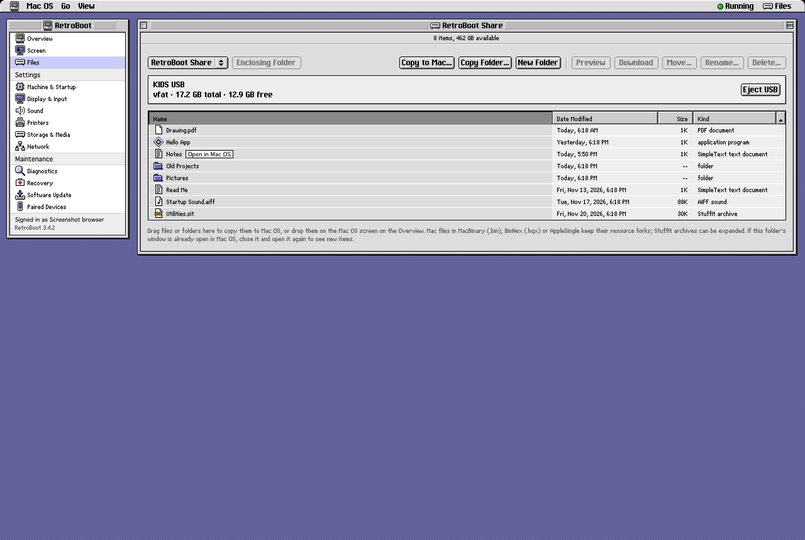
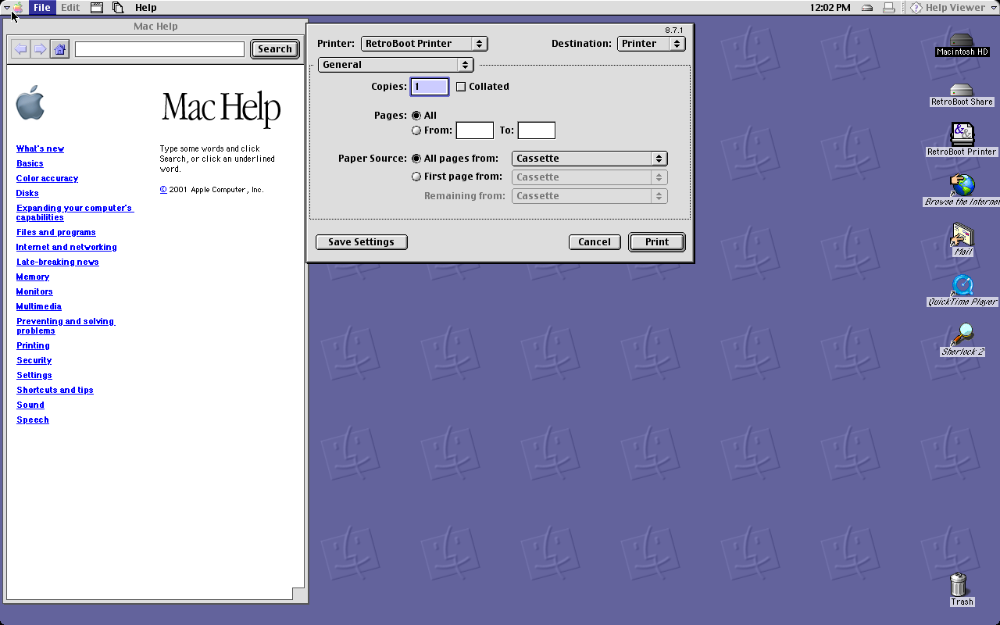
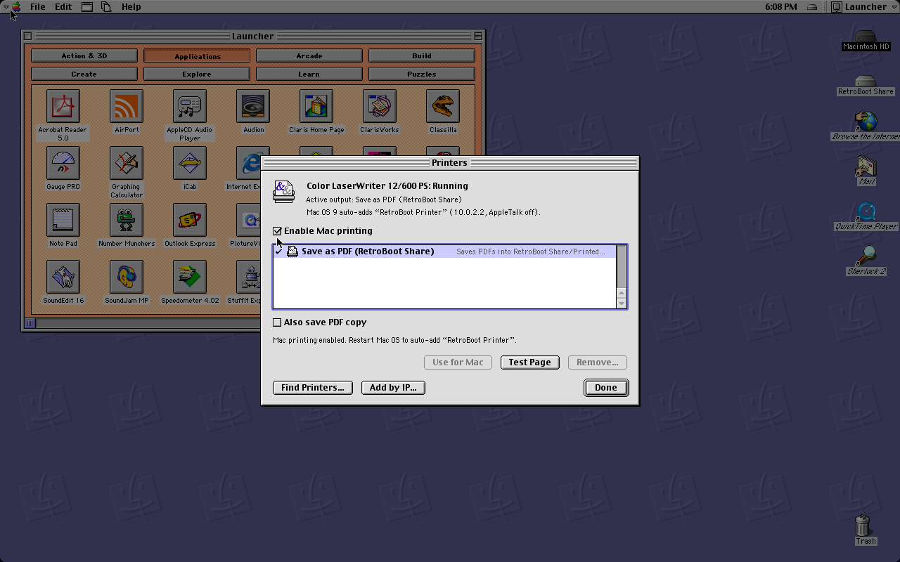
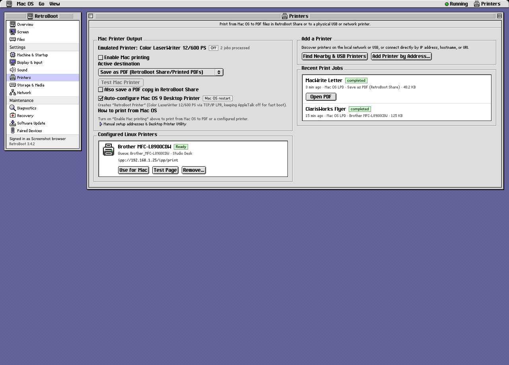
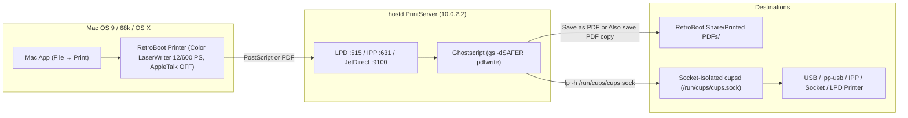

[← Previous](07-networking-airport-and-web-helper.md) · [Table of Contents](README.md) · [Next →](09-web-management-and-remote-screen.md)

# Chapter 8: Files, USB Drives, CD-ROMs, and Printing

RetroBoot gives Classic Mac OS seamless ways to move documents in and out, mount optical media and USB thumb drives, and print cleanly to PDFs or real printers—without needing AppleTalk file sharing or external file servers.

---

## 8.1 RetroBoot Share (`classicvirtio` 9P Volume)

On the Mac OS desktop, **RetroBoot Share** appears as a mounted disk backed directly by `/var/lib/retroboot/share/` on the RetroBoot computer's `RBDATA` partition via RetroBoot's `classicvirtio` 9P volume driver (`classicvirtio-6`).

### Preserving Resource Forks and Finder Metadata

Classic Mac files carry two forks (data and resource) plus Finder type/creator codes and flags. Because Linux filesystems do not natively store classic Mac forks, `classicvirtio` keeps them transparently alongside each file in hidden sidecar files:

- **`NAME`** — the data fork.
- **`NAME.rdump`** — the resource fork (stored as Rez/DeRez source when non-empty).
- **`NAME.idump`** — Finder info (4-byte type, 4-byte creator, and Finder flags such as `kHasBundle` or `kIsInvisible`; folders also support `FOLDER.idump`).

Sidecar files, dot-prefixed staging files (`.retroboot-incoming`), and Mac OS's internal top-level folders (`TheVolumeSettingsFolder`, `TheFindByContentFolder`, `Temporary Items`, `Network Trash Folder`) stay invisible inside Mac OS and Web Files.

### Names, Limits, and Volume Settings

- **Mac names & long names:** Mac OS filenames use Mac OS Roman up to 31 bytes (`/` maps to host `:`). Files added on the host with names longer than 31 bytes or non-Mac-Roman characters remain accessible in Mac OS using shortened `Name#CNID.ext` names (matching HFS+ behavior) and can be opened, renamed, and deleted from either side.
- **Size & space limits:** Individual files support up to **2 GB** (Mac OS 9's signed 32-bit file-size limit). RetroBoot always reserves at least **256 MB** of free space on `RBDATA`.
- **Renaming or toggling the share:** Under **Storage & Media ▸ Shared Volume** (requires a **Mac OS restart**), you can turn **Shared volume** (`share.enabled`) on or off or change **Shared volume name** (`share.volume_name`, 1–27 characters).

---

## 8.2 Web Files Manager

The **Files** page in the paired Web UI mirrors RetroBoot Share as a Finder-style list view (showing **Name**, **Date Modified**, **Size**, and **Kind**).

### Copying Files to Mac OS

You can send files and entire folders into Mac OS in three ways:

1. **Drag and drop onto Files:** Drop files or folders anywhere on the **Files** page to copy them into the currently open folder.
2. **Drag and drop onto the live screen:** Drop files or folders directly onto the live Mac OS picture on **Overview** or **Screen** to place them at the top level of RetroBoot Share.
3. **Toolbar buttons:** Click **Copy to Mac…** or **Copy Folder…** to choose items using your browser's file picker.

Transfers appear in a classic Finder-style copy progress window with per-file progress and a **Stop** button. When Mac OS already has a RetroBoot Share window open, new items appear within about five seconds (or when closing and reopening the folder).

### Automatic Classic Format Handling

RetroBoot automatically inspects uploaded files and converts them cleanly before placing sidecars and data forks into the share:

- **MacBinary (`.bin`), BinHex (`.hqx`), and AppleSingle:** Decoded directly into native Mac files with intact resource forks, icons, types, and creators so classic applications launch straight from RetroBoot Share.
- **AppleDouble (`._Name`):** Automatically merged with the matching `Name` file—useful when copying folders originally created on modern macOS.
- **StuffIt archives (`.sit`, `.sea`):** RetroBoot prompts whether to **Expand now** (unpacking directly into the share) or **Copy as it is** (for StuffIt Expander inside Mac OS).
- **Plain files & text conversion:** Plain files receive Mac type/creator codes based on their extension (`.txt` → SimpleText, `.jpg`/`.gif` → PictureViewer, `.pdf` → Acrobat Reader, `.mp3`/`.mov` → QuickTime Player, `.html` → Internet Explorer). For text files, an optional **Convert … for Mac OS** checkbox converts line endings and accented characters to Mac OS Roman.

### Previewing, Organizing & Downloading

- **In-browser previews (up to 32 MB):** Select a file and click **Preview** (or double-click it) to inspect **Apple `PICT`** (`.pict`, `.pct`, `PICT` type—decoded server-side for modern browsers), **JPEG**, **PNG**, **GIF**, **PDF**, and **plain text** (UTF-8 or Mac OS Roman) directly in the browser.
- **Organizing files:** Use **New Folder**, **Move…** (or drag items onto the parent-folder drop target), **Rename…**, and **Delete…**. Files currently held open by QEMU/Mac OS are detected and protected from being moved, renamed, or deleted while in use.
- **Downloading files & `.zip` folders:** Click **Download** on a file (files with resource forks download as `.bin` MacBinary by default, with a link to download the data fork alone). Selecting a folder downloads the entire folder as a **`.zip` archive** (up to **512 MB** / **10,000 items**).
- **Mount as CD:** Dropping a disc image (`.iso`, `.toast`, `.cdr`, `.dmg`, or `.img`) offers **Put it in the CD-ROM drive (Mount as CD)**, which imports it into the Media Library and offers to restart Mac OS with the disc inserted.

---

## 8.3 Plug-and-Play USB Flash Drives

Plug a USB thumb drive into the RetroBoot computer to browse and exchange files without moving them over the network. `hostd` (`UsbShare`) scans removable block devices every 5 seconds and mounts supported partitions automatically under:

`RetroBoot Share/USB Drives/<drive-name>/`

- **Supported filesystems:** `FAT32` (`vfat`/`msdos`), `exFAT`, `HFS+`, `HFS`, and `NTFS` (`ntfs`/`ntfs3`), mounted with `nosuid,nodev,noexec` (falling back to read-only if a dirty or locked filesystem refuses read-write).
- **Protected partition exclusions:** RetroBoot strictly refuses to mount or touch any partition or disk bearing RetroBoot's system/data labels (`RBEFI`, `BIOSBOOT`, `RBROOT_A`, `RBROOT_B`, `RBDATA`, `RBINSTEFI`, `RETROBOOT`) or system mount points (`/`, `/boot`, `/boot/efi`, `/boot/firmware`, `/var/lib/retroboot`, `/usr`, `/etc`).
- **Safe eject:** Mounted drives appear in a dedicated banner at the top of Web **Files** with **Open** and **Eject USB** buttons. Always click **Eject USB** (which flushes buffers, unmounts, and keeps the device ignored until physically unplugged) before pulling the drive. If Mac OS has a file open on the drive, RetroBoot warns that the drive is busy.
- **Toggle:** USB sharing can be turned on or off live under **Storage & Media ▸ USB flash drives in Share** (`usb_share.enabled`).

---

## 8.4 CD-ROM Drives & Disc Images

RetroBoot supports physical optical drives, emulated Media Library discs, and inside-Mac OS virtual CD utilities:

### Physical USB or Built-In CD-ROM Drives

1. Insert a disc into a USB CD/DVD drive or built-in optical drive connected to the RetroBoot computer.
2. Restart Mac OS (or select **Start Up from CD…** on a blank or existing machine to boot from the disc, e.g., for Mac OS installation). Mac OS 9 only detects IDE CD-ROM disc changes at startup.
3. While Mac OS has the disc mounted, QEMU locks the drive's physical eject button. Drag the disc icon to the **Trash** (or choose **Special ▸ Put Away**) inside Mac OS to unlock and eject the tray.

### Media Library ISO & Toast Mounting

Disc images uploaded via **Mount as CD** or the media API live in `/var/lib/retroboot/media/` and are identified by content (Apple Partition Map, HFS/HFS+, or ISO 9660 larger than 4 MiB). Choose the active disc under **Storage & Media ▸ CD-ROM drive** (`media.cd`) and restart Mac OS.

### Virtual CD/DVD-ROM Utility (`GImg` / `VCDM`) in Deluxe Editions

**Deluxe**, **SuperDeluxe**, and **Mega Deluxe** Mac OS 9 editions include **Virtual CD/DVD-ROM Utility 1.0d3** in `Applications (Mac OS 9):Virtual CD` (**Start → Utilities → Mount Disc Image**):

- **Manual mounting:** Copy `.iso`, `.toast`, or `.cdr` images onto **Macintosh HD** first—mounting directly from `RetroBoot Share` fails with an insufficient-resources error. Plain disc uploads through RetroBoot Share receive `GImg`/`VCDM` metadata automatically; for files downloaded inside Mac OS, drop them onto **Virtual CD Typer** (**Start → Utilities → Prepare Disc Image**) once.
- **Eject before restart:** Always select manually mounted Virtual CD desktop volumes and press **Command-E** before restarting or shutting down Mac OS 9 (mounted Virtual CD volumes block Restart until ejected).
- **On-demand discs in Mega Deluxe v6:** In **Mac OS 9.2.2 Mega Deluxe v6**, all 7 game CDs sit on `Macintosh HD` as standalone APM-wrapped `.iso` images paired with stay-open AppleScript launchers (`0` CDs mounted at boot). Launching a game mounts its disc automatically and puts it away cleanly when you quit.

---

## 8.5 Printing in RetroBoot 3.4.2 (Print-to-PDF & Physical/Network/USB CUPS)

RetroBoot includes an integrated PostScript/PDF print server in `hostd` paired with socket-isolated Linux **CUPS** so Mac OS 9 can print straight to PDFs or real network and USB printers without enabling AppleTalk.

Mac printing is **off by default** (`printer.enabled` = `false`). To turn it on, check **Enable Mac printing** at the top of **Ctrl+Alt+Delete ▸ Printers…** or **Printers** in the Web UI.

### Automatic Mac OS 9 Setup (`RetroBoot Printer`)

When **Enable Mac printing** (`printer.enabled`) and **Auto-configure Mac OS 9 Desktop Printer** (`printer.mac_auto_setup`, `guest_restart`) are both enabled, `rbguestprep` inspects the stopped HFS+ disk before Mac OS 9 starts and automatically provisions:

- **Desktop Printer:** **`RetroBoot Printer`** using **Apple Color LaserWriter 12/600 PS** (`LaserWriter 8` with the built-in `LaserWriter Color 12/600 PS` PPD) over TCP/IP LPR to `10.0.2.2` (queue `retroboot`).
- **AppleTalk stays OFF:** Startup stays fast because AppleTalk is never activated.
- **User printers preserved:** If you have already created your own Desktop Printer on the Mac OS 9 desktop, RetroBoot leaves it untouched.

### Printing from Mac OS 9, 68k, and Mac OS X

In any Mac OS 9 application, choose **File → Print…** (`Command-P`) and click **Print** with **RetroBoot Printer** selected:

If you configure a printer manually on a **68k Mac** (**Desktop Printer Utility → Printer (LPR)**) or **Mac OS X** (**Printer Setup Utility → Add → IP Printer**), use RetroBoot's virtual printer endpoints (up to `64 MB` per job):

| Protocol | Endpoint | Notes |
| --- | --- | --- |
| **LPD / LPR** | Host `10.0.2.2`, port `515`, queue `retroboot` | Used automatically by Mac OS 9 `RetroBoot Printer`; supports `Desktop PrintMonitor` framing |
| **IPP** | `http://10.0.2.2:631/printers/retroboot` | Recommended for Mac OS X IPP printing (or target a named CUPS queue at `/printers/<queue>`) |
| **AppSocket / JetDirect** | `10.0.2.2:9100` | Raw PostScript / PDF stream (Mac OS X `HP JetDirect - Socket`) |

### Print-to-PDF (`Printed PDFs/`)

When **Active destination** is set to **Save as PDF** (the default), `hostd` strips LaserWriter EOT framing, converts incoming PostScript to PDF via Ghostscript (`gs -dSAFER -sDEVICE=pdfwrite`, or `ps2pdf`), and writes the file atomically to:

`RetroBoot Share/Printed PDFs/<YYYY-MM-DD HH.MM.SS> - <job>.pdf`

The Web UI displays a toast notification when a PDF finishes, and **Recent Print Jobs** on the **Printers** page provides a one-click **Open PDF** preview link.

### Physical, Network & USB CUPS Printers

RetroBoot ships `cups`, `cups-client`, `cups-filters`, `ipp-usb`, and `avahi-utils` with `cupsd` bound **strictly to the Unix socket `/run/cups/cups.sock`** (keeping TCP `127.0.0.1:631` reserved for Mac OS IPP, and storing mutable CUPS configuration on `/var/lib/retroboot/cups`). You can manage printers from either **Ctrl+Alt+Delete ▸ Printers…** on the local computer or **Printers** in the Web UI:

- **Automatic discovery (`Find Printers…` / `Find Nearby & USB Printers`):** Runs `avahi-browse` (`_ipp._tcp`, `_ipps._tcp`, `_pdl-datastream._tcp`, `_printer._tcp`), `lpinfo -v` (direct USB and `ipp-usb`), and `driverless` in parallel (`8.0 s` panel scan timeout, preserving partial results on timeout). Duplicate network advertisements for the same physical printer are collapsed by transport priority: `ipp > ipps > socket > lpd > dnssd` (preferring IPv4 and concrete IPs over `.local`).
- **Add by IP / Address (`Add by IP…` / `Add Printer by Address…`):** Supports `ipp://`, `ipps://`, `socket://`, and `lpd://` (or full custom URIs). RetroBoot blocks loopback addresses on its own virtual printer ports (`515`, `631`, `9100`) while allowing `ipp-usb` local bridges on ports `>= 60000`.
- **Automatic driver selection (`driver="auto"`):** For IPP/IPPS/IPP-dnssd URIs, RetroBoot tries **IPP Everywhere** (`-m everywhere`) → **Generic PDF** (`Generic-PDF_Printer-PDF.ppd`) → **Generic PostScript** (`drv:///sample.drv/generic.ppd`). Non-IPP queues (`socket://`, `lpd://`, `usb://`) bypass `-m everywhere` and use Generic PostScript automatically (with `Generic PCL` and `Raw Queue` available in manual setup).
- **Routing & options:**
  - Click **Use for Mac** (or choose the printer in **Active destination**) to send Mac OS print jobs to that physical/network printer.
  - Enable **Also save a PDF copy in RetroBoot Share** (`printer.keep_pdf`) to archive a PDF alongside every physical printout.
  - Click **Test Page** / **Test Mac Printer** to send a RetroBoot PostScript Level 2/3 checkerboard and grayscale test sheet.
  - Watch **Recent Print Jobs** in the Web UI and click **Cancel** on active CUPS jobs if needed.

---

## 8.6 Classic Mac Printing Pipeline

---

[← Previous](07-networking-airport-and-web-helper.md) · [Table of Contents](README.md) · [Next →](09-web-management-and-remote-screen.md)
