[← Previous](08-files-usb-and-printing.md) · [Table of Contents](README.md) · [Next →](10-creating-and-serving-images.md)

# Chapter 9: Web Management and Remote Screen (KVM)

Every RetroBoot runs a built-in HTTPS management server (`hostd`) outside the emulator. Because it does not depend on Mac OS, you can pair a phone, tablet, or second computer on the same local network to configure settings, transfer files, print, monitor startup timelines, update RetroBoot, or recover a frozen Mac OS session at any time.

---

## 9.1 Pairing a Browser

1. **Show the pairing screen on the computer:** Press **Ctrl+Alt+Delete** (or your configured recovery chord) and choose **Network & Web Access…** (or click **Network…** during first-time setup).
   - The window displays the local HTTPS addresses (both IP and mDNS `<hostname>.local`), a **QR code**, a **6-digit pairing code**, and the TLS certificate's **SHA-256 fingerprint**.
   - **mDNS naming:** RetroBoot advertises `retroboot.local` by default. If another RetroBoot on the same LAN already owns `retroboot.local`, `MdnsWatch` automatically assigns a stable unique default (`retroboot-<last 4 hex digits of MAC>.local`) and shows the real published name in the panel.

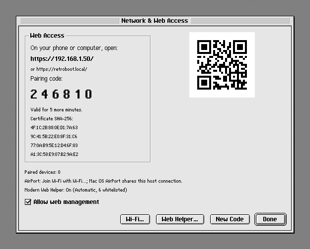

2. **Open the address & verify the certificate:** Scan the QR code or open the `https://` URL in your browser. Because RetroBoot generates its own self-signed EC P-256 TLS certificate on first boot (no cloud CA is involved), your browser will show an untrusted-certificate warning. Open the browser's certificate details and verify that the **SHA-256 fingerprint** matches the fingerprint displayed on the RetroBoot computer before continuing.
3. **Enter the 6-digit code:** On the **Pair with RetroBoot** screen, type the 6-digit code and give this browser a recognizable device name (up to 64 characters; RetroBoot supports up to 32 paired devices).

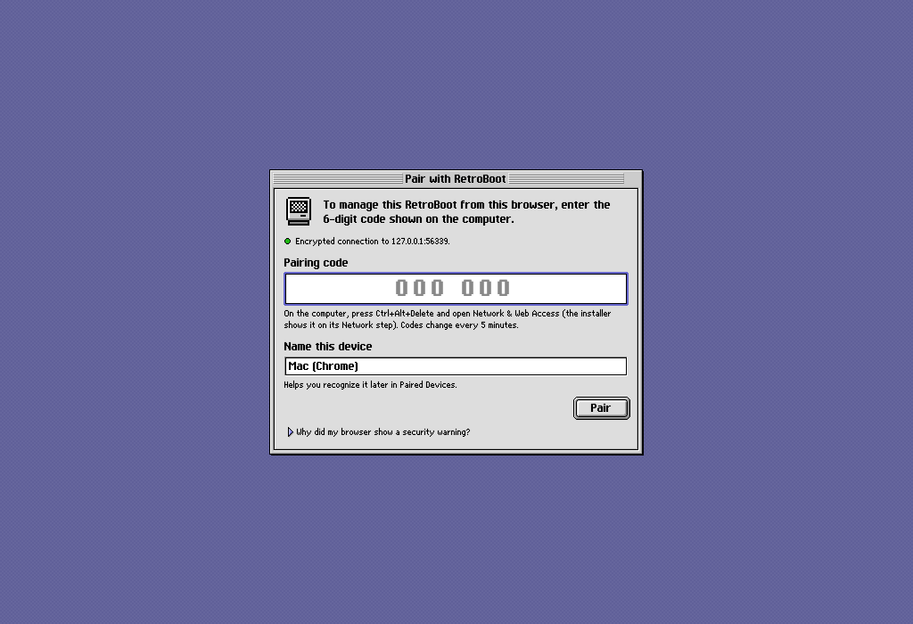

### Pairing Code Rules & Privacy Masking (`PAIRING CODE HIDDEN`)

- **Single-use & 5-minute lifetime:** Each 6-digit code works once and expires after 5 minutes (`300 s`). Five wrong guesses from a client or 20 global failures trigger rate-limiting and retire the code; click **New Code** on the local panel to generate a fresh one.
- **Privacy masking on Remote Screen:** If another browser is watching the **Screen** page while the local panel displays a pairing screen (`network-web` or `installer-network`), RetroBoot automatically masks the remote stream with a lock overlay (**PAIRING CODE HIDDEN** / **CHECK THE RETROBOOT SCREEN**) and marks screenshot responses with `X-RetroBoot-Masked: 1`. Pairing codes can only ever be read physically on the RetroBoot screen.

---

## 9.2 Complete 13-Page Tour

The Web UI mirrors Classic Mac OS 9 Platinum (using the active Mac OS system's Charcoal/Geneva/Monaco assets when present, or RetroBoot's built-in MIT Platinum theme before setup). On desktop, the left **RetroBoot** window groups all 13 pages into three sections, alongside a classic menu bar (**RetroBoot**, **Mac OS**, **Go**, and **View**).

### Primary Workspace

1. **Overview (`#/overview`)** — Live guest status (**Mac OS**), quick lifecycle actions (**Start Mac OS**, **Restart Mac OS**, **Shut Down Mac OS…**, **Turn Off RetroBoot…**, **Collect Evidence**), live screen preview with drag-and-drop into **RetroBoot Share**, proportional **Startup Timeline**, and **This RetroBoot** host summary (URLs, IPs, version, uptime, display mode, battery). When Mac OS stops responding, **Overview** shows a **Needs attention** notice with **Collect Evidence** and a link to **Recovery**.

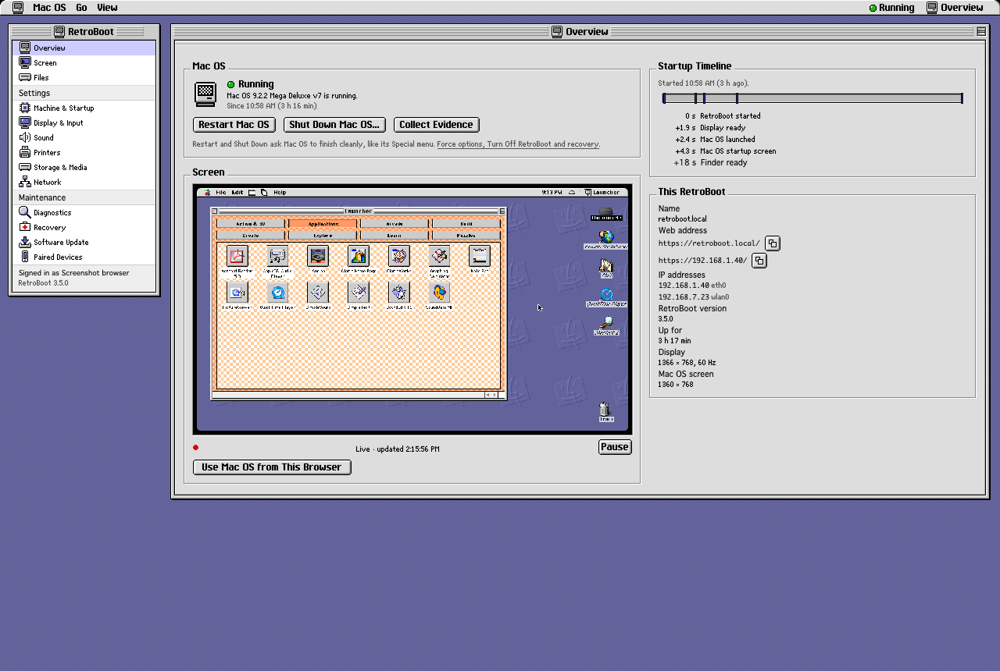

2. **Screen (`#/screen`)** — Live lossless Remote Screen (KVM) viewer with browser keyboard/mouse/touch control, live browser audio toggle, **Paste Text…**, key bar, and game keys (detailed in [Section 9.4](#94-remote-screen-kvm)).

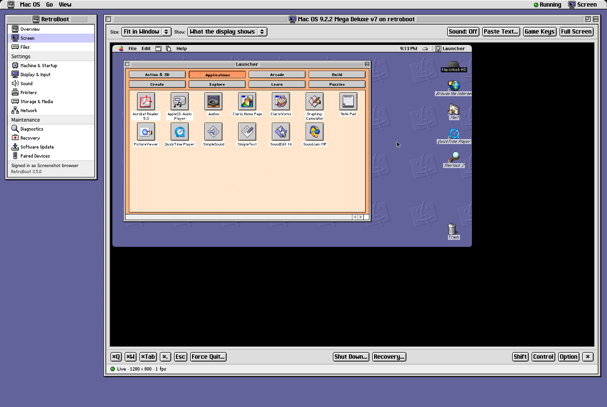

3. **Files (`#/files`)** — Finder-style browser for **RetroBoot Share**, drag-and-drop uploads with automatic MacBinary/BinHex/AppleDouble/StuffIt handling, inline previews (`PICT`, JPEG, PNG, GIF, PDF, text), `.zip` folder downloads, **Mount as CD**, and **USB Drives** safe eject (detailed in [Chapter 8](08-files-usb-and-printing.md)).

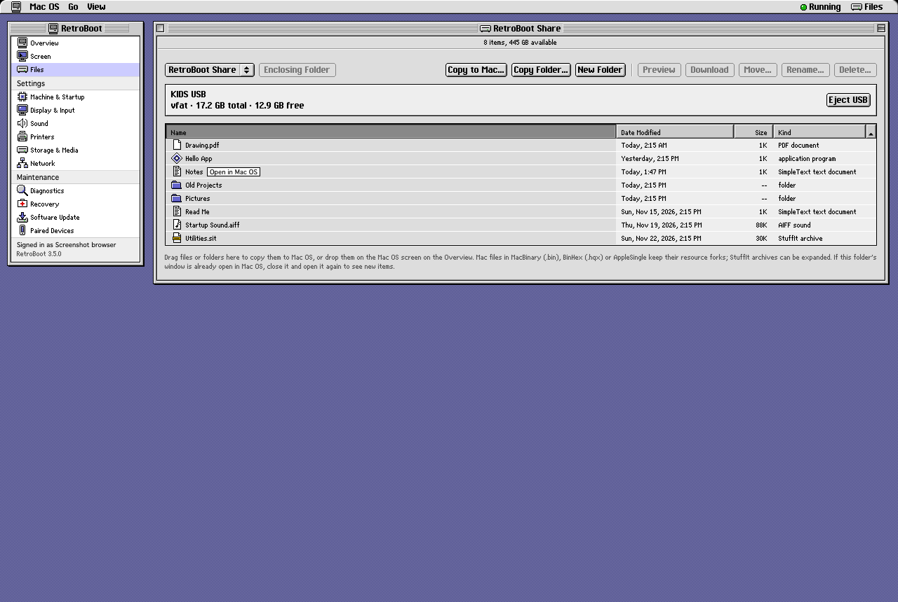

### Settings

4. **Machine & Startup (`#/machine`)** — Startup Mac selector, memory (`ram_mb` / `quadra_ram_mb` / `osx_ram_mb`), processor (`G4` / `G3`), startup speed, time zone (with **Use This Device's Time Zone** and network auto-detection), PowerBook battery indicator, automatic startup, startup progress indicator, and an **In Use Now** summary.

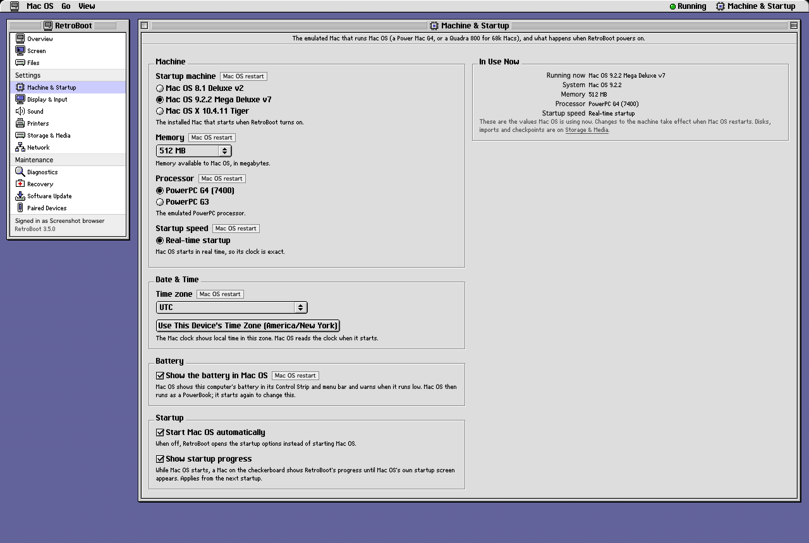

5. **Display & Input (`#/display`)** — Pixel size (`Automatic`, `1×`–`4×`), Mac screen size, scaling (**Sharp** vs **Fill the screen**), main display, rotation, **Graphics card** (**Standard** vs **3D acceleration (ATI Radeon)** plus **Install ATI Software…**), display resolution, keyboard swaps, gamepad preset (`Arrows` / `WASD` / `Off`), natural scrolling, mouse DPI (`legacy_mouse`), live outer-screen preview, **Current Display**, and **3D Acceleration** status.

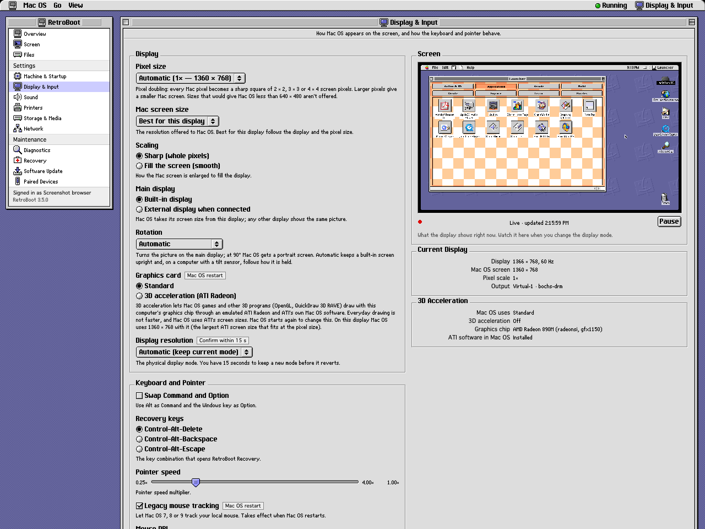

6. **Sound (`#/sound`)** — Master volume (`0–100`), mute toggle, **Startup chime** style (**Automatic**, **Mac OS 9**, **Quadra**, **Power Mac**, **Mac II**, **Macintosh SE**, **Off**), sound output device selector (supporting both hardware mixers and ALSA `softvol`), and **Test Sound**.

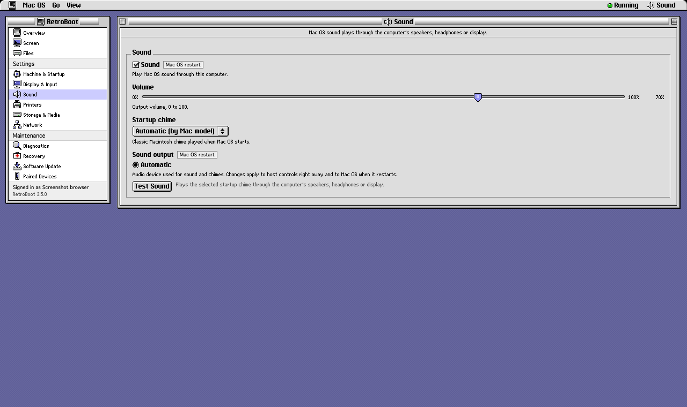

7. **Printers (`#/printers`)** — **Enable Mac printing** toggle (off by default), **Mac Printer Output** destination (`Save as PDF` vs any configured CUPS printer, **Also save a PDF copy**, **Auto-configure Mac OS 9 Desktop Printer**, manual LPD/IPP/AppSocket addresses), **Configured Linux Printers**, **Add a Printer** (**Find Nearby & USB Printers** / **Add Printer by Address…**), and **Recent Print Jobs** with **Open PDF** and **Cancel** (detailed in [Chapter 8](08-files-usb-and-printing.md#85-printing-in-retroboot-print-to-pdf--physicalnetworkusb-cups)).

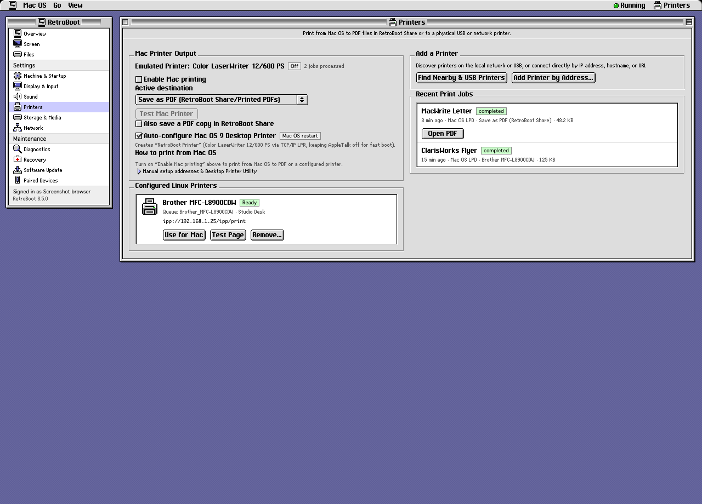

8. **Storage & Media (`#/storage`)** — Installed **Machines** (select startup Mac, **Remove…**, **New Blank Disk…**, **Start Up from CD…**), **Checkpoints** (automatic **Fresh Install** plus manual snapshots), **Import from Catalog** (with **Show older versions**), **Import from a File** (`.tar.gz`), **68k Macs** (Quadra 800 ROM upload), **CD-ROM drive**, **Shared Volume**, and **USB flash drives in Share**.

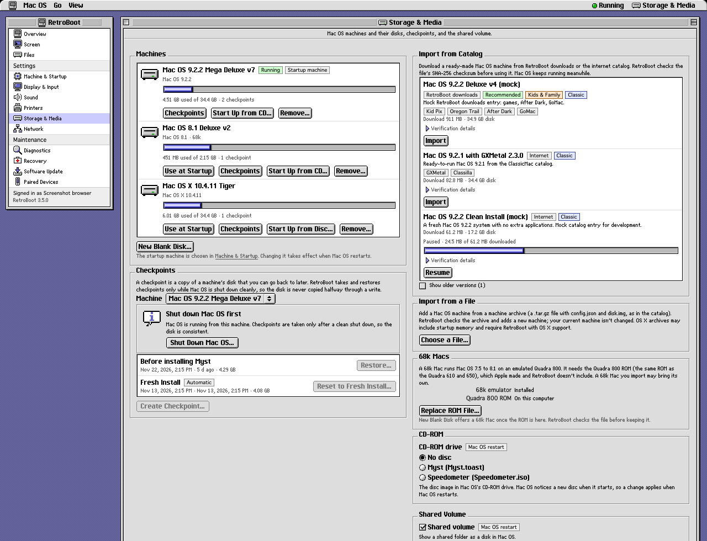

9. **Network (`#/network`)** — Quick-jump navigation bar, host **Connection** interfaces and URLs, **Wi-Fi** scanner/join/forget, **Bluetooth** controls, **Modern Web Helper** with **Sites not to help (whitelist)** and **Home page redirects**, **Mac OS Network Status**, **Mac OS Networking** (`Share` / `No network`, `Ethernet` / `AirPort`), **Web Management**, and **Remote Screen** access mode (detailed in [Chapter 7](07-networking-airport-and-web-helper.md)).

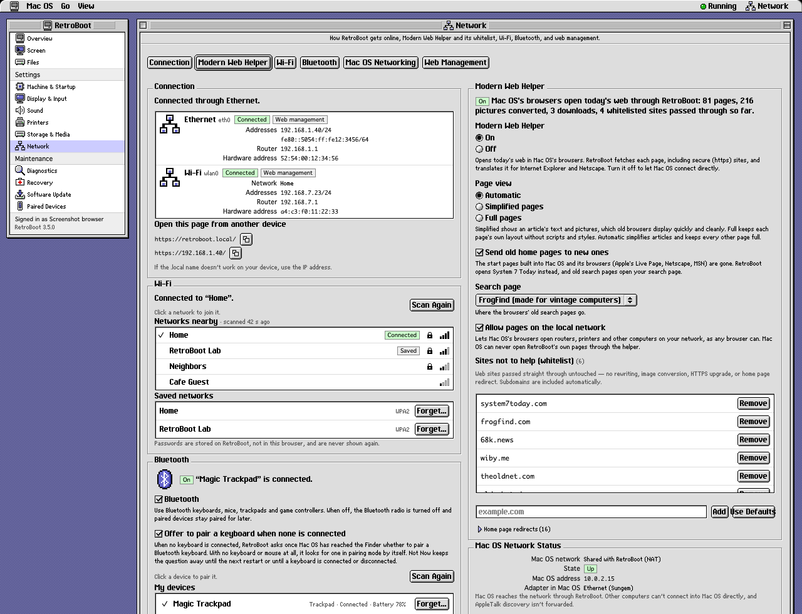

### Maintenance

10. **Diagnostics (`#/diagnostics`)** — One-click **Collect Evidence** bundle builder (logs, settings, status, and both outer and guest screenshots—with secrets redacted), live outer and Mac OS screen captures, **Versions**, **Startup Timeline**, and filterable **Log Viewer** (`hostd`, `lifecycle`, `guest`, `launcher`, `presenter`, `kernel`).

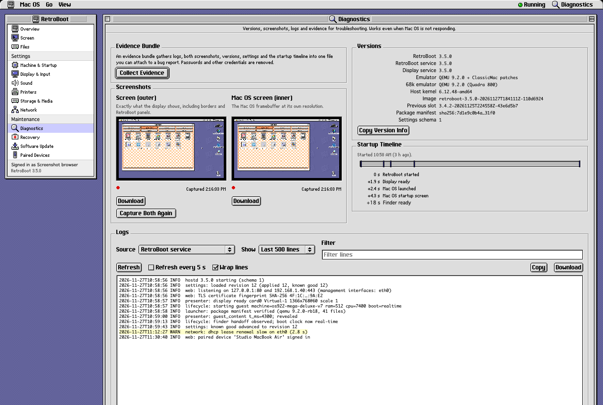

11. **Recovery (`#/recovery`)** — Clean **Start Mac OS**, **Restart Mac OS**, and **Shut Down Mac OS…**, **Turn Off or Restart RetroBoot**, **Force Restart…** / **Force Shut Down…** (saves evidence first and warns before discarding unsaved work), **Restore Known Working Settings**, **Fresh Install** checkpoint restore, and a reminder of the physical recovery key chord.

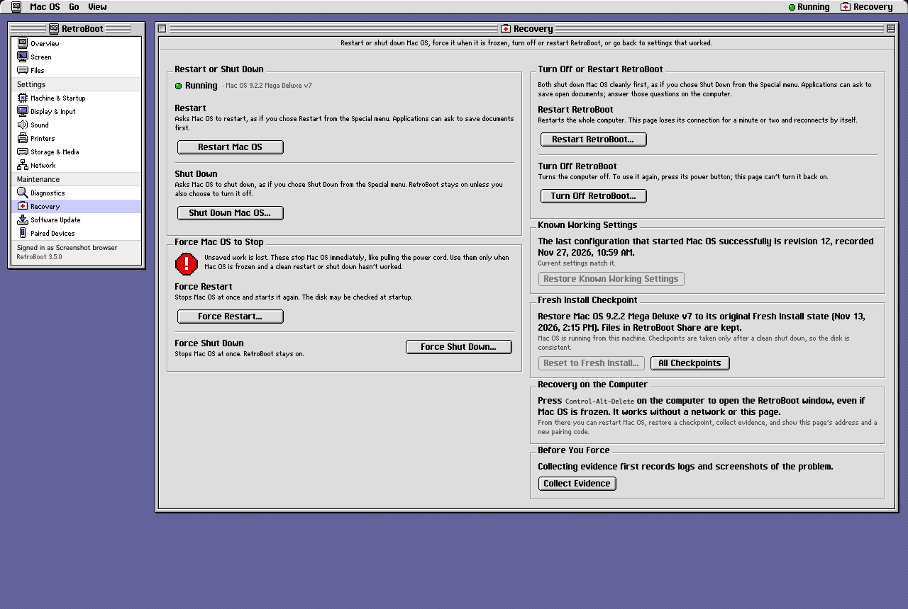

12. **Software Update (`#/update`)** — Checks the signed update feed (or uploads a `.rbu` bundle manually), shows live transfer speed and ETA during downloads, stages the update into the inactive `RBROOT` slot while Mac OS keeps running, offers **Restart to Update** or **Clean Update** (preserving Wi-Fi profiles while resetting disks/settings), and offers **Go Back** rollback to the previous slot.

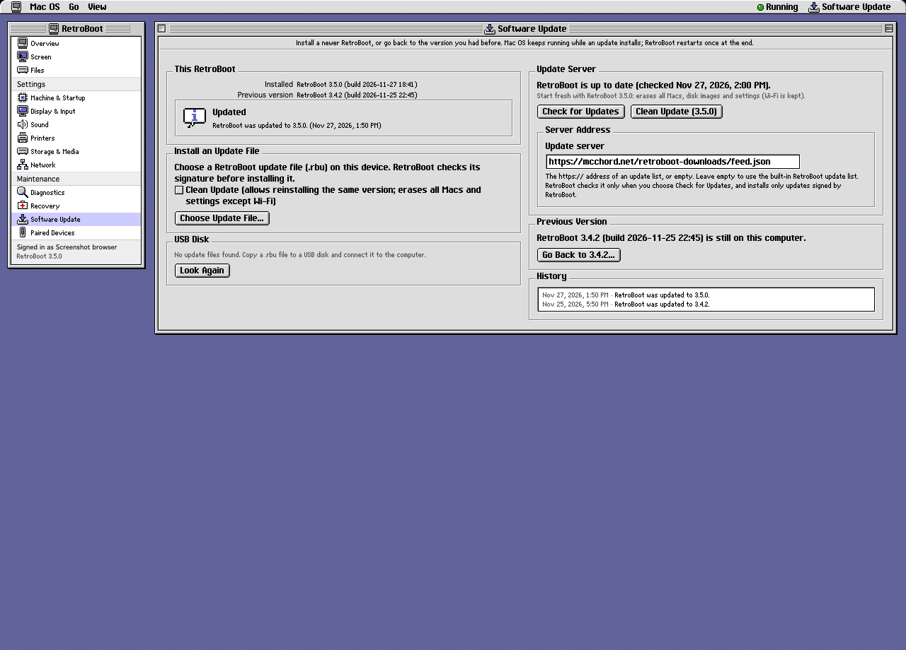

13. **Paired Devices (`#/devices`)** — Lists all browsers currently authorized to manage this RetroBoot with their pairing date, last active timestamp, and user agent. Click **Sign Out…** for your current browser or **Remove…** to immediately revoke any other device.

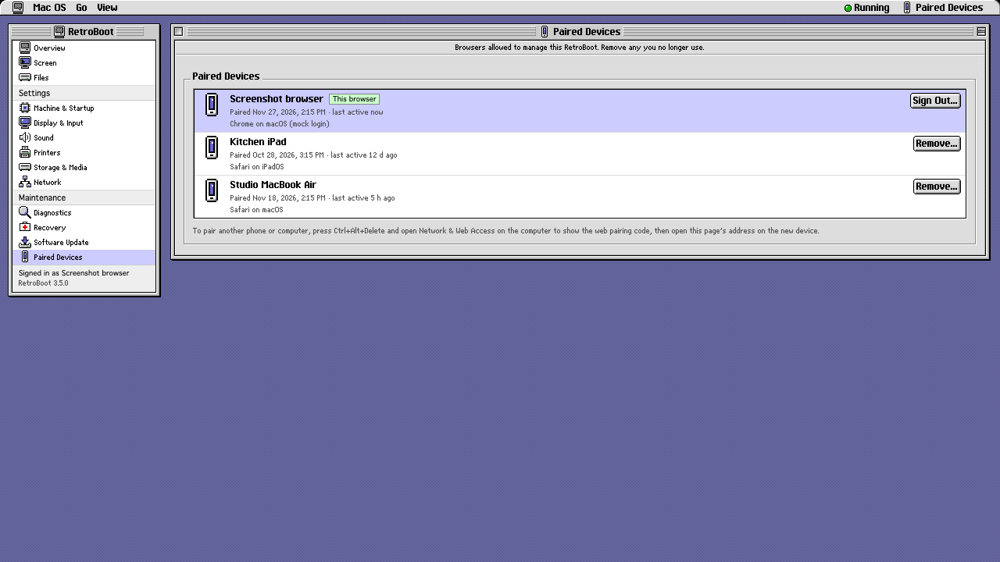

### Mobile Layout

On phones and narrow screens, pages stack into a single column, the sidebar collapses into a horizontal quick-pill bar and the **Go** menu, and **Screen** exposes touch **Trackpad**, **Keyboard**, and **Game Keys** controls:

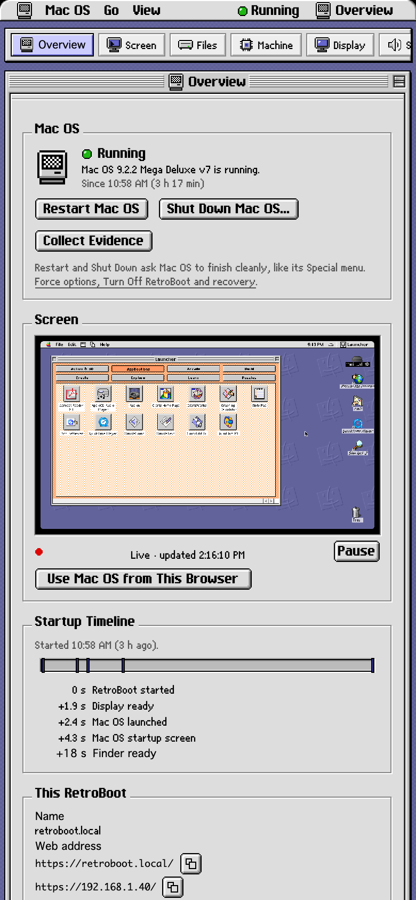

---

## 9.3 Settings Model: Drafts, Apply, Conflicts, and Pixel Size

Every setting in the Web UI follows a transactional draft-and-apply model shared with the local classic panel:

- **Drafts (`Edited`) & Changes Bar:** Changing any control marks it **`Edited`** and opens the bottom changes bar showing every modified setting as a clickable chip. Changes stay local to your browser tab until you save them (**Discard** cancels all local edits).
- **Apply Behavior by Setting Type:**
  - **Live:** Takes effect immediately when you click **Apply** (e.g., volume, Modern Web Helper, Remote Screen mode, display scaling/rotation, computer name).
  - **Mac OS restart (`guest_restart`):** Marked **`Mac OS restart`**. When Mac OS is running, the changes bar offers **Apply and Restart Mac OS** (asks Mac OS to restart cleanly via Special → Restart) or **Apply Without Restarting** (saves the value now and marks the field **`Pending`** with **`In use now: …`** until the next Mac OS start). **Discard Pending** reverts saved-but-unapplied changes back to what Mac OS is currently using.
  - **RetroBoot restart (`host_reboot`):** Marked **`Pending`** until the host appliance restarts.
  - **Timed confirmation (`15 s`):** Display resolution changes apply immediately and open a **Keep the new display setting?** banner at the top of the page. If the physical screen looks wrong or blank, do nothing—RetroBoot automatically reverts to the previous mode after **15 seconds** unless you click **Keep Change** (or **Revert Now**).
- **Stale-edit conflict protection:** Every `PATCH /api/v1/settings` and `POST /api/v1/settings/apply` checks the settings `revision`. If someone modified settings on the computer or in another browser while you were editing, RetroBoot returns `409` and opens the **Settings Changed Elsewhere** dialog showing what changed and letting you choose **Keep My Changes** or **Discard My Changes**.
- **Known Working Settings:** Whenever Mac OS boots successfully, RetroBoot records that settings revision as known-good; **Recovery ▸ Restore Known Working Settings** restores it if a setting change prevents startup.
- **`View ▸ Browser Pixel Size`:** Controls how sharply the browser itself renders RetroBoot's Platinum UI (`Automatic`, `1×`, `2×`, `3×`, or `4×`), offering only integer multiples that map cleanly onto your browser display's pixels.

---

## 9.4 Remote Screen (KVM)

Open **Screen** from the navigation sidebar, the **Go** menu, or **Use Mac OS from This Browser** on **Overview**. Remote Screen requires an `https://` connection (`wss://.../api/v1/screen/stream`).

### Video Stream, Audio & Display Controls

- **Lossless tile stream:** `hostd` taps the presenter's sealed shared-memory surface (`/run/retroboot/remote.sock`) and sends only changed screen rectangles encoded losslessly as `zlib`-compressed BGRX tiles (or `png` fallback for browsers without `DecompressionStream`). Pacing adapts automatically—if a browser falls behind, intermediate frames are dropped rather than queued so latency stays low. (In lab measurements on a 1024×768 Mac OS 9.2.1 session with Chromium, the stream ran around 27 fps with ~19 ms median pointer latency; Safari 16.4+ and Firefox are supported in the protocol though lab timing measurements were recorded on Chromium.)
- **Live Browser Audio (`Sound: Off` / `Sound: On`):** Streams live PCM Mac OS audio to your browser over the WebSocket (`WebAudioSink`) whenever toggled on.
- **Toolbar:**
  - **Size:** **Fit in Window**, **Actual Size** (`1×`), **Double Size** (`2×`), or **Triple Size** (`3×`).
  - **Show:** **What the display shows** (includes RetroBoot's classic overlay panels and startup checkerboard) or **Mac OS only**.
  - **Paste Text…:** Types pasted text into the frontmost Mac OS application at ~20 characters/second using Mac OS Roman keystrokes (accents via Option dead keys; unsupported characters are skipped and counted).
  - **Full Screen:** Expands the viewer to fill your screen (and uses `navigator.keyboard.lock()` in Chrome so shortcuts like `⌘W` reach Mac OS instead of closing the browser tab).
  - **Drag-and-Drop Files:** Drop files directly onto the live screen canvas to copy them to **RetroBoot Share**.

### Keyboard, Mouse, Touch & Access Control

- **Desktop mouse & keyboard:** Click the canvas to focus. Right-click sends contextual clicks, scroll wheel scrolls, and keys map by physical keyboard position (`Windows` / `Command` acts as `⌘`, `Alt` as `Option`, with an **Alt is Command** checkbox on non-Apple platforms).
- **Key Bar & Game Keys:** Sends browser-reserved shortcuts directly: `⌘Q`, `⌘W`, `⌘Tab`, `⌘.`, `Esc`, **Force Quit…** (`⌘⌥Esc`), **Shut Down…** (Mac Power key), **Recovery…** (`Ctrl+Alt+Delete` panel), plus sticky modifier latches (**Shift**, **Control**, **Option**, **⌘**) and an expandable **Game Keys** D-pad (`▲ ◀ ▼ ▶`, `Space`, `Return`, `Esc`).
- **Touch & Trackpad mode:** On phones and tablets, tap to click, drag to move, touch-and-hold for right-click, two-finger drag to scroll, and pinch to zoom. Toggle **Trackpad** for relative laptop-style pointer movement (two-finger tap = right-click), and tap **Keyboard** to bring up the mobile on-screen keyboard.
- **Access modes & indicator:** Under **Network ▸ Remote Screen** (`remote.screen`), choose **View and control** (default), **View only** (hides input controls), or **Off** (refuses WebSocket streams). Whenever at least one browser is watching (up to `6` concurrent viewers), a small **remote-screen icon** appears in the Mac OS menu bar on the physical computer, and the **Screen** status bar lists any other connected browsers (**Also here: …**).

---

## 9.5 Security Architecture

RetroBoot's management interface is designed for safe local-network operation without cloud accounts:

- **Local HTTPS only:** Remote browser access runs strictly over `TLSv1.2+` using the device's self-signed EC P-256 certificate (plain HTTP listens on loopback only).
- **Strict sessions & CSRF protection:** Pairing stores only a SHA-256 hash of the session token in `/var/lib/retroboot/state/pairing.json`. Browsers receive an `HttpOnly; Secure; SameSite=Strict` cookie (`rb_session`), and every mutating API call and WebSocket `hello` must present a per-session HMAC-SHA256 `X-RetroBoot-CSRF` token plus matching `Origin` and `Host` headers (defeating CSRF and DNS rebinding).
- **Typed API only:** The web server exposes only validated, typed endpoints—no raw QMP access, no shell execution, and no arbitrary host path reads.
- **Revoking access or turning Web Management off:** Remove individual browsers anytime in **Paired Devices**, or uncheck **Allow web management** in **Network & Web Access** (or set **Web management** to **Off** on the **Network** page) to stop the HTTPS listener completely. The local **Ctrl+Alt+Delete** classic panel always remains available on the computer itself.

---

## 9.6 Browser Pairing, Settings Apply & Remote Screen Flow

```mermaid
sequenceDiagram
  participant User as Browser User
  participant Panel as Local Panel (Screen)
  participant Web as hostd HTTPS Server
  participant Eng as ApplyEngine and Presenter

  User->>Panel: Press Ctrl+Alt+Delete → Network & Web Access
  Panel-->>User: Display HTTPS URL, QR, 6-digit Code, TLS SHA-256
  User->>Web: Open HTTPS, verify TLS fingerprint, POST /api/v1/pair
  Web-->>User: Set HttpOnly rb_session cookie + return CSRF token

  User->>Web: Edit settings → PATCH /api/v1/settings (revision)
  User->>Web: Click Apply / Apply and Restart → POST /api/v1/settings/apply
  Web->>Eng: Validate schema & apply (Live / Guest Restart / 15s Confirm)
  Eng-->>Web: Updated applied state & revision

  User->>Web: Open Screen → wss://.../api/v1/screen/stream (Origin + CSRF)
  Web->>Eng: Tap /run/retroboot/remote.sock (Privacy mask if pairing visible)
  Eng-->>Web: Lossless zlib/PNG tiles + optional PCM audio
  Web-->>User: Stream frames & audio; forward pointer/key events
```

---

[← Previous](08-files-usb-and-printing.md) · [Table of Contents](README.md) · [Next →](10-creating-and-serving-images.md)
