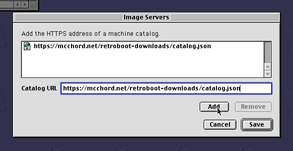
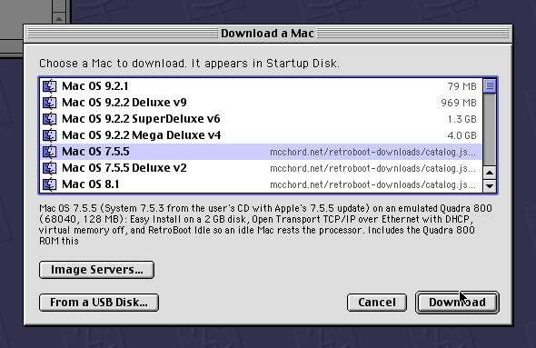
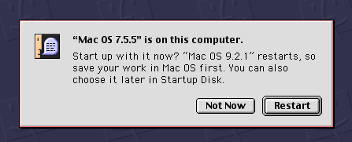
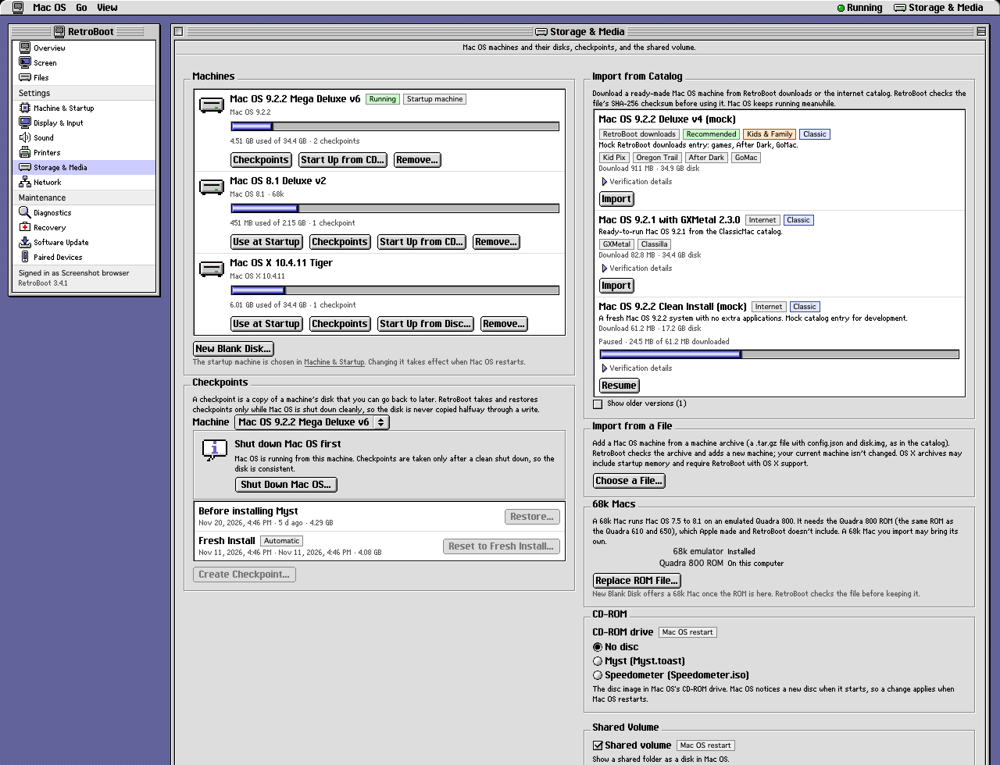

[← Previous](09-web-management-and-remote-screen.md) · [Table of Contents](README.md) · [Next →](11-updates-recovery-and-troubleshooting.md)

# Chapter 10 — Creating and Serving Custom Mac Images

RetroBoot includes 13 ready-to-run Macintosh editions out of the box, and also lets you author, package, and host your own Mac OS disk images—either for offline distribution on a USB flash drive or over HTTPS via up to eight custom image catalogs.

This chapter walks through the complete workflow from a blank disk to a verified, resumable HTTPS catalog entry.

```mermaid
flowchart LR
    A["Build Disk (New Blank Disk or Export)"] --> B["Clean Shut Down in Mac OS"]
    B --> C["Prepare & Sparsify (rbguestprep + sparsify.py)"]
    C --> D["Package Thin Archive (catalog_archive.py)"]
    D --> E["Verify Import (--verify XFS_DIR)"]
    E --> F["Publish Archive & catalog.json"]
    F --> G["Serve via HTTPS (Range + identity)"]
    G --> H["Add Server in RetroBoot (Image Servers)"]
```



> **Provenance & legal notice:** Only package, host, and distribute ROMs, installers, and disk images that you have the right and permission to serve. Never commit Apple ROMs, Mac OS disks, or proprietary installers to Git.

---

## Part 1 — Building Your Own Mac Image

You can create a custom image in two ways: by doing a fresh installation inside RetroBoot (**Route A**), or by exporting and converting an existing clean disk (**Route B**).

### Route A — Clean Install Inside RetroBoot

1. **Create a blank disk:**
   Press **Ctrl+Alt+Delete** and open **Startup Disk → New Blank Disk…** (or open **Storage & Media → New Blank Disk…** in a paired browser).
   - **PowerPC Classic (`powerMacG4`)** and **PowerPC Mac OS X (`powerMacOSX`)**: choose a disk size from **2, 4, 8, 16, 32, or 64 GB** (`BLANK_SIZES_GB`). The file is created as a sparse raw `disk.img` that occupies host blocks only as data is written.
   - **68k Quadra 800 (`quadra800`)**: choose **1, 2, or 4 GB** (`QUADRA_BLANK_SIZES_GB`; default **2 GB**). System 7.5.x can use up to 2 GB and Mac OS 7.6–8.1 up to 4 GB on standard HFS volumes. *(68k Macs require a verified Quadra 800 ROM in RetroBoot's ROM store before creation.)*

2. **Start up from your installation media:**
   Select the new Mac in **Startup Disk** and choose **Start Up from CD…** (or click **Start Up from CD…** in **Storage & Media**). Choose either a physical disc in a USB/internal **CD-ROM drive** or an ISO/disc image uploaded to your **Media Library**.

3. **Initialize the disk with Drive Setup:**
   Inside the Mac OS installer environment, launch **Drive Setup** (from the CD's *Utilities* folder):
   - Select the QEMU target drive and click **Initialize**.
   - Under **Custom Setup**, pick **Mac OS Extended (HFS+)** for PowerPC Classic (Mac OS 8.5–9.2.2) or Mac OS X, or **Mac OS Standard (HFS)** for 68k Quadra 800 (68k Macs cannot start up from HFS+).
   - Give the volume a clean name such as `Macintosh HD`.

4. **Run the Mac OS Installer:**
   Run **Mac OS Install** (or the Mac OS X Installer) onto the initialized volume. When installation finishes and restarts, RetroBoot detects the blessed System Folder automatically and boots from `disk.img`.

5. **Install guest additions & tune the system:**
   Depending on the Mac family and guest OS, configure the drivers and tools that RetroBoot expects:

   | Component | Purpose | How it is installed / handled |
   | --- | --- | --- |
   | **`classicvirtio` / `ndrvloader`** | Powers the **RetroBoot Share** volume, directory caching, Finder refresh, and exact virtio tablet pointer on PowerPC Classic and 68k (`classicvirtio-68k.rom`) | Provided by the RetroBoot host emulator package (`/usr/lib/retroboot/qemu-classicvirtio/ndrvloader` or package `share/qemu/`); no guest extension install needed |
   | **`rbdisplay`** (`RetroBoot Display` + `RetroBoot Display Startup`) | Switches ATI Radeon startup resolution from 640 × 480 to RetroBoot's chosen screen size during the extension parade and at Finder launch | Installed automatically with ATI software by `python3 -m rbguestprep ati install` or **Display & Input → Install ATI 3D Software** |
   | **`rbidle`** (`RetroBoot Idle`, `INIT/RBid`) | Halts the emulated Motorola 68040 CPU when Mac OS 7.5.5–8.1 is idle | Automatically installed into `System Folder:Extensions` by `rbguestprep 68k apply` when RetroBoot launches a 68k Mac (respects `Extensions (Disabled)`) |
   | **USB Overdrive 1.4** | Enables right-click (`Control-click`), middle-click (`Command-click`), and 3-line-per-notch scroll wheel on PowerPC Classic | Install and register inside Mac OS 9 (or replay a captured payload via `python3 -m rbguestprep usb-overdrive install`); `hostd` detects it automatically to expose `usb-mouse,wheel-per-report=1` |
   | **ATI 3D drivers (`radeon-3d` set)** | Provides QuickDraw 3D RAVE & OpenGL hardware acceleration on PowerPC Classic (`ATI Driver Update`, `ATI Radeon 3D Accelerator`, `ATI Resource Manager`, `OpenGLRendererATI`) | Install from a Mac OS 9.2.1 CD via **Display & Input** in the web UI or `python3 -m rbguestprep ati install` *(intentionally omits `ATI Graphics Accelerator` 2D acceleration, which slows offscreen GWorld `CopyBits` ~40× under emulation)* |
   | **`RetroBoot Printer`** | Pre-configures a TCP/IP LPR Desktop Printer (*Color LaserWriter 12/600 PS* at `10.0.2.2`, queue `retroboot`, AppleTalk off) | Automatically provisioned on Mac OS 9 startup when `printer.enabled` and `printer.mac_auto_setup` are on |
   | **Cleanup & guest prep** | Removes browser histories/caches, `Recent` folders, shuts off Energy Saver sleep, AppleTalk, and Software Update's weekly check, sets DHCP TCP/IP, and turns off improper-shutdown warnings | Run `rbguestprep apply` (automatically run by RetroBoot on first launch, or run offline via `guest/build/finalize.py`) |

   - Inside Mac OS 9, also open **Memory** control panel and turn **Virtual Memory off** (QEMU provides ample physical RAM; virtual memory hurts emulation performance), and set **Energy Saver** sleep timers to **Never**.
   - Inside 68k Mac OS (7.5.5–8.1), turn **Virtual Memory off**, set a reasonable Disk Cache (e.g., 4 MB on 128 MB RAM), and ensure **32-bit addressing** is enabled in the **Memory** control panel (turning 32-bit addressing off prevents the Quadra 800 ROM from booting past the gray screen).

6. **Zero free space and cleanly shut down:**
   Before exporting, empty the Mac OS **Trash**, delete temporary installers, and choose **Special → Shut Down** inside Mac OS (or **Shut Down** in RetroBoot's panel). Never copy a disk while Mac OS is running or after a forced power-off.

   If you are preparing an HFS+ disk on a Linux build host, run `guest/build/sparsify.py` (covered in Part 2) to punch out freed HFS+ blocks so the resulting thin archive is as small as possible.

---

### Route B — Exporting or Converting an Existing Disk

Every installed Mac in RetroBoot lives in its own directory under `/var/lib/retroboot/machines/<id>/`.

1. **Verify a clean shutdown first:**
   Check `/var/lib/retroboot/machines/<id>/state.json`—it must show `"clean": true`. Never copy `disk.img` while QEMU is running or if `state.json` indicates an unclean exit. (On a running appliance, cleanly shut down Mac OS first, then copy from `/var/lib/retroboot/machines/<id>/`, or create a clean checkpoint and export from `/var/lib/retroboot/checkpoints/<id>/<ts>/`.)

2. **Preserve sparseness when copying:**
   ```sh
   cp --sparse=always /var/lib/retroboot/machines/my-mac/disk.img ./export-mac/disk.img
   ```
   *(If converting from an existing ClassicMac machine directory, shut down ClassicMac cleanly first, copy its `disk.img` and `config.json`, and run `sparsify.py` on HFS+ disks to reclaim deleted installer space.)*

3. **Add `config.json` and family-specific files** as described below before running `catalog_archive.py`.

---

### Family-Specific Requirements

RetroBoot supports three machine families in catalogs (`TEMPLATE_FAMILIES` in `hostd/retroboot/machines.py`). Each has specific archive files and metadata requirements:

#### 1. PowerPC Classic (`powerMacG4`)

- **Required files:** `config.json` and `disk.img` (HFS+ volume on an Apple Partition Map with a blessed System Folder).
- **Optional files:** `preview.png`.
- Example `config.json` (`guest/build/machine-config-922.json`):
  ```json
  {
    "name": "Mac OS 9.2.2",
    "machineFamily": "powerMacG4",
    "useG4CPU": true,
    "ramMB": 512,
    "width": 1024,
    "height": 768,
    "depth": 32,
    "diskImageName": "disk.img",
    "diskSizeGB": 32,
    "sound": true,
    "networking": true,
    "tabletInput": true,
    "bootFromCD": false
  }
  ```

#### 2. 68k Quadra 800 (`quadra800`)

- **Required files:** `config.json` (`"machineFamily": "quadra800"`) and `disk.img` (standard HFS volume on an Apple Partition Map—68k Macs cannot boot HFS+).
- **Authorized ROM & PRAM (`Quadra800.rom`, `pram.img`):**
  - `Quadra800.rom`: exact **1 MiB** (`1,048,576` bytes) Quadra 610/650/800 ROM whose SHA-256 matches `05ad753fb594e656cf078023ec189e09e2a7655a780de993b75b8c51ed6b09ca`.
  - `pram.img`: **256 or 512 bytes** with the `NuMc` signature at offset `0x0C`, a valid `nubus-qfb` slot record at `0x66` (mode byte at `0x68`), and 32-bit addressing enabled (`0x05` bits at `0x8A`).
  - *Note:* If a 68k archive omits `Quadra800.rom` and `pram.img` (for legal redistribution of a non-Apple ROM-free archive, for example), `hostd` fills them in at first launch from the local ROM store (`/var/lib/retroboot/roms/`) and the `q800-pram-seed.img` template—provided the user has already added the Quadra 800 ROM on **Storage & Media**. If you bundle `Quadra800.rom` inside the archive, that archive must be kept private.
- **Building the machine directory with `guest/build/quadra_machine.py`:**
  `quadra_machine.py` validates the ROM SHA-256, checks PRAM (`NuMc` + 32-bit addressing), checks that the HFS disk was cleanly shut down (`shutdown_check == "absent"`), copies `disk.img` sparsely (only non-zero 64 KiB blocks), and generates `config.json`, `machine.json`, and `fixture.json`:
  ```sh
  python3 guest/build/quadra_machine.py ./out-quadra \
    --id mac-os-8-1-v1 \
    --name "Mac OS 8.1" \
    --os-version 8.1 \
    --disk ./raw-81.img \
    --pram ./pram.img \
    --rom ./Quadra800.rom \
    --ram 128 \
    --size 800x600x8
  ```

#### 3. PowerPC Mac OS X (`powerMacOSX`)

- **Required files:** `config.json`, `disk.img`, and the paired **`nvram.img`**.
- **`config.json` fields:** Set `"machineFamily": "powerMacOSX"` and `"guestOS"` to one of `"macosx-10.2"`, `"macosx-10.3"`, or `"macosx-10.4"`.
- **Catalog build tag:** Include `"osBuild"` matching the installed `/System/Library/CoreServices/SystemVersion.plist` (`ProductBuildVersion`). Tested RetroBoot profiles are:
  - Jaguar `macosx-10.2`: `6R73` (`10.2.8`)
  - Panther `macosx-10.3`: `7W98` (`10.3.9`)
  - Tiger `macosx-10.4`: `8S165` (`10.4.11`)
- **Paired `nvram.img` rules (`hostd/retroboot/osx.py`):**
  Mac OS X uses a **16,384-byte** two-bank Core99 flash NVRAM image (two 8,192-byte banks). `hostd` rejects any `nvram.img` whose banks fail validation:
  - Each valid bank begins with signature byte `0x5a`, partition version `2`, an 8-bit header checksum at byte `1`, an Adler-32 payload checksum at offset `16`, a 32-bit generation counter at offset `20`, and an `APL,MacOS75` partition containing the signed 24-bit RTC offset at XPRAM `0xEC` (within ±86,400 seconds).
  - Always package the `nvram.img` paired with that exact `disk.img` after a clean Mac OS X shutdown.

---

## Part 2 — `config.json` & Archive Rules Reference

### Allowed Archive Members & Byte Caps

`hostd/retroboot/catalog.py` extracts archives in a single streaming pass into a private staging directory. Every member must sit flat at the archive root (no subdirectories, no `./` prefix, no symlinks, no hard links, no special device/FIFO entries, no duplicates, and no top-level PAX headers).

| Member | Required | Maximum Size | Rules & Constraints |
| --- | --- | --- | --- |
| `config.json` | **Yes** | `64 KiB` (65,536 B) | Valid JSON object; unknown keys stripped by `sanitize_template_config` |
| `disk.img` | **Yes** | `140 GiB` | Positive multiple of `512` bytes; regular or GNU PAX sparse `1.0` |
| `preview.png` | No | `16 MiB` | Optional preview image |
| `Quadra800.rom` | No | `4 MiB` (must be `1 MiB`) | Allowed **only** for `machineFamily: "quadra800"`; SHA-256 verified |
| `pram.img` | No | `4 KiB` (`256` or `512` B) | Allowed **only** for `machineFamily: "quadra800"` |
| `nvram.img` | No | `16 KiB` (`16,384` B) | Allowed **only** when `guestOS` starts with `macosx-`; two-bank flash verified |

### Complete `config.json` Field Reference

`sanitize_template_config` in `hostd/retroboot/catalog.py` parses and sanitizes `config.json` on import:

| Field | Type | Allowed Values / Notes |
| --- | --- | --- |
| `name` | string | Display name for the machine (truncated to 100 characters) |
| `machineFamily` | string | `"powerMacG4"` (default if omitted), `"quadra800"`, or `"powerMacOSX"` |
| `guestOS` | string | `"classic"` (default), `"macosx-10.2"`, `"macosx-10.3"`, or `"macosx-10.4"`. Must be `macosx-*` if and only if `machineFamily` is `"powerMacOSX"` |
| `ramMB` | integer | Suggested RAM in MiB (e.g., `128`, `512`, `1024`, `2048`) |
| `useG4CPU` | boolean | `true` for PowerPC G4 (`7400`); `false` sets default `cpu` to `"g3"` on PowerPC Classic |
| `width` | integer | Default screen width in pixels (e.g., `800`, `1024`) |
| `height` | integer | Default screen height in pixels (e.g., `600`, `768`) |
| `depth` | integer | Color depth in bits per pixel (`8`, `16`, `24`, `32`; used to seed initial Quadra PRAM color depth) |
| `sound` | boolean | Audio enabled flag (`true`) |
| `networking` | boolean | Networking enabled flag (`true`) |
| `tabletInput` | boolean | Virtio tablet input enabled flag (`true`) |
| `diskSizeGB` | integer | Nominal disk capacity in GB |
| `directFramebuffer` | boolean | Default `false`. Opts PowerPC Classic into `untracked-vram=on` dirty-row scanning for games that write VRAM directly without dirty-page faults |
| `osxDisplaySetup` | string | Only `"firmware-desktop-1"` is accepted, and only when `guestOS` is `"macosx-10.4"`. Enables paired 1280×800 EDID / 1920×1080 desktop handling with ATI Radeon |
| `recommendedSettings` | object | Optional per-Mac defaults applied on import (`ram_mb`, `osx_ram_mb`, `graphics`, `guest_adapter`, `cpu`; integers or strings up to 40 characters) |

*(ClassicMac templates also commonly include `"diskImageName": "disk.img"` and `"bootFromCD": false`; `catalog.py` safely ignores those two legacy keys during import.)*

### Sparsifying Disks (`guest/build/sparsify.py`)

Mac OS leaves deleted files (installer temporaries, browser caches, virtual memory swap files) on disk as non-zero sectors inside free HFS+ allocation blocks. On a Linux host, run `guest/build/sparsify.py` against a **stopped** HFS+ disk image before packaging:

```sh
# Preview how many bytes can be reclaimed without modifying disk.img
python3 guest/build/sparsify.py ./my-mac/disk.img --dry-run

# Punch holes for free HFS+ runs >= 64 KiB and verify with fsck.hfsplus -fn
python3 guest/build/sparsify.py ./my-mac/disk.img
```

`sparsify.py` reads the HFS+ volume's allocation bitmap, calls `fallocate(FALLOC_FL_PUNCH_HOLE | FALLOC_FL_KEEP_SIZE)` on every contiguous free run of at least `64 KiB`, verifies the volume with `fsck.hfsplus -fn`, and prints a JSON summary (`free_runs`, `punched_bytes`, `allocated_before`, `allocated_after`, `fsck`).

---

## Part 3 — Packaging with `guest/build/catalog_archive.py`

RetroBoot's archive packer (`guest/build/catalog_archive.py` + `hostd/retroboot/sparsetar.py`) creates deterministic `.tar.gz` archives (mtime `0`, uid/gid `0`, gzip header without filename or timestamp).

### Thin (`retroboot-thin-1`) vs. Classic (`--classic`)

- **Default (`retroboot-thin-1`):** Stores `disk.img` as a **GNU PAX sparse 1.0** tar member. The packer scans `disk.img` using `SEEK_DATA`/`SEEK_HOLE` plus a `4 KiB` zero-block check, coalescing up to `262,144` extents (`MAX_EXTENTS`). Only non-zero 4 KiB blocks are compressed and transferred, and RetroBoot imports the archive in seconds by calling `ftruncate()` first and writing only the data extents.
- **`--classic`:** Writes a ClassicMac schema-1 archive using regular tar members where every byte of `disk.img` (including zeros) is passed through gzip. Choose this only when targeting ClassicMac or older RetroBoot versions prior to thin archive support.

### CLI Reference

```sh
python3 guest/build/catalog_archive.py MACHINE_DIR OUT.tar.gz \
  [--url URL] \
  [--json FACTS.json] \
  [--verify SCRATCH_DIR] \
  [--preview] \
  [--classic] \
  [--level N]
```

| Option | Description |
| --- | --- |
| `MACHINE_DIR` | Directory containing `config.json`, `disk.img`, and optional `preview.png`, `Quadra800.rom`/`pram.img`, or `nvram.img` |
| `OUT.tar.gz` | Output archive path (must end in `.tar.gz`). Written atomically via `.part`, set read-only (`0444`), and accompanied by `OUT.tar.gz.sha256` |
| `--url URL` | HTTPS archive URL to embed in the printed catalog JSON snippet |
| `--json FILE` | Save the printed JSON catalog facts to `FILE` |
| `--verify DIR` | Run `hostd`'s `catalog.extract_archive` into a temporary directory under `DIR` (use an XFS filesystem like `RBDATA` for realistic sparse allocation) and compare the extracted `disk.img` SHA-256 against the source |
| `--preview` | Include `preview.png` from `MACHINE_DIR` |
| `--classic` | Build a ClassicMac schema-1 regular tar archive instead of `retroboot-thin-1` |
| `--level N` | Gzip compression level (defaults: `9` for thin archives, `6` for `--classic`) |

#### Example Packaging Run & Output

```sh
python3 guest/build/catalog_archive.py ./my-os9-machine ./my-os9-v1.thin.tar.gz \
  --url https://macs.example.org/files/my-os9-v1.thin.tar.gz \
  --verify /var/lib/retroboot/tmp \
  --json ./my-os9-v1.facts.json
```

The packer writes `./my-os9-v1.thin.tar.gz`, creates `./my-os9-v1.thin.tar.gz.sha256`, and outputs JSON facts:

```json
{
 "thinArchive": {
  "format": "retroboot-thin-1",
  "archiveURL": "https://macs.example.org/files/my-os9-v1.thin.tar.gz",
  "archiveBytes": 207111795,
  "sha256": "5e9f2b91f5a3d8f2da110de3ab5e457b0bb05197b7e62b6495b6799a9c309e01"
 },
 "installedBytes": 34359738651,
 "diskCapacityBytes": 34359738368,
 "requiredStorageBytes": 533725184,
 "storedBytes": 489123840,
 "extents": 4120,
 "build_s": 14.2,
 "verify": {
  "ok": true,
  "disk_sha256": "...",
  "expected_sha256": "...",
  "extract_s": 3.8,
  "allocated_bytes": 489123840,
  "stored_bytes": 489124123
 }
}
```

### Offline USB Stick Distribution

You can distribute any packaged `.tar.gz` (or `.tgz`) without a web server:

1. Format a USB flash drive with any supported filesystem (`vfat`, `exfat`, `ext4`, `ext3`, `ext2`, `ntfs`, `iso9660`, `udf`, `xfs`, or `btrfs`). Note that `exfat`, `ext4`, `ntfs`, or `xfs` is required if your archive exceeds FAT32's 4 GiB file size limit.
2. Copy both `my-os9-v1.thin.tar.gz` and its `my-os9-v1.thin.tar.gz.sha256` sidecar file to the drive's top-level directory (or one folder deep—`hostd` scans `depth=1`).
3. Plug the USB drive into RetroBoot and import it via **Ctrl+Alt+Delete → Download a Mac → From USB Disk…** (or **Storage & Media → Import from a File** in a paired browser). RetroBoot mounts the drive read-only (`ro,nosuid,nodev,noexec`) and verifies the archive against the `.sha256` sidecar automatically if present.

---

## Part 4 — Writing `catalog.json` (`schemaVersion: 1`)

A custom image server hosts a JSON catalog at an HTTPS URL such as `https://macs.example.org/catalog.json`.

### Exact Validation Rules (`validate_catalog`)

RetroBoot enforces strict validation on `catalog.json` before displaying or importing any machine:

- **Document envelope:** JSON object with `"schemaVersion": 1` and `"machines"` array containing at most **50** entries. Total `catalog.json` size must not exceed **1 MiB** (`1,048,576` bytes).
- **Unique identifiers (`id`):** Must match `^[a-z0-9._-]{1,100}$`, cannot start with `.`, and must be unique within the catalog.
- **Text fields:** `name` (1–100 chars), `summary` (1–1,000 chars), `osVersion` (1–80 chars), optional `gxMetalVersion` (1–80 chars); printable text only (no control chars other than `\n`).
- **Minimum app version (`minimumAppVersion`):** Optional (defaults to `"3.0.0"`), must match `^\d{1,6}\.\d{1,6}(\.\d{1,6})?$`.
- **SHA-256 (`sha256`):** Exact 64 lowercase hexadecimal characters (`^[0-9a-f]{64}$`).
- **URLs (`archiveURL`):** Valid `https://` URL (max 2,048 chars, no credentials, no fragments, no spaces/backslashes).
- **Byte & capacity invariants:**
  - `0 < archiveBytes <= 140 GiB`
  - `512 <= installedBytes <= 140 GiB`
  - `diskCapacityBytes` (optional): positive multiple of `512`, strictly `< installedBytes`, and `installedBytes - diskCapacityBytes <= 16 MiB + 65536`.
  - `requiredStorageBytes` (optional; requires `diskCapacityBytes`): positive multiple of `1 MiB`, `<= installedBytes + 3 MiB`.
- **Thin vs. Dual-Format Entries:**
  - For a **RetroBoot-only** catalog, copy `archiveURL`, `archiveBytes`, and `sha256` straight from `thinArchive` into the top-level fields (and optionally keep `thinArchive` as well).
  - For a **dual-format** catalog supporting ClassicMac too, run `catalog_archive.py --classic` for the top-level `archiveURL`/`archiveBytes`/`sha256`, and embed the `thinArchive` object alongside it; RetroBoot automatically prefers `thinArchive` while ClassicMac ignores it.
- **Versioning (`-vN`):** Group editions by keeping the base ID identical and incrementing the `-vN` suffix (e.g., `my-os9-v1` → `my-os9-v2`). RetroBoot automatically collapses older versions under **Show older versions**. Always keep older archive files live at their existing URLs so users who already bookmarked or cached them are not broken.

### Copy-Paste `catalog.json` Examples

Below is a complete `catalog.json` showing all three supported families (**PowerPC Classic**, **68k Quadra 800**, and **PowerPC Mac OS X Tiger**). Replace the example URLs, byte counts, and SHA-256 hashes with the exact output from `catalog_archive.py`.

```json
{
  "schemaVersion": 1,
  "machines": [
    {
      "id": "custom-os922-ppc-v1",
      "name": "Mac OS 9.2.2 Custom",
      "summary": "Custom Mac OS 9.2.2 PowerPC edition with QuickTime 6 and developer tools.",
      "osVersion": "9.2.2",
      "machineFamily": "powerMacG4",
      "minimumAppVersion": "3.0.0",
      "tags": ["ppc", "os9", "custom"],
      "highlights": [
        "Clean Mac OS 9.2.2 on a 32 GB sparse disk",
        "AirPort & ATI 3D ready"
      ],
      "archiveURL": "https://macs.example.org/files/custom-os922-ppc-v1.thin.tar.gz",
      "archiveBytes": 207111795,
      "installedBytes": 34359738651,
      "diskCapacityBytes": 34359738368,
      "requiredStorageBytes": 533725184,
      "sha256": "0000000000000000000000000000000000000000000000000000000000000001",
      "thinArchive": {
        "format": "retroboot-thin-1",
        "archiveURL": "https://macs.example.org/files/custom-os922-ppc-v1.thin.tar.gz",
        "archiveBytes": 207111795,
        "sha256": "0000000000000000000000000000000000000000000000000000000000000001"
      }
    },
    {
      "id": "custom-os81-68k-v1",
      "name": "Mac OS 8.1 Quadra Custom",
      "summary": "68040 Quadra 800 Mac OS 8.1 build with RetroBoot Idle and Open Transport.",
      "osVersion": "8.1",
      "machineFamily": "quadra800",
      "minimumAppVersion": "3.0.0",
      "tags": ["68k", "custom"],
      "highlights": [
        "Quadra 800 (68040, 128 MB RAM)",
        "2 GB HFS disk with Ethernet & DHCP"
      ],
      "archiveURL": "https://macs.example.org/files/custom-os81-68k-v1.thin.tar.gz",
      "archiveBytes": 60851270,
      "installedBytes": 2148532737,
      "diskCapacityBytes": 2147483648,
      "requiredStorageBytes": 204472320,
      "sha256": "0000000000000000000000000000000000000000000000000000000000000002",
      "thinArchive": {
        "format": "retroboot-thin-1",
        "archiveURL": "https://macs.example.org/files/custom-os81-68k-v1.thin.tar.gz",
        "archiveBytes": 60851270,
        "sha256": "0000000000000000000000000000000000000000000000000000000000000002"
      }
    },
    {
      "id": "custom-tiger-ppc-v1",
      "name": "Mac OS X 10.4.11 Tiger Custom",
      "summary": "PowerPC Mac OS X 10.4.11 Tiger with paired Core99 NVRAM and Quartz Extreme defaults.",
      "osVersion": "10.4.11",
      "osBuild": "8S165",
      "guestOS": "macosx-10.4",
      "machineFamily": "powerMacOSX",
      "minimumAppVersion": "3.0.0",
      "tags": ["osx", "tiger", "custom"],
      "highlights": [
        "Mac OS X 10.4.11 (8S165) with paired nvram.img",
        "Recommended 1024 MB RAM & ATI Radeon"
      ],
      "recommendedSettings": {
        "osx_ram_mb": 1024,
        "graphics": "ati-radeon"
      },
      "archiveURL": "https://macs.example.org/files/custom-tiger-ppc-v1.thin.tar.gz",
      "archiveBytes": 1155121688,
      "installedBytes": 34359755020,
      "diskCapacityBytes": 34359738368,
      "requiredStorageBytes": 3078619136,
      "sha256": "0000000000000000000000000000000000000000000000000000000000000003",
      "thinArchive": {
        "format": "retroboot-thin-1",
        "archiveURL": "https://macs.example.org/files/custom-tiger-ppc-v1.thin.tar.gz",
        "archiveBytes": 1155121688,
        "sha256": "0000000000000000000000000000000000000000000000000000000000000003"
      }
    }
  ]
}
```

---

## Part 5 — Serving Over HTTPS

### `CatalogClient` Download & Import Lifecycle

```mermaid
sequenceDiagram
    participant User as User / Panel / Web UI
    participant Client as hostd CatalogClient
    participant Server as HTTPS Image Server
    participant Disk as RBDATA XFS Staging

    User->>Client: Fetch catalog.json
    Client->>Server: GET /catalog.json (HTTPS, CA verified, max 5 same-origin redirects)
    Server-->>Client: 200 OK (JSON <= 1 MiB, schemaVersion 1)
    User->>Client: Import selected Mac
    Client->>Client: Prefer thinArchive if present; check free space (+256 MiB reserve)
    Client->>Server: GET archiveURL (Range bytes=<have>- if .part exists)
    Server-->>Client: 206 Partial Content (Content-Range, Content-Encoding identity)
    Client->>Client: Stream to <sha256>.part & verify exact archiveBytes + SHA-256
    Client->>Disk: extract_archive (single-pass gunzip, validate sparse map, pwrite extents)
    Client->>Disk: Verify config.json + family files, write machine.json & state.json
    Client->>Disk: Atomic os.rename(staging, /var/lib/retroboot/machines/<id>)
```

### Strict `CatalogClient` Requirements

Your HTTPS server must satisfy every rule enforced by `CatalogClient` (`hostd/retroboot/catalog.py`) and `validate_catalog_urls` (`hostd/retroboot/schema.py`):

1. **`https://` only with a trusted CA:** Plain `http://` is rejected. Use a certificate signed by a publicly trusted Certificate Authority (such as Let's Encrypt).
2. **Full file path, clean URL:** Must include a non-root file path (e.g., `https://macs.example.org/catalog.json`), and must contain **no** embedded credentials (`user:pass@`), **no** query string (`?`), and **no** fragment (`#`).
3. **Same-origin redirects only (max 5):** Any HTTP `301`/`302`/`303`/`307`/`308` redirect must remain `https://` on the exact same hostname and port.
4. **Byte ranges (`206 Partial Content`):** Support `Range: bytes=<offset>-` requests returning `206 Partial Content` with a matching `Content-Range: bytes <offset>-...` header so interrupted downloads can resume cleanly.
5. **`Content-Encoding: identity` (critical!):** `CatalogClient` opens its HTTP client with `auto_decompress=False` and **rejects** any archive response whose `Content-Encoding` header is anything other than empty or `identity` (`"The server sent an encoded archive."`). Never let a web server, reverse proxy, or CDN apply `gzip` transfer compression or advertise `Content-Encoding: gzip` on `.tar.gz` files!

### Ready-to-Use Web Server Configurations

#### Caddy (`Caddyfile`)

Caddy obtains and renews Let's Encrypt TLS certificates automatically, serves byte ranges out of the box, and does not compress `.tar.gz` files:

```caddyfile
macs.example.org {
    root * /srv/retroboot-catalog
    file_server

    @archives path *.tar.gz *.tgz
    header @archives Content-Encoding identity
}
```

#### Nginx (`/etc/nginx/sites-available/retroboot-catalog`)

Explicitly disable `gzip` on `.tar.gz` locations and verify `types` does not emit `Content-Encoding: gzip`:

```nginx
server {
    listen 443 ssl http2;
    server_name macs.example.org;

    ssl_certificate     /etc/letsencrypt/live/macs.example.org/fullchain.pem;
    ssl_certificate_key /etc/letsencrypt/live/macs.example.org/privkey.pem;

    root /srv/retroboot-catalog;

    location = /catalog.json {
        default_type application/json;
        add_header Cache-Control "no-cache";
    }

    location /files/ {
        gzip off;
        types {
            application/octet-stream gz tgz;
        }
        default_type application/octet-stream;
        add_header Accept-Ranges bytes;
        add_header Content-Encoding identity;
    }
}
```

#### Apache (`httpd` / `apache2` VirtualHost)

Disable `mod_deflate` and `AddEncoding` on `.gz`/`.tgz` archives so Apache never sets `Content-Encoding: gzip`:

```apache
<VirtualHost *:443>
    ServerName macs.example.org
    DocumentRoot /srv/retroboot-catalog

    SSLEngine on
    SSLCertificateFile    /etc/letsencrypt/live/macs.example.org/fullchain.pem
    SSLCertificateKeyFile /etc/letsencrypt/live/macs.example.org/privkey.pem

    <Directory /srv/retroboot-catalog>
        Options -Indexes +FollowSymLinks
        Require all granted
    </Directory>

    <FilesMatch "\.(tar\.gz|tgz)$">
        RemoveEncoding .gz .tgz
        ForceType application/octet-stream
        SetEnv no-gzip 1
        Header set Content-Encoding "identity"
    </FilesMatch>
</VirtualHost>
```

### Pre-Flight Verification with `curl`

Always upload the `.tar.gz` archive **first**, verify it, and publish `catalog.json` **last**. Run these checks from another host before adding the server in RetroBoot:

```sh
# 1. Verify HTTPS, valid JSON, and schemaVersion: 1
curl -fsSL https://macs.example.org/catalog.json | python3 -m json.tool | head -n 20

# 2. Verify headers on the archive (must NOT show Content-Encoding: gzip)
curl -fsSI https://macs.example.org/files/custom-os922-ppc-v1.thin.tar.gz

# 3. Verify HTTP 206 Partial Content byte-range resume works
curl -fsS -D - -o /dev/null -r 1024-2047 https://macs.example.org/files/custom-os922-ppc-v1.thin.tar.gz
```

Confirm that step 3 returns **`206 Partial Content`**, **`Content-Range: bytes 1024-2047/...`**, and either no `Content-Encoding` header or **`Content-Encoding: identity`**.

### Adding Your Server in RetroBoot

RetroBoot supports up to **8** custom HTTPS catalog URLs (`catalog.urls` setting) alongside the built-in 13-Mac RetroBoot library:

- **On RetroBoot (Local Panel):** Press **Ctrl+Alt+Delete** → **Download a Mac** → **Image Servers…**, add your catalog URL (for example `https://macs.example.org/catalog.json`), and choose **Save**.
- **In the PC / Universal Installer:** On **Choose Macs to Install**, choose **Image Servers…**. Any saved server URLs are carried onto the installed system automatically.
- **In a Paired Browser:** Open **Storage & Media → Image Servers**, enter one full HTTPS catalog URL per line, and click **Apply**.



Once saved, your custom machines appear alongside the built-in library in **Download a Mac** and **Storage & Media**, complete with SHA-256 verification, resumable downloads, and automatic **Fresh Install** checkpoints upon import.

<table>
<tr>
<td></td>
<td></td>
</tr>
</table>



---

[← Previous](09-web-management-and-remote-screen.md) · [Table of Contents](README.md) · [Next →](11-updates-recovery-and-troubleshooting.md)
