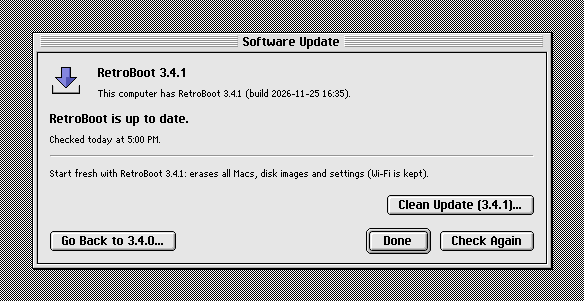
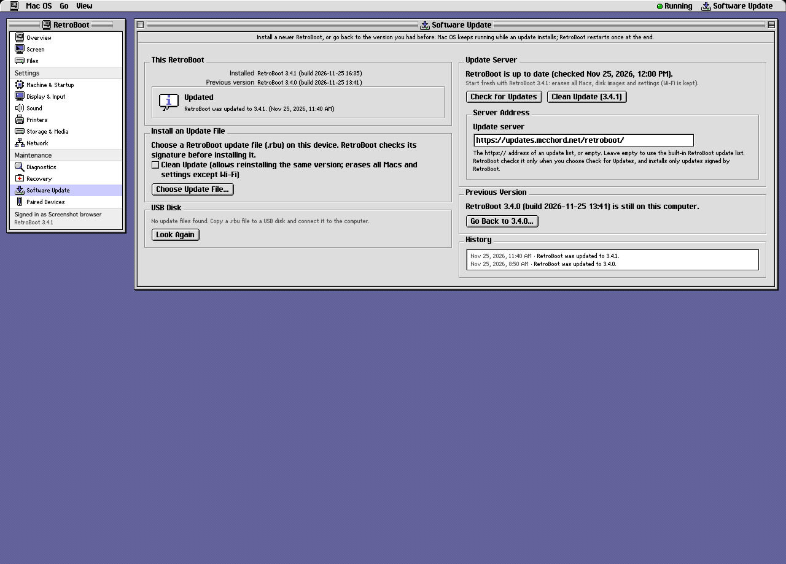
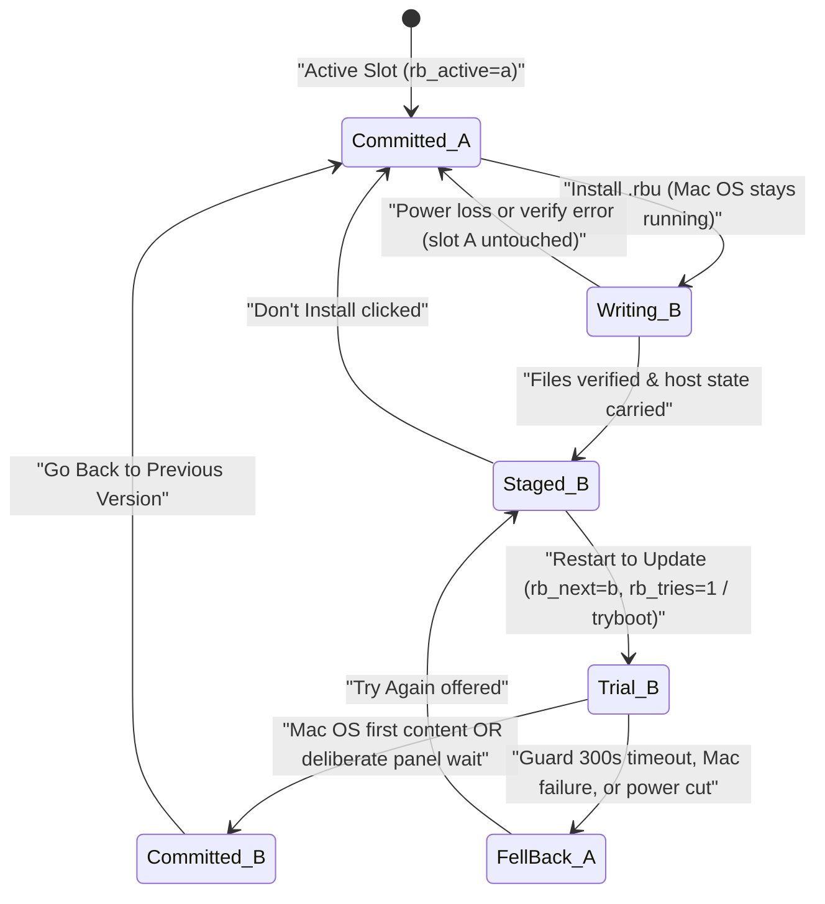
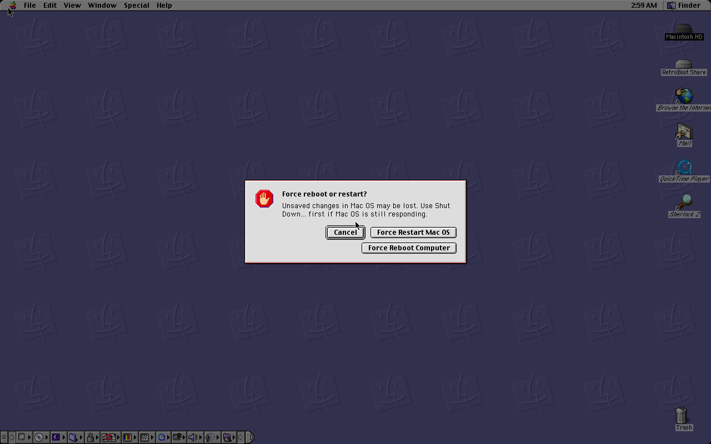
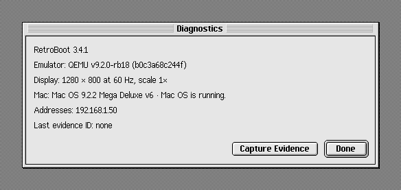
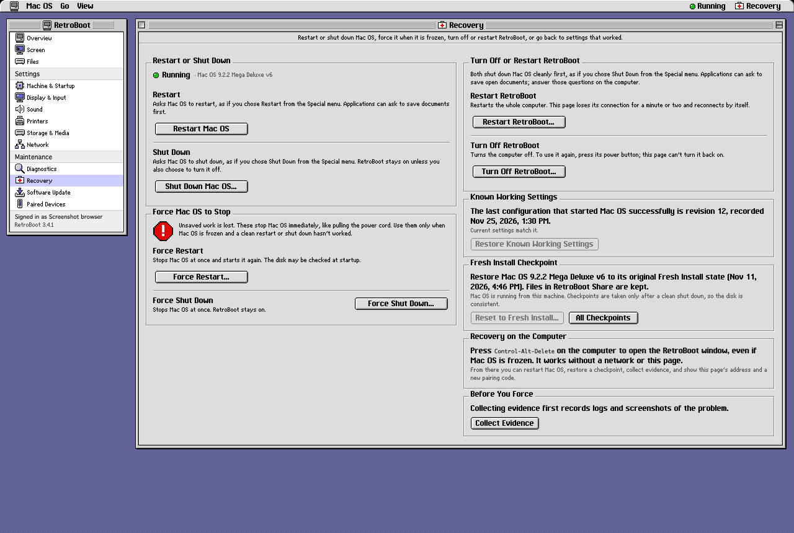
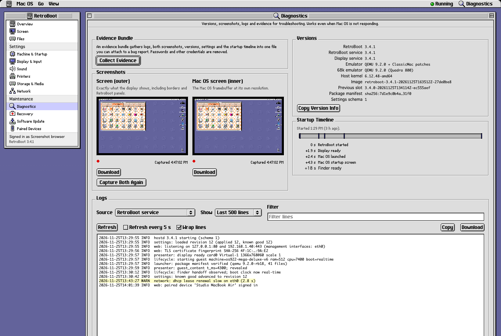

[← Previous](10-creating-and-serving-images.md) · [Table of Contents](README.md) · [Next →](12-settings-reference.md)

# Chapter 11 — Updates, Recovery, and Troubleshooting

RetroBoot is built so that neither an update nor a frozen Mac OS can strand your computer or expose a Linux terminal. System updates write into a separate inactive system slot while Mac OS keeps running, disk repairs snapshot your disk first, and every failure produces a classic Platinum alert with a redacted evidence ID.

---

## Software Updates

RetroBoot updates its own Linux system, emulator packages, presenter, and web management service without touching your Macs, documents, Wi-Fi networks, or settings.

<table>
<tr>
<td></td>
<td></td>
</tr>
</table>

### Signed Ed25519 `.rbu` Bundles

Every RetroBoot update is packaged as an uncompressed POSIX tar bundle ending in `.rbu`—for example `retroboot-update-3.4.1-product.rbu` (x86-64 PC) or `retroboot-update-3.4.1-rpi-product.rbu` (Raspberry Pi 4/5/400). Each bundle contains four members in strict order:

1. `manifest.json` — version, `build_id`, flavor (`product` or `debug`), `min_version`, `settings_schema`, kernel arguments, and payload hashes.
2. `manifest.sig` — an **Ed25519** signature (`retroboot-update-sig/1`) over the exact bytes of `manifest.json`.
3. `root-files.json.gz` — gzipped manifest of every file, mode, owner, symlink, and SHA-256 in the new root filesystem.
4. `root.sqfs` — XZ-compressed SquashFS root image.

Before writing anything, `hostd` verifies `manifest.sig` against trusted public keys in `/usr/lib/retroboot/update/keys/*.pub` (checking any `revoked` list), verifies compatibility with your installed architecture, flavor, and `min_version`, and later re-verifies every extracted file on disk against `root-files.json.gz`.

### Update Architecture by Platform

| Platform | Mechanism | Rollback / Recovery |
| --- | --- | --- |
| **x86-64 PC & Intel Mac** | Dual A/B ext4 system partitions (`RBROOT_A` and `RBROOT_B`, 3 GiB each) controlled by GRUB (`grub/retroboot/slots.env`, `slot-a.cfg`, `slot-b.cfg`). `RBDATA` (`/var/lib/retroboot`) is shared and never reformatted. | Automatic GRUB fallback if the trial boot fails; manual **Go Back to …** anytime. |
| **Raspberry Pi 4, Pi 5 & Pi 400** | Dual A/B system slots controlled by `retroboot/slots.env` and the Raspberry Pi firmware's one-shot `tryboot.txt` (`systemctl reboot "0 tryboot"`). | Automatic fallback to the active `config.txt` slot if trial fails; **Go Back to …** or second-card migration. |
| **Raspberry Pi Zero 2 W** | Single-slot MBR layout (512 MB RAM profile). Does not offer OTA `.rbu` updates. Flash the new `retroboot-<ver>-rpi-zero2w-*.img.xz` to a second SD card, boot it once to expand `RBDATA`, shut down cleanly, and migrate your data: `sudo bash image/rpi/scripts/migrate-data.sh /dev/OLD_DATA /dev/NEW_DATA`. | Reinsert the original SD card. |
| **Planet Gemini PDA** | Single `/retroboot` directory inside `PARTNAME=linux` (alongside Gemian). Extract `retroboot-<ver>-gemini.tar`, verify hashes, and run from Gemian: `sudo sh gemini-install.sh --verify` then `sudo sh gemini-install.sh --keep-data --activate`. | Run `sudo sh gemini-install.sh --rollback previous` from Gemian, or automatic fallback to Gemian after 3 failed boots. |

### Three Ways to Deliver an Update

RetroBoot never checks or downloads updates automatically in the background; it checks only when you ask.

1. **Update Server (`https://`):**
   On **Ctrl+Alt+Delete → Software Update…** (or the web **Software Update** page), choose **Check for Updates**. By default, devices signed in to RetroBoot downloads check the configured RetroBoot feed, or you can set a custom `https://` feed URL (`update.url`, `retroboot-feed/1` JSON format). Click **Download and Install** when a newer matching flavor appears.
2. **Web Upload:**
   In a paired browser, open **Software Update**, click **Choose Update File…**, and select a downloaded `.rbu` file.
3. **USB Disk:**
   Copy the `.rbu` file to the top level of a USB flash drive or inside a `RetroBoot/` folder on the drive, and plug it in. RetroBoot polls removable partitions every 10 seconds (`update_usb_poll_s`), or click **Look Again** in the web UI. Choose **Install from USB Disk**.

### Staging, Live Progress, Trial Boot, and Rollback

1. **Background staging with live progress:**
   While you keep using Mac OS, `hostd` formats the inactive slot (`mkfs.ext4`), copies `root.sqfs` at idle CPU/I/O priority (`ionice -c 3 nice -n 19`, bandwidth-limited to `32768 KB/s`), verifies every file, carries over host identity/Wi-Fi/SSH keys, and updates `slots.env`. Both the local panel and web UI display live transfer speed and ETA (`TransferMeter`).
2. **Restart to Update:**
   When staging finishes, RetroBoot shows **Restart to Update** (or **Don't Install** to cancel). Clicking **Restart to Update** sends a clean Shut Down request to Mac OS so open apps can prompt you to save, re-syncs host state, arms a single trial boot (`rb_tries=1` in GRUB or `tryboot.txt` on Raspberry Pi), and reboots.
3. **Trial boot and health commit:**
   `retroboot-slot-guard.service` monitors the new slot with a **300-second** boot deadline. `hostd` commits the new slot (`rb_active=<new>`, `rb_next=""`, `rb_tries=0`, `rb_other_ok=1`, writes `/run/retroboot/update/healthy.json`) as soon as either:
   - Mac OS shows genuine first content (`guest_content`), or
   - Mac OS was deliberately held stopped/paused in the local panel (`update_panel_health_s`).
4. **Automatic rollback and Go Back:**
   If the trial slot fails to start Mac OS, crashes, loses power, or exceeds the 300 s slot-guard deadline, the next boot automatically returns to the previous slot with all your Macs and settings intact, and offers **Try Again**. At any time later, you can choose **Go Back to \<version\>…** (or **Switch to \<version\>…** to return forward).
5. **Updating via the Installer USB Disk:**
   Systems running very old builds (pre-0.3.0) or unslotted installs can boot the RetroBoot installer medium, select the existing RetroBoot disk, and choose **Update** (next to **Erase and Install…**) to upgrade in place while preserving Macs, documents, and settings. *(Verified across 17 lab VM tests including forced power cuts and bad signatures in `image/reports/update-2026-10-11.md`; forced rollback behavior on real laptop firmware has not been tested in the lab yet.)*

---

## Clean Update (3.3.0+)

If you want a factory-fresh RetroBoot setup while upgrading—or while reinstalling your current release—select **Clean Update** (tick **Clean Update** in **Ctrl+Alt+Delete → Software Update…** or on the web **Software Update** page before installing or restarting, or click **Clean Update (\<version\>)…** when already up to date).

Clean Update intentionally wipes user Macs and appliance configuration while preserving network connectivity so the device comes right back online into first-time Setup. The exact behavior comes from `clean_reset_data` and `carry_state` in `hostd/retroboot/update/writer.py`:

| Category | Erased by Clean Update | Preserved by Clean Update |
| --- | --- | --- |
| **Macs & Disks** | `/var/lib/retroboot/machines/*`, `/var/lib/retroboot/checkpoints/*`, `/var/lib/retroboot/roms/*` | — |
| **Shared Files & Media** | `/var/lib/retroboot/share/*`, `/var/lib/retroboot/media/*`, `/var/lib/retroboot/downloads/*`, `/var/lib/retroboot/assets/*`, `/var/lib/retroboot/cache/*` | — |
| **Settings & Pairing** | `config/settings.json`, `config/settings.json.bak`, `state/known-good.json`, pairing secrets & TLS cert (`state/*`), `bluetooth/*`, `cups/*`, `update/settings/*`, `update/incoming/*` | `config/lab-auth.env`, `config/hostd.local.json`, `config/hostd.local.migrated`, `state/growdata.done`, `state/microcode.json`, `state/boot-network.json`, `update/state.json` (history) |
| **Wi-Fi & Host Identity** | `etc/machine-info`, `var/lib/alsa/asound.state`, `var/lib/systemd/backlight`, `var/lib/systemd/rfkill`; resets `hostname` to `retroboot` and `timezone` to `Etc/UTC` | **Saved Wi-Fi networks** (`/var/lib/retroboot/network/connections` & NetworkManager keyfiles), `etc/machine-id`, `etc/ssh/ssh_host_*`, `root/.ssh`, `var/lib/systemd/random-seed`, `var/lib/systemd/timesync/clock` |
| **Logs & Boot Art** | `logs/evidence/*`, `logs/bundles/*`; ESP `display.cfg`, generated `checker-*.png`, and `startup-*.cpio`/`.rbi` | Persistent logs (`logs/lifecycle.jsonl`, `logs/hostd.log`, `logs/guest-serial.log`, `/var/log/journal`), default checkerboard |

---

## Checkpoints & Disk Safety

RetroBoot protects your Mac OS disks with zero-copy XFS reflinks and automatic pre-repair snapshots:

- **Instant XFS reflink checkpoints:**
  Under **Ctrl+Alt+Delete → Startup Disk → Checkpoints…** (or **Storage & Media → Checkpoints** on the web), **Save Checkpoint** takes an instant snapshot under `/var/lib/retroboot/checkpoints/<machine>/<timestamp>/` using `cp --reflink=always`. Because reflinks share underlying disk extents on `RBDATA`, a checkpoint completes in seconds and consumes extra blocks only as the Mac modifies data later.
  - Checkpoints require a **clean shutdown**. If Mac OS is running on that machine, RetroBoot shuts Mac OS down cleanly first before copying.
  - For **PowerPC Mac OS X**, checkpoints save both `disk.img` and `nvram.img` (`schema: 2`), and **Restore…** uses Linux `renameat2(..., RENAME_EXCHANGE)` to swap the entire machine directory atomically so disk and NVRAM can never fall out of sync.
- **Automatic "Fresh Install" checkpoint:**
  Every Mac imported from a catalog or archive automatically receives a **Fresh Install** checkpoint (`kind: "fresh-install"`) immediately after import, giving you a permanent clean baseline.
- **Pre-repair safety snapshot & silent disk repair:**
  Whenever a previous session did not end cleanly (such as a power loss or **Force Stop**), RetroBoot automatically saves a **Pre-repair backup** (`kind: "pre-fsck"`) checkpoint before running offline `fsck.hfsplus` (PowerPC) or `fsck.hfs` (68k) silently in the background. It also disables Mac OS's built-in *"This computer may not have been shut down properly"* dialog (`Smrt` resource / `Shutdown Check` file) so repaired volumes boot straight to the Finder without Disk First Aid interruptions.
- **Broken-disk recovery dialog:**
  If offline `fsck` cannot safely repair a disk (`result == "failed"`), RetroBoot halts before launching QEMU and displays the **Disk needs recovery** alert (`corrupt-disk-recovery`) offering:
  1. **Restore Last Clean Checkpoint** (the most recent clean checkpoint before the failure)
  2. **Reset to Fresh Install**
  3. **Startup Disk…** (to switch to another Mac)

---

## Recovery & Diagnostics

<table>
<tr>
<td></td>
<td></td>
</tr>
<tr>
<td></td>
<td></td>
</tr>
</table>

### Recovery Key Chord (`Ctrl+Alt+Delete`)

Pressing **Ctrl+Alt+Delete** (configurable to **Ctrl+Alt+Backspace** or **Ctrl+Alt+Escape** in **Display & Sound**; on the Planet Gemini PDA, **Ctrl+Alt+Backspace** is always accepted) opens the **RetroBoot** window over the dimmed Mac OS screen. Mac OS never receives the recovery key chord and continues running normally underneath until you choose **Return to Mac OS**.

### Frozen Mac OS Detection

RetroBoot continuously monitors guest responsiveness without interrupting normal use (`hostd/retroboot/freeze.py` and `supervisor.py`):

1. **QMP emulator watchdog:** Every **10 seconds**, `hostd` queries QEMU's QMP `query-status` socket with a **5-second** timeout. If QEMU fails to respond within 5 s, Mac OS is marked unresponsive immediately.
2. **Framebuffer freeze detector:** While Mac OS runs, its menu-bar clock normally updates at least once a minute. If the guest framebuffer (`last_damage_ms`) has not changed for **75 seconds** (`frozen_stale_s`) **and** no keyboard or pointer input occurred for **30 seconds** (`frozen_quiet_s`), `hostd` verifies the screen is not asleep (mostly black frames >= 98% are skipped), then asks the presenter to perform a **1-pixel `pointer_nudge`** (moves 1 px and restores 120 ms later).
3. If Mac OS fails to redraw the software cursor within **3 seconds** (`frozen_nudge_wait_s`), `hostd` sets `responsive = false`. The local panel displays *"Mac OS is not responding."* with **Force Shut Down…** and **Force Restart…**, and the web Overview displays **Needs attention**.
4. **Never automatic:** RetroBoot never restarts a frozen Mac on its own—so a full-screen game that hides the cursor and draws a static screen will never lose progress. Any subsequent framebuffer update clears the flag automatically.

### Force Reboot & Force Stop

When Mac OS refuses a normal **Shut Down** or **Restart** (or is completely hung):

- Choose **Force Reboot…** at the bottom-left of the **RetroBoot** window (or **Force Restart…** / **Force Shut Down…** when flagged unresponsive, or use the **Recovery** page in the web UI).
- The **Force reboot or restart?** dialog offers **Force Restart Mac OS** (stops only QEMU and restarts Mac OS) and **Force Reboot Computer** (reboots the entire host computer).
- Every forced action **saves diagnostics evidence first** (screenshots or last good guest frame, `lifecycle.jsonl`, `guest-serial.log`, `qemu-stderr.log`, and `status.json`), then sends SIGTERM (followed by SIGKILL after **3 seconds** if needed), and schedules silent `fsck` before the next Mac OS start.

### Preboot Recovery: `Escape` on the Checkerboard

If a problem prevents Mac OS from reaching the desktop, press **Escape** while the checkerboard startup screen is visible (or **touch and hold** / **two-finger tap** on a touchscreen):

- **Startup Details:** Opens `rb-bootdiag`, showing boot progress stages, detected display/keyboard hardware, any errors found, and recent system messages. (If startup stalls for 45 seconds, the checkerboard automatically prompts *"Press Esc for startup details"*.)
- **Startup Options (`Return`):** Pressing **Return** inside Startup Details opens the **RetroBoot** window before Mac OS starts (or pauses QEMU immediately via QMP `stop` if it was already launching—titled *Startup Options*, *"Mac OS is paused while you choose"*). From here you can switch **Startup Disk**, change **Display & Sound**, run **Diagnostics**, or start **Software Update**.

### Presenter 10-Second Built-in Fallback

`rb-presenter` owns the physical display and keyboard independently of `hostd`. If `hostd` crashes or fails to answer the recovery key chord within **10 seconds**, the presenter displays its own built-in Platinum alert—**"RetroBoot needs to restart."**—with **Restart** and **Shut Down** buttons that call `systemctl reboot` / `systemctl poweroff` directly without ever dropping to a Linux console.

### Automatic Corrupt-Settings Recovery

Every settings change is written atomically via temp file + `fsync` + rename (`settings.json`), backed up to `settings.json.bak`, and mirrored when proven healthy (after 30 seconds of successful Mac OS operation) to `/var/lib/retroboot/state/known-good.json`. If `settings.json` becomes unreadable or fails schema validation, `hostd` preserves the damaged file as `settings.json.corrupt-<timestamp>`, recovers automatically in order from `.bak` → `known-good.json` → factory defaults, and shows a brief notice: *"RetroBoot restored its settings."* You can also click **Restore Known Working Settings** manually on the web **Recovery** page.

---

## Troubleshooting & FAQ

### Evidence IDs & Redacted Diagnostics Bundles

When an unexpected error occurs, RetroBoot assigns an **Evidence ID** such as `RB-20261124-054255-3944`. To collect a complete diagnostics archive:

- **On the computer:** **Ctrl+Alt+Delete → Diagnostics… → Capture Evidence**.
- **In a paired browser:** **Diagnostics → Collect Evidence**, then download the `.tar.gz` bundle.

Before any log or bundle is saved or served, RetroBoot's redactor automatically strips or masks Wi-Fi passwords, session cookies, CSRF tokens, live pairing codes, QR payloads, and RetroBoot downloads credentials.

### Alert Reference Table

| Alert / Notice | Cause | What to Do |
| --- | --- | --- |
| *"Mac OS is not responding."* | QMP watchdog (5 s) or 75 s static screen + 3 s nudge check detected a hung guest, or Clean Shut Down timed out | Collect diagnostics if needed, then choose **Force Restart…** or **Force Shut Down…** |
| *"Mac OS could not start."* (with Evidence ID) | Mac OS crashed or failed twice in a row before showing its startup screen | Click **Restart**, or open **Startup Disk** to restore a checkpoint |
| *"“\<name\>” disk needs recovery."* | Offline `fsck.hfsplus` / `fsck.hfs` after an unclean stop could not safely repair the volume | Choose **Restore Last Clean Checkpoint** (or **Reset to Fresh Install**) |
| *"RetroBoot needs to restart."* | Built-in presenter fallback triggered after `hostd` was unreachable for > 10 s on recovery chord | Click **Restart** or **Shut Down** |
| *"RetroBoot restored its settings."* | Corrupted `settings.json` recovered automatically from `.bak`, `known-good.json`, or defaults | Review your display/network preferences and continue |
| *"RetroBoot \<ver\> didn't finish starting, so this computer went back to RetroBoot \<old\>."* | New Software Update failed its trial start or hit the 300 s guard timeout and rolled back | Stay on the working version or click **Try Again** in **Software Update** |
| *"The disk you inserted was not readable"* (macOS host) | macOS cannot mount Linux/GPT partitions on a flashed RetroBoot USB stick or SD card | Click **Ignore** (or **Eject**) — **never click Initialize** |
| *"Windows (encrypted)"* (in installer) | Target drive uses Windows BitLocker / Device Encryption | Back up your BitLocker recovery key at `aka.ms/myrecoverykey` before disabling Secure Boot or erasing |

### Platform & Hardware Caveats

- **Verification boundary (Proxmox VMs vs. physical hardware):** Boot timings, A/B update power-cut tests, and virtual touch/tilt checks were validated in the Proxmox VM lab; physical hardware caveats below reflect testing on specific laptops, Raspberry Pi boards, and the Gemini PDA.
- **Brief firmware logo & display blink:** Your PC's UEFI/BIOS logo appears briefly before RetroBoot's checkerboard; some laptops also blank HDMI once (`0.1–0.9 s`) during initial KMS/DRM driver probe.
- **GPD MicroPC with HDMI attached at boot:** Powering on a GPD MicroPC with an HDMI cable already plugged in leaves its internal panel dark (hardware firmware behavior); RetroBoot routes output to the HDMI monitor automatically. Unplug HDMI before power-on or restart to use the internal screen.
- **Laptop low-battery reserve:** Save open documents promptly if Mac OS warns at **15 %** (*reserve battery power*). RetroBoot initiates a clean shutdown at **8 %** (with battery passthrough on) or **4 %** (passthrough off) and forces power-off at **2 %**.
- **Speedometer Graphics test with 3D acceleration:** With **ATI Radeon** enabled, Speedometer skips its monochrome Graphics test (*"does not support monochrome graphics"*); switch **Graphics card** back to **Standard** in **Display & Input** if comparing monochrome scores.
- **Raspberry Pi Zero 2 W memory & families:** Runs 68k Quadra 800 Macs only (`64 MB` or `128 MB` RAM; `64 MB` TCG translation cache); PowerPC Classic and Mac OS X are excluded by `/usr/lib/retroboot/rpi-profile.json`.
- **Gemini PDA recovery to Gemian:** If RetroBoot fails 3 consecutive boots, the initrd automatically sets `para=boot-recovery` and boots back into Gemian. You can also hold **Esc/On + the silver side button** at power-on to enter Gemian recovery.

### Frequently Asked Questions

**Why does the checkerboard remain on screen for several seconds at power-on?**
RetroBoot starts the Linux kernel, display compositor, audio, and Mac emulator silently underneath so you never see console text or half-painted boot frames. The Happy Mac progress bar scales dynamically to your computer's learned boot time.

**Can I open a Linux terminal or boot menu?**
No. Product builds mask `getty@tty1` and hide GRUB (`timeout=0`) so Linux stays invisible, including during recovery. Developer Debug builds provide SSH and serial console access (`docs/dev/README.md`).

**Why did Rufus produce an unbootable USB installer on Windows?**
Always choose **DD Image mode** when Rufus prompts. ISO mode alters the partition layout and breaks dual UEFI/BIOS boot and the `RBINSTEFI` partition.

**How do I reset a Mac OS disk if an extension or System Folder change breaks startup?**
Shut down Mac OS (or force stop if stuck), open **Ctrl+Alt+Delete → Startup Disk → Checkpoints…**, and restore the automatic **Fresh Install** checkpoint or your latest manual checkpoint.

**Are Wi-Fi passwords or pairing codes included in Diagnostics bundles?**
No. All Wi-Fi profiles are stored root-only under `/var/lib/retroboot/network/connections`, Mac OS never sees your Wi-Fi password (even with AirPort enabled), and the diagnostics redactor strips all passwords, cookies, CSRF tokens, and pairing codes.

---

[← Previous](10-creating-and-serving-images.md) · [Table of Contents](README.md) · [Next →](12-settings-reference.md)
