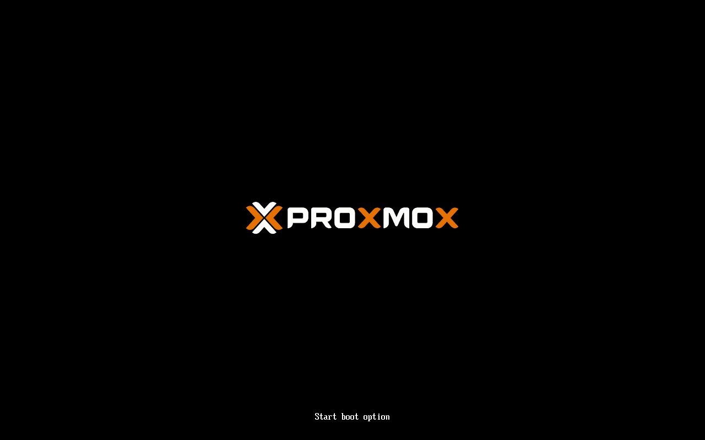
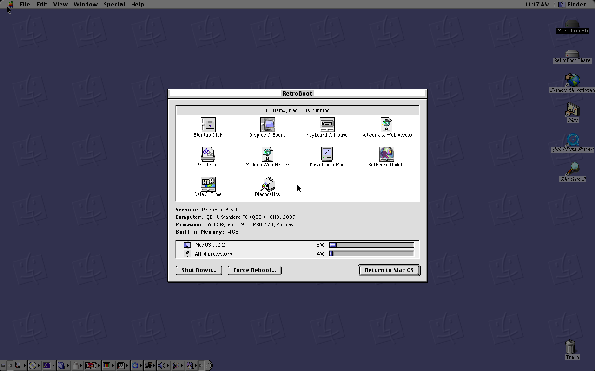
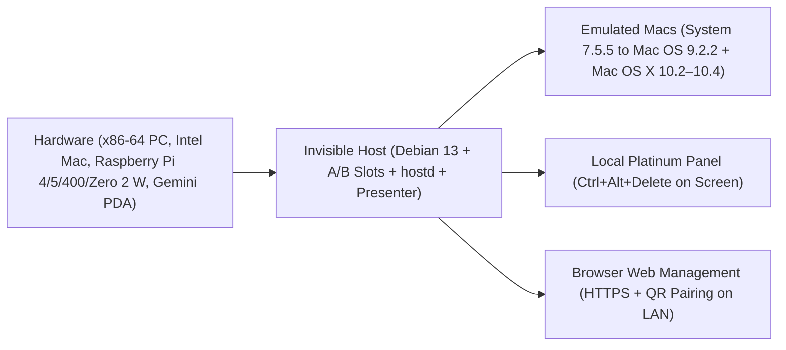

# RetroBoot 3.5.1 User Manual

Welcome to the complete **RetroBoot 3.5.1** user manual. RetroBoot turns a spare x86-64 PC, Intel Mac, Raspberry Pi, or Planet Computers Gemini PDA into a dedicated classic Macintosh—no Linux experience or collector hardware required. Power on, hear a genuine classic Mac startup chime, and your chosen Mac OS desktop takes over the screen.

<table>
  <tr>
    <td align="center">
      
       Live Proxmox 3.0.0 cold boot to the Mac OS 9 Finder (playback shortened).
    </td>
    <td align="center">
      
       Live Proxmox 3.5.1 local <strong>Ctrl+Alt+Delete</strong> Platinum panel.
    </td>
  </tr>
</table>

---

## RetroBoot at a Glance

---

## Table of Contents

| Chapter | Title | What It Covers |
| --- | --- | --- |
| 1 | [System Requirements & Supported Hardware](01-system-requirements.md) | Supported PCs, Intel Macs, Raspberry Pi 4/5/400/Zero 2 W, Gemini PDA, storage, RAM, and runtime compatibility |
| 2 | [Architecture & How RetroBoot Works](02-architecture-how-it-works.md) | Invisible Debian 13 host, A/B root slots, `RBDATA` XFS reflink checkpoints, presenter, QEMU, and `hostd` |
| 3 | [Installation & First Boot](03-installation.md) | Flashing ISO/USB/SD images (Etcher, Pi Imager JSON, Rufus DD), BitLocker recovery keys, `network.conf`, and disk setup |
| 4 | [First Start & The 13-Mac Library](04-first-start-and-mac-library.md) | **Mega Deluxe v7** (126 apps, Color Oregon Trail, 8-tab 4-row Launcher, clean ACTION Menus™, GoMac Battery Monitor, on-demand Virtual CDs), clean OS 9, 68k, and Mac OS X |
| 5 | [Everyday Use, Input & Peripherals](05-everyday-use-and-peripherals.md) | Startup chimes, keyboard/mouse DPI, game controllers (`Arrows`/`WASD`), Bluetooth, laptop battery, lid, and rotation |
| 6 | [Display Scaling & 3D Graphics](06-display-and-3d-graphics.md) | Integer pixel scaling (`1×`–`4×`), smooth fill, per-Mac resolutions, Pi DSI/DPI presets, and ATI Radeon 3D acceleration |
| 7 | [Networking, AirPort & Modern Web Helper](07-networking-airport-and-web-helper.md) | Wi-Fi, NAT Ethernet, native Apple AirPort emulation, HTTPS translation, search redirects, and whitelist passthrough |
| 8 | [File Sharing, USB Drives & Printing](08-files-usb-and-printing.md) | `RetroBoot Share`, Web Files (`PICT`/PDF/ZIP/Move), USB thumb drives, Print-to-PDF, and CUPS LaserWriter printing |
| 9 | [Web Management & Remote Screen](09-web-management-and-remote-screen.md) | QR/6-digit browser pairing, live Overview, per-Mac settings, Apply & Restart, and live browser Screen KVM with audio |
| 10 | [Creating & Serving Custom Mac Images](10-creating-and-serving-images.md) | Custom HTTPS image catalogs, `retroboot-thin-1` archive packaging (`catalog_archive.py`), Quadra/OS X metadata |
| 11 | [Updates, Checkpoints & Recovery](11-updates-recovery-and-troubleshooting.md) | Signed A/B OTA updates, Pi `tryboot`, Clean Update, Fresh Install checkpoints, `fsck.hfsplus` repair, and evidence bundles |
| 12 | [Complete Settings Reference](12-settings-reference.md) | Every setting in `hostd/retroboot/schema.py` with types, defaults, apply policies, and capability gates |

*For contributors and AI agents:* see the **[Manual Maintenance Guide](MAINTENANCE.md)** for the code-to-manual impact matrix, screenshot regeneration scripts, and verification checks.

---

## Start Here by Goal

| Your Goal | Jump Straight To |
| --- | --- |
| **Brand New User** | [Chapter 3: Installation & First Boot](03-installation.md) → [Chapter 4: First Start & The 13-Mac Library](04-first-start-and-mac-library.md) |
| **Families & Kids** | [Families & Kids Guide](../guide/families-and-kids.md) · [Chapter 4: Mega Deluxe v7](04-first-start-and-mac-library.md) · [Chapter 8: Print-to-PDF & USB](08-files-usb-and-printing.md) |
| **Raspberry Pi / Zero 2 W** | [Chapter 1: Hardware Support](01-system-requirements.md) · [Chapter 3: Pi Imager & Zero 2 W](03-installation.md) · [Chapter 6: Pi Displays](06-display-and-3d-graphics.md) |
| **3D Gaming / Mac OS X** | [Chapter 4: Tiger Deluxe & Period Editions](04-first-start-and-mac-library.md) · [Chapter 6: 3D Acceleration (ATI Radeon)](06-display-and-3d-graphics.md) |
| **Printing & Files** | [Chapter 8: File Sharing, USB Drives & Printing](08-files-usb-and-printing.md) · [Chapter 9: Web Files & Overview](09-web-management-and-remote-screen.md) |
| **Hosting Your Own Mac Images** | [Chapter 10: Creating & Serving Custom Mac Images](10-creating-and-serving-images.md) · [Image Servers Guide](../guide/image-servers.md) |
| **Troubleshooting & Recovery** | [Chapter 11: Updates, Checkpoints & Recovery](11-updates-recovery-and-troubleshooting.md) · [Chapter 12: Settings Reference](12-settings-reference.md) |

---

## Conventions and Screenshot Provenance

### Keyboard Mapping (PC to Classic Mac)

Manual instructions use PC key labels unless noted otherwise:

| PC Key | Classic Mac Key | Notes |
| --- | --- | --- |
| **Windows** (or Super) | **Command** (`⌘`) | Swappable with **Alt** via `input.swap_command_option` |
| **Alt** | **Option** (`⌥`) | Swappable with **Windows** in **Display & Sound** or **Web Display & Input** |
| **Ctrl+Alt+Delete** | Opens **RetroBoot** panel | Configurable via `input.recovery_chord` (Gemini PDA defaults to **Ctrl+Alt+Backspace**) |
| **Escape** (on checkerboard) | Startup options | Pauses automatic boot to choose a Mac, checkpoint, or CD |

### Screenshot Provenance & Privacy Rules

RetroBoot separates built-in MIT-licensed UI chrome from live guest captures (decisions D012, D079, D082):

- **Built-in MIT Platinum UI renders:** Installer screens, local panel dialogs, and browser Web UI pages under `docs/images/manual/` are rendered using RetroBoot's built-in MIT-licensed Platinum theme, fonts, and original icons—never proprietary Apple assets (`RBUI_ASSETS` / `--platinum`).
- **Live Proxmox captures:** `../images/retroboot-proxmox-boot.gif` (captured on Proxmox in 3.0.0) and live Mac OS / local panel shots (`panel-main-341.png`, `panel-printers-341.png`, `macos9-print-dialog.png`, `macos9-volume-osd.png`, `finder-mega-deluxe-v7.png`, `zero2w-system755.png`) are captured from running RetroBoot systems (`3.5.1` for main panel, `3.4.2` for Printers/Volume OSD, `mega-deluxe-v7` for Finder) and clearly labeled as virtual-machine or board captures.
- **Redacted & synthetic examples:** Live pairing codes, session cookies, and home Wi-Fi credentials are never published; pairing screens show temporary/synthetic example values.
- **Public guides:** Topic-focused quick guides remain available for [Installing](../guide/installing.md), [Families & Kids](../guide/families-and-kids.md), [Mac Disk Library](../guide/disk-library.md), [Web Management](../guide/web-management.md), [Image Servers](../guide/image-servers.md), and [Upgrading](../guide/upgrading.md).
